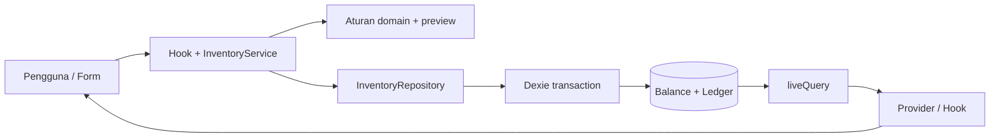

# Belajar Fase 3 — Inventory, Ledger, dan Konversi Satuan

Panduan ini menjelaskan implementasi yang benar-benar ada di POS-Zanna. Baca bersama `INVENTORY-DATA-MODEL.md` untuk kontrak field, batas presisi, dan rencana backend. Tidak ada backend/sinkronisasi/checkout nyata pada fase ini.

## 1. Hasil audit sebelum implementasi

Pembaruan aturan satuan dan panduan review legacy tersedia di [Business Logic Hardening, 21 Oktober 2026](PHASE-3-BUSINESS-HARDENING.md). Audit dan hasil 36 tes pada dokumen ini merekam baseline sebelum hardening; hasil terbaru terdapat pada dokumen hardening.

- Repository Git tunggal ditemukan di `C:/04-Project-TOKO/POS-Zanna`, branch `master`, HEAD awal `d1e02d9` (chore: move repository to POS-Zanna root).
- Working tree dan staging awal bersih. Tidak dibuat repository, branch, commit, push, reset, atau staging baru oleh agen.
- React 19, TypeScript 6 strict, Vite 8, Tailwind 4, Dexie 4.4.6. Tidak ada dependency baru untuk Fase 3.
- Database `zanna-cell-db` versi aplikasi 1: products/categories/units/variants. `quantityInBaseUnit` dan `minimumStock` sudah berskala 1000. Harga integer rupiah. Satuan dasar sudah dikunci setelah produk dibuat.
- Halaman Stok sebelumnya hanya menampilkan minimum dan belum mempunyai saldo. Kasir membaca proyeksi master dengan stok null; state keranjang berada di provider yang sama untuk desktop/drawer.
- Pemeriksaan awal lint, typecheck aplikasi, build, serta seluruh 19 tes Fase 2 lulus.
- Tidak ditemukan kebutuhan mengubah makna data lama. Migrasi yang dipilih hanya menambahkan tabel kosong, tanpa reset atau auto-zero.

## 2. Dua puluh konsep yang dipelajari

### 1 — Inventory Management

**Pengertian:** mengelola jumlah fisik barang yang tersedia, masuk, atau berkurang karena koreksi. **Masalah:** katalog nama/harga saja tidak menjawab berapa barang yang benar-benar ada. **Contoh warung:** mi datang 10 bungkus dan 2 bungkus rusak. **Kode:** StockPage, StockMovementForm, InventoryService, dan repository lokal menghubungkan tindakan pengguna ke perubahan persediaan. **Risiko jika diabaikan:** daftar produk tampak siap dijual padahal stok belum dihitung atau sudah habis.

### 2 — InventoryBalance

**Pengertian:** satu baris saldo terkini untuk setiap Product. **Masalah:** menjumlahkan seluruh histori pada setiap render tidak efisien, sementara menyimpan saldo pada setiap varian menimbulkan konflik. **Contoh:** mi 38 bungkus disimpan sebagai quantityBase 38000 pada satu productId. **Kode:** interface InventoryBalance di domain/inventory.ts dan tabel inventoryBalances dengan productId sebagai primary key. **Risiko:** stok per dus dan per bungkus dapat saling bertentangan jika dijadikan dua saldo fisik.

### 3 — StockMovement

**Pengertian:** satu peristiwa perubahan stok, dengan delta, saldo sebelum/sesudah, alasan, serta waktu. **Masalah:** mengganti angka saldo saja menghilangkan penjelasan penyebabnya. **Contoh:** ADJUSTMENT_OUT −2 bungkus dengan alasan Barang rusak. **Kode:** StockMovement dan DexieInventoryRepository.apply menulis catatan bersama balance. **Risiko:** pemilik tidak dapat membedakan barang masuk, kerusakan, salah hitung, atau perubahan tanpa alasan.

### 4 — Inventory Ledger

**Pengertian:** urutan StockMovement yang menjadi jejak audit persediaan. **Masalah:** satu peristiwa belum cukup untuk memahami perjalanan stok. **Contoh:** +30 awal, +10 masuk, −2 rusak, berakhir 38. **Kode:** getHistory/subscribeHistory dan StockHistory menampilkan riwayat terbaru terlebih dahulu, tanpa tombol edit/hapus. **Risiko:** mengubah catatan lama dapat membuat saldo dan histori tidak cocok. Ledger lokal bukan bukti anti-manipulasi terhadap pengguna yang menguasai DevTools.

### 5 — Base Unit

**Pengertian:** satuan acuan stok fisik sebuah produk. **Masalah:** saldo tidak bermakna tanpa satuan yang konsisten. **Contoh:** mi berdasar Bungkus, gula bisa Gram atau Kg, bensin lama berdasar Liter. **Kode:** Product.baseUnitId tetap memakai aturan Fase 2; repository produk menolak penggantian satuan dasar produk tersimpan. **Risiko:** mengubah Liter menjadi Mililiter tanpa migrasi mengubah arti angka saldo, minimum, dan histori sebanyak 1000 kali.

### 6 — Selling Unit

**Pengertian:** satuan saat varian ditawarkan kepada pembeli. **Masalah:** satu barang dapat dijual dalam beberapa kemasan. **Contoh:** mi per bungkus dan per dus, bensin per botol 1/1,5 L atau jeriken 5 L. **Kode:** ProductVariant.sellingUnitId dan quantityInBaseUnit, diproyeksikan oleh projectCatalog. **Risiko:** menganggap satu dus sama dengan satu bungkus membuat jumlah stok dan harga tidak masuk akal.

### 7 — Conversion Factor

**Pengertian:** isi satu satuan masukan/jual dalam satuan dasar. **Masalah:** input 2 dus perlu diterjemahkan ke bungkus. **Contoh:** dus isi 40 berarti faktor scaled 40000, sehingga 2 dus menjadi 80 bungkus. **Kode:** resolveConversion menangani base, metric, variant, dan custom; inventoryInputOptions menyusun pilihan form. **Risiko:** menebak kapasitas dus atau jeriken menciptakan stok fiktif. Snapshot faktor lama harus tetap dipakai untuk membaca histori.

### 8 — Fixed-point / Integer Quantity

**Pengertian:** menyimpan pecahan sebagai integer dengan skala yang disepakati. **Masalah:** floating-point seperti 0.1 + 0.2 tidak selalu tepat. **Contoh:** 1,5 Liter disimpan 1500 pada produk berdasar Liter; 38 bungkus disimpan 38000. **Kode:** QUANTITY_SCALE, parseQuantity, dan convertInventoryQuantity. Perkalian memakai BigInt sementara, lalu kembali ke Number setelah pemeriksaan batas. **Risiko:** pembulatan diam-diam dapat membuat selisih stok kecil menumpuk. Pecahan satuan diskret ditolak, bukan dibulatkan.

### 9 — Atomic Transaction

**Pengertian:** sekelompok penulisan yang harus berhasil bersama atau gagal bersama. **Masalah:** balance dan movement merupakan dua objek yang harus konsisten. **Contoh:** stok masuk 10 tidak boleh menaikkan saldo tanpa ledger. **Kode:** db.transaction('rw', ...) pada DexieInventoryRepository.apply mencakup tabel master yang dibaca, inventoryBalances, dan stockMovements. **Risiko:** kegagalan pada penulisan kedua akan meninggalkan saldo tanpa bukti jika tidak menggunakan transaksi.

### 10 — Commit dan Rollback

**Pengertian:** commit mengesahkan transaksi; rollback membatalkan perubahan pada transaksi yang gagal. Ini berbeda dari Git commit. **Masalah:** operasi dapat gagal setelah sebagian kode penulisan dijalankan. **Contoh:** tes memaksa hook creating ledger gagal setelah balance.put. **Kode:** error dibiarkan keluar dari callback transaksi; promise service ditolak, sehingga UI menampilkan gagal. **Risiko:** menangkap error di tengah transaksi lalu melanjutkan seolah sukses dapat mengesahkan data parsial.

### 11 — Race Condition dan Concurrency

**Pengertian:** hasil yang salah akibat beberapa operasi membaca/menulis data bersamaan. **Masalah:** dua tab bisa sama-sama membaca stok 30 lalu menulis hasil masing-masing, menghilangkan salah satu penambahan. **Contoh:** +10 dan +5 harus menghasilkan 45, bukan 40/35. **Kode:** seluruh baca-validasi-hitung-tulis dilakukan dalam transaksi rw dengan scope tabel yang sama; tes memakai dua koneksi. **Risiko:** stok hilang, koreksi keluar ganda, atau saldo negatif.

### 12 — Idempotency dan Double Submit

**Pengertian:** permintaan logis yang sama tidak menghasilkan mutasi kedua saat diulang. **Masalah:** pengguna dapat menekan dua kali, atau mencoba lagi setelah hasil penyimpanan tidak jelas. **Contoh:** operasi STOCK_IN +10 dengan operationId yang sama dikirim dua kali; saldo hanya bertambah 10. **Kode:** UUID operationId pada form, unique index, commandFingerprint dan pengecekan di dalam transaksi. **Risiko:** tombol disabled saja tidak melindungi dari retry/dua event sebelum render atau permintaan dari tab lain.

### 13 — NOT_INITIALIZED vs Stok Nol

**Pengertian:** belum dihitung berbeda dari sudah dihitung dan hasilnya nol. **Masalah:** mengubah semua produk lama menjadi nol mengarang hasil stock opname. **Contoh:** produk baru tanpa balance menunjukkan Belum diatur; stok awal 0 menghasilkan OUT_OF_STOCK dan ledger awal delta 0. **Kode:** stockStatus memeriksa keberadaan balance sebelum memeriksa quantityBase. **Risiko:** pengguna mengira barang sudah dipastikan habis padahal belum pernah dihitung.

### 14 — Minimum Stock

**Pengertian:** ambang perhatian yang ditetapkan pemilik dalam satuan dasar. **Masalah:** persediaan masih positif tetapi perlu diisi kembali. **Contoh:** minimum 5 bungkus, saldo 5 => LOW_STOCK; saldo 0 tetap OUT_OF_STOCK. **Kode:** stockStatus(balance, minimumStock), Product.minimumStock, StockBadge. **Risiko:** memakai minimum dalam dus untuk saldo dalam bungkus menghasilkan peringatan salah. Minimum null tidak diganti angka rekaan.

### 15 — Database Migration

**Pengertian:** perubahan skema dengan versi yang mempertahankan data pengguna. **Masalah:** Fase 2 belum memiliki tabel inventory. **Contoh:** v1 empat tabel menjadi v2 enam tabel, tanpa mengisi balance untuk produk lama. **Kode:** database.ts mempertahankan PRODUCT_SCHEMA_V1 dan menambahkan version(2).stores. **Risiko:** mengganti skema lama, delete database, atau clear tabel dapat menghapus semua master/barcode yang sudah dimasukkan. Git tidak menyimpan isi IndexedDB.

### 16 — Repository Pattern

**Pengertian:** kontrak akses data yang tidak mengikat komponen pada implementasi storage tertentu. **Masalah:** query Dexie yang tersebar di UI sulit diuji atau dikembangkan untuk backend. **Contoh:** service memanggil repository.apply(command), bukan UI memanggil db.inventoryBalances.put. **Kode:** InventoryRepository di domain/inventory.ts dan implementasinya di data/dexieInventoryRepository.ts. **Risiko:** aturan keunikan/transaksi dapat dilewati oleh komponen yang menulis tabel langsung.

### 17 — Service Layer

**Pengertian:** batas operasi aplikasi yang mengoordinasikan aturan domain dan repository. **Masalah:** komponen perlu preview dan execute melalui API yang konsisten. **Contoh:** form meminta service.preview sebelum menampilkan konfirmasi lalu service.execute untuk penyimpanan. **Kode:** InventoryService di services/inventoryOperations.ts; factory instance di services/inventoryService.ts. **Risiko:** aturan konversi berbeda antara preview dan hasil simpan. Implementasi memakai fungsi domain yang sama dan memvalidasi ulang dalam transaksi.

### 18 — Single Source of Truth

**Pengertian:** setiap informasi utama memiliki satu sumber yang berwenang. **Masalah:** saldo di Product, varian, dan React state yang bisa diedit sendiri akan saling bersaing. **Contoh:** satu balance bensin dipakai semua botol. **Kode:** inventoryBalances menyimpan saldo; provider hanya menerima observasi; CatalogItem.stock adalah proyeksi jumlah kemasan, bukan tabel saldo kedua. **Risiko:** halaman Stok berkata 50 L tetapi Kasir membaca saldo lain yang tidak pernah diperbarui.

### 19 — Data Invariant

**Pengertian:** aturan yang harus selalu benar setelah operasi selesai. **Masalah:** validitas input saja belum menjamin data akhir konsisten. **Contoh:** after = before + delta, after ≥ 0, satu saldo per produk, setiap perubahan punya ledger. **Kode:** previewMovement, primary key/unique index, transaksi, dan assertLedger pada tes. **Risiko:** angka terlihat masuk akal di UI tetapi tidak dapat direkonsiliasi dengan histori.

### 20 — Error Handling dan Regression Testing

**Pengertian:** menangani kegagalan secara terlihat sambil menjaga fitur lama tetap berfungsi. **Masalah:** fitur inventory dapat memengaruhi CRUD, barcode, katalog, dan drawer tablet. **Contoh:** koreksi terlalu besar ditolak tanpa menulis apa pun, lalu pengguna memperbaiki isian. **Kode:** catch pada form, status loading/error pada hooks, tes repository/migrasi/DOM serta tes Fase 2 yang tetap dijalankan. **Risiko:** error tersembunyi membuat pengguna menekan simpan lagi atau kehilangan kepercayaan pada saldo.

## 3. Peta file dan tanggung jawab

```text
src/domain/inventory.ts                # Model dan repository interface
src/domain/inventoryRules.ts           # Aturan, status, fingerprint, konversi, preview
src/data/database.ts                   # Skema v1 + penambahan v2
src/data/dexieInventoryRepository.ts   # Query/observe dan transaksi atomik
src/data/localDatabase.ts              # Satu instance koneksi aplikasi
src/services/inventoryOperations.ts    # Class InventoryService
src/services/inventoryService.ts       # Composition root inventory
src/services/inventoryInputs.ts        # Pilihan satuan form
src/hooks/useInventory.ts              # View rows dan API inventory untuk React
src/hooks/useStockHistory.ts           # State/loading/error riwayat per produk
src/features/stock/StockPage.tsx        # Ringkasan, filter, daftar dan tindakan
src/features/stock/StockMovementForm.tsx # Input, preview, konfirmasi, simpan/retry
src/features/stock/StockHistory.tsx     # Ledger baca saja, detail audit
src/components/ui/StockBadge.tsx       # Status stok yang konsisten
src/components/ui/ProductStock.tsx     # Saldo dasar pada halaman/detail produk
scripts/inventory.test.ts              # Unit/domain, integrasi DB, migrasi/concurrency
scripts/stock-ui.test.tsx              # Alur DOM form, double submit, ledger
```

File lama yang diubah:

- DemoProvider.tsx dan demoContext.ts menerima balances dari observasi service, menjaga satu keranjang, serta menunggu master dan inventory siap. Proyeksi katalog dimemoisasi sehingga perubahan keranjang tidak menghitung ulang seluruh master tanpa kebutuhan.
- services/productRepository.ts memakai instance localDatabase yang sama dengan inventory. Interface ProductRepository tetap dipertahankan.
- services/catalogRepository.ts menerima snapshot master dan balances untuk menghitung stok per varian serta membawa saldo/status dasar.
- domain/validation.ts menambahkan penolakan pecahan satuan dasar diskret untuk konversi dan minimum stok. Data lama tidak dimigrasi diam-diam.
- types/pos.ts menambahkan read fields stockBase, stockStatus, quantityInBaseUnit, baseUnitName dan minimum nullable. Ini read model, bukan saldo permanen kedua.
- data/demoSeed.ts mempertahankan minimum null, tanpa menciptakan inventory otomatis.
- ProductsPage.tsx dan ProductDetails.tsx menampilkan ProductStock dari sumber inventory.
- ProductCard.tsx, CartPanel.tsx, CashierPage.tsx, useCart.ts, cartLogic.ts membatasi stok bersama dan mempertahankan keranjang responsif.
- PaymentDialog.tsx meninjau ulang perubahan saldo/konversi ketika proses DEMO berjalan; tidak menulis movement.
- DashboardPage.tsx memakai stok lokal per Product. Penjualan/laporan tetap sampel DEMO.
- Layout/welcome/SettingsPage memperbarui identitas fase dan keterangan inventory lokal.
- package.json menambahkan script tes inventory/unit; script test utama mencakup tes baru. Tidak ada dependency baru atau perubahan dependency lockfile.
- scripts/cart-ui.test.tsx kini menginisialisasi stok test secara eksplisit, memverifikasi NOT_INITIALIZED, akses pembayaran empat breakpoint, serta saldo/ledger yang tidak berubah setelah pembayaran DEMO.

Nama file factory `inventoryService.ts` dan file class `inventoryOperations.ts` sengaja berbeda agar tidak bentrok pada filesystem Windows yang mengabaikan perbedaan kapitalisasi.

## 4. Interface, class, fungsi, parameter, dan hasil

| Kode | Parameter → hasil dan tanggung jawab |
| --- | --- |
| InventoryBalance | Tipe saldo: productId, quantityBase, initializedAt, updatedAt. |
| StockMovement | Tipe kejadian dan snapshot; identitas id berbeda dari operationId intent. |
| InventoryCommand | Input request berskala, jenis, UUID operasi, alasan, unit/varian/custom dan optimistic guard opsional. |
| InventoryRepository | Interface getBalances/getHistory/apply/subscribeBalances/subscribeHistory. Tidak mengimpor Dexie. |
| InventoryService | Class yang menerima implementasi InventoryRepository pada constructor. |
| InventoryService.preview(command, catalog, balance?) | Mengembalikan before/after/delta/conversion atau melempar ValidationError. Tidak menulis DB. |
| InventoryService.execute(command) | Menyalin command, memvalidasi, lalu menghasilkan Promise MovementResult. Error selalu berupa penolakan promise. |
| stockStatus(balance?, minimumStock) | Menghasilkan salah satu dari empat status. Tidak mengubah data. |
| validateInventoryCommand(command) | Memvalidasi bentuk/jenis/jumlah/alasan/UUID; return void jika sah, throw jika tidak. |
| commandFingerprint(command) | Menghasilkan string ternormalisasi untuk membandingkan isi operasi. |
| resolveConversion(command, catalog) | Menghasilkan ConversionSnapshot dari konfigurasi terkini tanpa menebak kemasan. |
| convertInventoryQuantity(inputQuantity, conversion) | Menghasilkan scaled base integer tepat; menolak presisi tidak sah/overflow. |
| previewMovement(command, catalog, balance?) | Memeriksa seluruh aturan bisnis dan menghasilkan preview yang sama dengan perhitungan transaksi. |
| DexieInventoryRepository.apply(command) | Membuka transaksi, mengecek duplikat, membaca current data, menghitung dan menyimpan dua tabel. Hasil { movement, duplicate }. |
| getBalances() / getHistory(productId) | Promise daftar saldo / histori terbaru-ke-lama. Tidak ada update/delete histori. |
| subscribeBalances/subscribeHistory | Callback data dan error → fungsi cleanup unsubscribe. Implementasinya memakai liveQuery. |
| inventoryInputOptions(catalog, productId) | Daftar pilihan base, metric, variant, custom untuk select form; tidak menggandakan aturan konversi. |
| useInventory() | Rows produk + saldo + unit + kategori + status, serta service/catalog/loading/error/reload. |
| useStockHistory(productId) | Records, status/error dan retry. Modal diberi key productId agar state riwayat tidak tertukar. |
| setCartQuantity(cart, item, quantity, catalog) | Menghasilkan cart baru bila stok cukup; pengurangan/hapus tetap tersedia untuk membersihkan cart invalid. |
| canAddToCart(cart, item, catalog) | Boolean kelayakan kenaikan satu unit, termasuk kebutuhan gabungan varian. |

### Mengapa lapisannya dipisah?

Domain memuat aturan murni tanpa React/Dexie sehingga dapat diuji langsung. Service memberi operasi aplikasi yang konsisten. Repository menjamin aturan yang bergantung pada saldo terkini dievaluasi dalam transaksi. Hook mengelola langganan dan state UI. Komponen menangani label, input, focus/modal, dan pesan. Preview UI tidak dianggap otoritas saldo; repository menghitung ulang saat commit.

Tidak ada framework baru: tes tetap Node test runner + tsx, fake-indexeddb, jsdom; runtime inventory memakai Dexie yang sudah terpasang. Ikon dan desain tetap Lucide/Tailwind dari Fase 1.

## 5. Contoh nyata dari implementasi

Pada domain/inventoryRules.ts:

```ts
if (command.movementType !== 'OPENING_BALANCE' && !balance) {
  throw new ValidationError('Atur stok awal terlebih dahulu sebelum stok masuk atau koreksi.')
}
```

Pemeriksaan ini tidak menyamakan undefined dengan saldo 0. Hanya produk tanpa balance yang ditolak; produk yang sudah diinisialisasi dengan nol boleh menerima stok masuk.

Pada data/dexieInventoryRepository.ts, di dalam satu callback transaksi:

```ts
await this.db.inventoryBalances.put({
  productId: product.id,
  quantityBase: preview.after,
  initializedAt: balance?.initializedAt ?? now,
  updatedAt: now,
})
await this.db.stockMovements.add(movement)
```

`put` membuat/memperbarui satu saldo Product. `initializedAt` tetap waktu awal. `add` menambahkan ledger baru dan menolak primary/unique key duplikat. Jika add gagal, put sebelumnya ikut rollback; letak kedua baris di dalam transaksi lebih penting daripada sekadar menulis await berurutan.

Contoh handler/modul TypeScript memakai service (bukan Console browser langsung):

```ts
const command = {
  operationId: createUuid(),
  productId: product.id,
  movementType: 'STOCK_IN' as const,
  inputQuantity: parseQuantity('10')!,
  inputUnitId: product.baseUnitId,
  reason: 'Barang baru datang',
}
const result = await inventoryService.execute(command)
```

`product` harus master yang sudah diinisialisasi. Nilai 10 tidak dikirim sebagai 10: parseQuantity mengubahnya menjadi 10000. Simpan object command yang sama untuk retry intent yang sama; jangan membuat UUID baru setiap retry. Di UI nyata, form mengelola lifecycle ini.

## 6. Alur sukses: pengguna mengklik Tambah Stok

1. StockPage memilih productId dan membuka StockMovementForm dengan initialType STOCK_IN.
2. Form menyimpan snapshot saldo awal untuk optimistic guard serta satu operationId.
3. Pengguna mengisi jumlah dan unit. parseQuantity mengubah teks ke scaled integer.
4. inventoryInputOptions hanya membantu memilih sumber unit; service.preview menjalankan aturan domain sebenarnya.
5. Domain memeriksa stok awal, alasan/jumlah, dimensi, faktor, presisi, dan batas saldo. UI menampilkan input, faktor, delta, before, after.
6. Saat simpan, form memanggil service.execute. Untuk koreksi keluar, pengguna lebih dahulu mengonfirmasi preview yang dibekukan.
7. Service menyalin command dan memanggil InventoryRepository.apply.
8. DexieRepository membuka transaksi rw, memeriksa operationId, lalu membaca saldo/master terkini.
9. previewMovement dijalankan ulang di dalam transaksi, termasuk expectedBeforeBase dan expectedFactorBase dari form.
10. InventoryBalance diperbarui, StockMovement dengan snapshot baru ditambahkan, transaksi commit.
11. Service mengembalikan movement. Form menampilkan sukses melalui StockPage dan ditutup.
12. liveQuery memancarkan balances/history terbaru, provider memperbarui read model, dan Produk/Kasir/Stok merender nilai dari sumber yang sama.



### Alur gagal dan retry

- Input tidak valid: domain/parse menolak sebelum penulisan, form menunjukkan pesan Indonesia.
- Saldo/konversi berubah: repository menolak optimistic guard; pengguna membuka ulang form dan meninjau data terbaru.
- Ledger gagal ditulis: transaksi rollback, saldo tidak berubah, form menampilkan gagal.
- Tombol terkirim dua kali: kedua request membawa operationId sama, tetapi transaksi kedua mengembalikan movement lama; tidak menulis saldo kedua.
- Retry setelah hasil tak jelas: tombol Coba lagi operasi yang sama menggunakan command yang sudah disimpan form. Jika sebelumnya sudah commit, hasil lama dikembalikan.
- Isian diedit: intent dianggap baru, UUID operasi berubah. Tidak mengedit histori yang pernah commit.

## 7. Menjalankan pemeriksaan dan membaca hasil

### Git dari root

```powershell
cd C:\04-Project-TOKO\POS-Zanna
git rev-parse --show-toplevel
git branch --show-current
git status --short
git diff --stat
git diff --cached --stat
git diff --check
```

rev-parse memastikan Anda berada pada repository yang benar. Branch menunjukkan cabang aktif. Status menunjukkan file berubah/untracked; kolom kiri status singkat terkait staging, kolom kanan working tree. `git diff` membaca perubahan belum staged; `--cached` membaca yang sudah staged. Tidak ada perintah di atas yang membuat commit. Git tidak menampilkan saldo IndexedDB. Jangan gunakan reset --hard untuk membersihkan perubahan pekerjaan Anda.

### Frontend dari folder frontend

```powershell
cd C:\04-Project-TOKO\POS-Zanna\frontend
npm run lint
npx tsc --noEmit -p tsconfig.app.json
npm run typecheck
npm run test:unit
npm run test:inventory
npm test
npm run build
npm run dev
```

Lint memeriksa aturan kualitas/statik. TypeScript memeriksa kontrak tipe, bukan membuktikan saldo benar. typecheck mencakup app, konfigurasi Vite dan tes. test:unit menjalankan tes hitungan demo murni; test:inventory menjalankan tes aturan serta integrasi repository/migrasi memakai fake-indexeddb; npm test menjalankan seluruh suite termasuk DOM. Build memeriksa TypeScript project references dan menghasilkan dist. Build bukan pengujian browser. npm run dev menyalakan server pengembangan; gunakan URL yang ditampilkan terminal.

Tes menggunakan database sementara bernama acak dan fake-indexeddb, bukan database browser `zanna-cell-db`. Penghapusan database di teardown tes hanya membersihkan emulator tersebut. Source aplikasi tidak mempunyai fitur delete/clear/reset database pengguna.

Pada putaran awal Fase 3, 34/35 tes lulus; satu tes gagal karena service mengembalikan validasi secara sinkron sebelum promise. execute dibuat async agar kontrak error konsisten. Setelah perbaikan dan penambahan tes DOM form, 36/36 lulus. Tidak ada kegagalan yang sengaja diabaikan.

### Console dan IndexedDB Chrome

1. Jalankan frontend, buka browser pada origin yang biasa Anda gunakan.
2. Tekan F12 → Console. Perhatikan error merah setelah operasi; jangan menganggap pesan sukses UI membuktikan tidak ada error lain.
3. Buka Application → Storage → IndexedDB → zanna-cell-db.
4. Lihat products/categories/units/variants: UUID, barcode dan nilai lama harus tetap ada setelah upgrade.
5. Lihat inventoryBalances: satu productId, quantityBase, initializedAt, updatedAt. Ingat nilai harus dibagi 1000 untuk tampilan satuan dasar.
6. Lihat stockMovements: delta/before/after, operationId dan conversionSnapshot. Klik refresh data pada DevTools jika tampilannya belum diperbarui.
7. Coba alur 30 + 10 − 2; harus ada tiga movement dan saldo 38000 pada produk dasar Bungkus.
8. Refresh halaman atau tutup/buka browser pada origin sama; master, saldo dan ledger harus tetap ada. Keranjang DEMO sengaja kembali kosong saat refresh.
9. Jangan klik Delete database/Clear site data untuk “memperbaiki” error migrasi. Data tersebut belum memiliki backup dari aplikasi ini.

localhost, alamat IP LAN, port berbeda, profil browser berbeda, dan tablet lain memiliki storage berbeda. Tidak ada sinkronisasi sehingga data komputer tidak otomatis muncul di tablet. Jika upgrade diblokir atau koneksi ditutup karena versi aplikasi lain, tutup/muat ulang tab lama sebelum mencoba lagi.

## 8. Materi yang selesai, diuji, dan ditunda

| Status | Isi |
| --- | --- |
| Diimplementasikan | Balance, ledger, empat jenis mutasi, konversi, idempotency, v2 additive, UI, status dan integrasi master/Kasir |
| Diuji otomatis | Awal 0/30, sekali saja, receive, koreksi, invalid input, rollback, concurrency dua koneksi, dedup, snapshot, reopen, migrasi, stok bersama, DOM form/drawer, checkout DEMO tidak mengubah saldo |
| Perlu diuji manual | Tampilan viewport, ukuran sentuhan, scroll/keyboard Android, focus trap native, Console browser nyata, upgrade/persistence data pengguna pada browser asli |
| Fase berikutnya | SALE/checkout nyata, ledger penjualan atomik, harga-volume aktual, pembatalan/retur, backup/restore, autentikasi owner, API Spring Boot/PostgreSQL, sinkronisasi, PWA |

Tidak ada dependency baru. Tidak ada kode backend, PostgreSQL, REST endpoint, sync queue, background synchronization atau conflict resolver. Operasi inventory tidak membutuhkan internet ketika frontend tersedia; cold start/reload tanpa frontend/PWA belum dijamin. Jangan memakai Git sebagai backup IndexedDB.

## 9. Lima latihan terarah

### Latihan 1 — Stok awal dan perbedaan belum diatur/nol

**Tujuan:** memahami keberadaan balance dan OPENING_BALANCE.

**Langkah:** buat “Mi latihan” berdasar Bungkus. Buka Stok dan perhatikan Belum diatur. Atur stok awal 30. Buka Riwayat dan detail IndexedDB. Pada produk latihan lain atur stok awal 0. Coba membuat stok awal kedua pada produk pertama melalui UI (tindakan tersebut seharusnya tidak ditawarkan).

**Hasil:** saldo 30000 dan movement +30000 pada mi; produk kedua mempunyai balance 0 dan status Stok habis. Tidak ada operasi awal kedua. Produk belum diatur berbeda dari nol.

**Kode yang dibaca:** stockStatus/previewMovement pada inventoryRules.ts, StockMovementForm, DexieInventoryRepository.apply.

### Latihan 2 — Stok masuk dan idempotency

**Tujuan:** melihat saldo 30 bertambah 10 menjadi 40 dan mengerti pencegahan double submit.

**Langkah:** pada Mi latihan, pilih Tambah Stok, jumlah 10 Bungkus, catatan Barang datang. Periksa preview dan simpan. Lihat ledger. Baca tes “idempotency atomik” dan tes DOM double-submit; jangan mencoba memodifikasi storage langsung untuk membuat duplikat.

**Hasil:** saldo 40000, satu movement STOCK_IN +10000. Retry intent sama tidak membuat movement kedua. Satu mutasi baru yang memang berbeda harus memiliki operationId baru.

**Kode yang dibaca:** InventoryService.execute, commandFingerprint, DexieInventoryRepository.apply, scripts/inventory.test.ts dan stock-ui.test.tsx.

### Latihan 3 — Koreksi dan audit ledger

**Tujuan:** memahami koreksi keluar, alasan, konfirmasi dan invariant.

**Langkah:** koreksi keluar 2 Bungkus, alasan Barang rusak. Periksa before 40 dan after 38. Konfirmasi. Buka riwayat. Coba koreksi 100 Bungkus atau alasan hanya spasi.

**Hasil:** saldo 38000; ledger mempunyai awal +30, masuk +10, keluar −2. Percobaan invalid tidak menambah baris dan saldo tidak berubah. Anda tidak bisa mengedit/menghapus catatan lama melalui UI.

**Kode yang dibaca:** StockMovementForm.submit/save, previewMovement, StockHistory, assertLedger pada inventory.test.ts.

### Latihan 4 — Dus dan bungkus tanpa menebak isi

**Tujuan:** mengerti faktor kemasan dan snapshot konversi.

**Langkah:** buat “Mi dus latihan” berdasar Bungkus, varian Dus dengan isi 40. Buka Atur Stok Awal, pilih varian Dus, masukkan 2. Simpan. Ubah varian itu menjadi isi 24 pada master, lalu baca ledger stok awal. Jangan ubah satuan dasar.

**Hasil:** stok awal 80000 = 80 Bungkus. Ledger lama tetap menyebut faktor 40 dan nama varian lama. Stok masuk baru dengan varian yang telah diedit memakai 24; saldo lama tidak berubah hanya karena edit konfigurasi.

**Kode yang dibaca:** resolveConversion, convertInventoryQuantity, conversionSnapshot pada StockMovement, inventoryInputOptions.

### Latihan 5 — Bensin, mililiter dan solar aktual

**Tujuan:** memahami volume dasar dan isi jeriken yang tidak tetap.

**Langkah:** pada produk bensin dasar Liter, tetapkan stok awal 50 L dan koreksi keluar 1,5 L dengan alasan jelas. Bandingkan dengan produk latihan dasar Mililiter yang mendapat masukan 50 Liter. Pada Solar, coba volume aktual 18,375 L, lalu stok masuk 2 Jeriken “isi manual” masing-masing 18,5 L. Harga tidak dipakai dalam form inventory.

**Hasil:** bensin dasar Liter berakhir 48500 scaled = 48,5 L. Produk dasar ml menyimpan 50000000 scaled = 50000 mL sebelum koreksi. Solar menjadi 55,375 L setelah contoh masuk, tanpa asumsi satu jeriken 5/20 L. Harga bensin tetap tidak diisi otomatis dan solar sample Rp13.000/L dapat diedit pada master.

**Kode yang dibaca:** units.ts, parseQuantity/quantityText, resolveConversion, convertInventoryQuantity, tes bensin/solar pada inventory.test.ts.

## 10. Checklist manual yang belum ditandai lulus

- [ ] Produk baru Belum diatur; produk Fase 2 lama dan barcode tetap ada.
- [ ] Awal 0/30, receive 10, koreksi keluar 2 dan koreksi masuk bekerja.
- [ ] Alasan kosong/whitespace, jumlah nol/negatif, keluar melebihi saldo ditolak tanpa movement baru.
- [ ] Preview unit, before/after dan konfirmasi keluar sesuai nilai yang tersimpan.
- [ ] Dus isi 40, kg/gram, Liter/ml, bensin 1/1,5/5 L dan jeriken manual sesuai.
- [ ] LOW_STOCK, OUT_OF_STOCK, IN_STOCK, NOT_INITIALIZED dan minimum null benar.
- [ ] Saldo/ledger/master tetap ada setelah refresh pada origin yang sama.
- [ ] Produk/Kasir menampilkan saldo yang sama dan varian berbagi batas keranjang.
- [ ] Tambah item dan pembayaran DEMO tidak mengurangi stok atau menambah SALE movement.
- [ ] Drawer Keranjang & Bayar tetap terakses pada 390×844 dan 768×1024; desktop/landscape juga benar.
- [ ] Scroll tabel, dialog, safe-area, keyboard, Tab/Shift+Tab/Escape, zoom dan reduced-motion nyaman.
- [ ] Tidak ada error Console pada browser Anda.

Agen belum menjalankan pengujian visual/browser/tablet pada Fase 3. Checklist sengaja kosong untuk evaluasi Anda.
