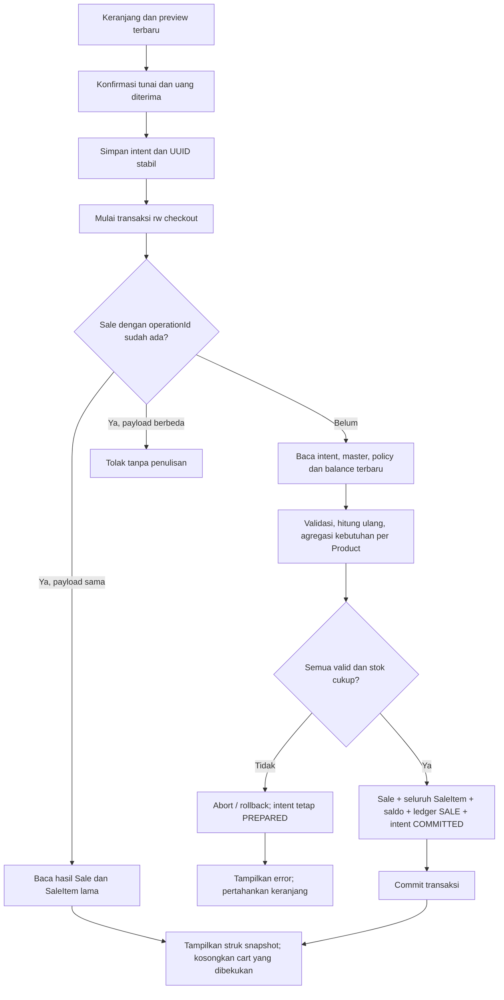
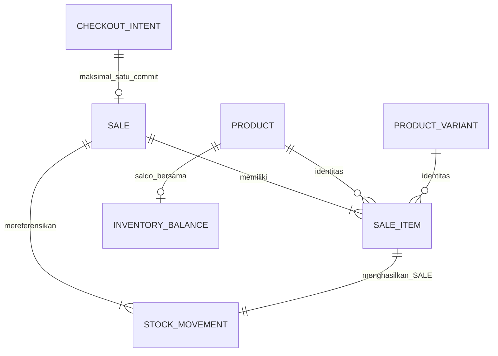

# Fase 4 · Langkah 4.1 — Audit dan desain checkout tunai

Tanggal audit: **21 Oktober 2026**. Repository POS-Zanna, aplikasi Zanna-Cell.

**Status historis saat Langkah 4.1 dibuat: desain untuk ditinjau.** Seluruh type, kontrak, tabel v3, nama file baru, dan alur checkout di bagian usulan **belum diimplementasikan pada 4.1**. Perubahan Langkah 4.1 hanya dokumen dan tautan README. Saat itu aplikasi memakai skema v2 dan pembayaran DEMO. Tidak ada migrasi, penulisan Sale, pengurangan stok penjualan, backend, PostgreSQL, sync, commit, atau push pada langkah tersebut.

**Kelanjutan 4.2:** model transaksi, kalkulator/validator murni dan schema v3 kini diimplementasikan sesuai cakupan terbatas. Service checkout atomik, writer penjualan, recovery dan UI nyata masih rencana. Lihat [hasil dan panduan Langkah 4.2](PHASE-4-2-DOMAIN-DATABASE.md); nama file final berbeda sebagian dari proposal ini.

**Kelanjutan 4.3:** [engine checkout atomik dan recovery](PHASE-4-3-CHECKOUT-SERVICE.md) sudah diimplementasikan pada lapisan service/repository; nama/signature aktual tercantum di dokumentasi tersebut. Integrasi UI tetap menunggu Langkah 4.4. Uraian usulan di bawah dipertahankan sebagai dasar desain historis.

## 1. Ringkasan audit kode aktual

Git awal bersih pada branch `master`, HEAD `9ec7d2c` (`feat(inventory): complete phase 3`). Kode sudah mencakup hardening satuan, sehingga angka 36/36 dan 16/16 pada prompt merupakan baseline lama. **`npm test` dijalankan ulang untuk audit ini: 44 berhasil, 0 gagal, 0 skipped**, termasuk **24 tes inventory**. Tes tersebut menguji implementasi Fase 3/DEMO, bukan checkout nyata yang baru dirancang.

Temuan utama:

- `DemoProvider` menyimpan `CartLine[]` melalui useState. CartLine hanya `{ variantId, quantity }`; quantity saat ini **jumlah satuan jual bulat, belum scaled**. Refresh menghilangkan keranjang. Master/saldo berasal dari subscription Dexie yang terpisah; quote React bukan snapshot transaksi database yang atomik.
- `setCartQuantity`, `canAddToCart`, `quoteCart` sudah membatasi varian aktif, harga, stok, dan kebutuhan bersama per productId. Harga mengikuti master terbaru; cart belum mempunyai harga yang disetujui secara persisten. Quote bukan otoritas checkout.
- `quoteCart` tidak mendukung saleMode variable; kuantitas harus integer 1–1.000.000. Kartu yang hilang dari proyeksi tidak ditampilkan pada quote.lines, meskipun quote.valid menjadi false. Alur nyata perlu menampilkan error per baris agar kasir mengetahui barang mana yang harus diperbaiki.
- `PaymentDialog.submit` memvalidasi tunai/Bon contoh, lalu memakai timer **700 ms**. Signature memeriksa varian, jumlah, harga, aktif, faktor, saldo. `success` berarti simulasi; tidak ada transaksi Dexie. `finish` memanggil onComplete; CashierPage kemudian cart.clear. Ini tidak boleh dijadikan bukti commit nyata.
- `PaymentMethod` UI adalah Tunai/QRIS/Bon. Ketiganya saat ini DEMO. DemoSale dan summarizeSales/groupSalesByDay di lib/sales.ts hanya untuk laporan contoh, bukan model penjualan tersimpan.
- Product, ProductVariant, Category, Unit memakai UUID; harga integer Rupiah; jumlah/faktor/minimum persediaan berskala **1000 per satuan dasar**. baseUnitId dikunci setelah produk dibuat. Harga null berbeda dengan nol.
- Hardening sudah menyediakan Product.unitPolicy, jenis general/fuel dan izin kemasan. `validateVariantUnit`, `assertUnitAllowed`, dan `variantUnitIssue` harus dipakai kembali. BBM tidak ditentukan dari string nama produk.
- Satu InventoryBalance per Product. Varian berbagi saldo dasar. StockMovement menyimpan snapshot, before/delta/after, operationId unik, requestFingerprint, createdBy null. Jenis yang diterima saat ini hanya empat mutasi manual; **SALE belum ada**.
- `DexieInventoryRepository.apply` memeriksa duplicate lalu baca–validasi–hitung–tulis dalam satu rw transaction enam tabel. `InventoryService.execute` mendelegasikan validasi otoritatif ke transaksi repository. Tidak cukup memanggil execute terpisah untuk setiap baris checkout.
- Database `zanna-cell-db` v1→v2 additive, enam tabel, tanpa sales/saleItems. Tidak ada durable checkout intent atau jalur pemulihan setelah refresh.
- Desktop dan drawer memakai panel/state keranjang yang sama. Breakpoint `CASHIER_MEDIA` adalah 1024px; launcher portal dan tombol atas membuka drawer. Struktur ini dapat dipertahankan.

### File aktual yang diperiksa

Path relatif terhadap frontend. Nama pada tabel ini **sudah ada**; nama baru pada bagian 10 adalah usulan.

| File | Fungsi/simbol dan hasil pemeriksaan |
| --- | --- |
| src/app/DemoProvider.tsx, src/app/demoContext.ts | DemoProvider, DemoStore: state cart, master/saldo observasi, readiness |
| src/types/pos.ts | CartLine, CatalogItem, PaymentMethod, DemoSale; tipe UI/DEMO terpisah dari domain |
| src/features/cashier/CashierPage.tsx | CashierPage, addProduct, updateQuery, onComplete: orkestrasi drawer/pembayaran/clear |
| src/features/cashier/useCart.ts | useCart: add/change/remove/clear dan quote |
| src/features/cashier/cartLogic.ts | exceedsSharedStock, setCartQuantity, canAddToCart, quoteCart |
| src/features/cashier/CartPanel.tsx | CartPanel: jumlah, subtotal/total, metode DEMO, tombol bayar |
| src/features/cashier/PaymentDialog.tsx | PaymentDialog, submit, finish: timer simulasi dan signature |
| src/hooks/useWideCashier.ts | CASHIER_MEDIA, useWideCashier: breakpoint tunggal |
| src/domain/product.ts | Product, ProductVariant, Unit, ProductUnitPolicy, QUANTITY_SCALE |
| src/domain/quantity.ts | parseQuantity, quantityInput, quantityText, parseRupiah |
| src/domain/validation.ts | validateConversion, validateVariantUnit, variantUnitIssue, validateProduct, validMoney |
| src/domain/unitPolicy.ts | validateUnitPolicy, assertUnitAllowed, unitAllowed, packagingPermittedByKind |
| src/domain/id.ts, src/domain/errors.ts | createUuid; ValidationError |
| src/domain/inventory.ts | InventoryBalance, StockMovement, InventoryCommand, InventoryRepository, UnitSnapshot, ConversionSnapshot |
| src/domain/inventoryRules.ts | resolveConversion, convertInventoryQuantity, previewMovement, commandFingerprint, validateInventoryCommand, MAX_STOCK_BASE |
| src/domain/inventoryReview.ts | productUnitIssues, historicalUnitIssue: review baca saja |
| src/data/database.ts | ZannaDatabase, PRODUCT_SCHEMA_V1, version(1), version(2) |
| src/data/dexieInventoryRepository.ts | DexieInventoryRepository.apply/getBalances/getHistory dan subscriptions |
| src/data/dexieProductRepository.ts | saveProduct, setProductActive, getSnapshot: master atomik, validasi, base unit terkunci |
| src/data/localDatabase.ts, src/services/inventoryService.ts | Singleton DB dan composition root InventoryService |
| src/services/inventoryOperations.ts | InventoryService.preview/execute dan fungsi baca |
| src/services/catalogRepository.ts | projectCatalog: proyeksi varian, stok/faktor, penyaringan varian invalid |
| src/data/units.ts | builtinUnits: referensi faktor dan dimensi |
| src/lib/format.ts, src/lib/sales.ts | money, parseWholeAmount; summarizeSales/groupSalesByDay untuk DemoSale |
| src/features/reports/ReportsPage.tsx, src/features/credit/CreditPage.tsx | ReportsPage/CreditPage masih memakai sampel, bukan transaksi Kasir |
| scripts/demo-logic.test.mjs | Enam tes logika keranjang/uang/laporan DEMO |
| scripts/product-repository.test.ts | Dua belas tes master, barcode/SKU, satuan dan persistence |
| scripts/inventory.test.ts | Dua puluh empat tes domain/repository, atomicity, idempotency, dua koneksi, migrasi, hardening |
| scripts/cart-ui.test.tsx, scripts/stock-ui.test.tsx | Dua tes DOM integrasi drawer/DEMO dan form/review inventory |
| package.json, tsconfig.tests.json | Scripts runner Node + tsx, fake-indexeddb, jsdom; tanpa framework baru |
| docs/INVENTORY-DATA-MODEL.md, docs/PHASE-3-BUSINESS-HARDENING.md, docs/PHASE-3-REPORT.md, README.md | Kontrak inventory, aturan kemasan, baseline lama dan batas fase |

Tidak ada browser/IndexedDB pengguna yang diperiksa. Tidak ada pengujian visual tablet. Lint/typecheck/build tidak diulang pada langkah dokumentasi ini; hasil build dan warning 500 kB dalam laporan hardening tetap merupakan hasil terdahulu.

## 2. Usulan domain Sale dan SaleItem

Sale adalah **satu kejadian penjualan yang sudah commit**: nomor struk, pembayaran, jumlah akhir, operator. SaleItem adalah **satu baris barang yang dijual**. Membeli dua varian bensin menghasilkan satu Sale dan dua SaleItem yang dapat mengurangi balance produk yang sama.

Cuplikan berikut hanya spesifikasi TypeScript dalam dokumen, bukan source yang dieksekusi. UUID, UnitSnapshot dan ConversionSnapshot merujuk tipe aktual yang sudah ada.

```ts
interface Sale {
  id: UUID
  receiptNumber: string
  checkoutOperationId: UUID
  requestFingerprint: string
  createdAt: string                   // ISO UTC dari perangkat
  status: 'COMPLETED'
  paymentMethod: 'CASH'
  subtotal: number                    // integer Rupiah
  total: number                      // tahap awal sama dengan subtotal
  cashReceived: number
  changeAmount: number
  operatorId: UUID | null             // null selama autentikasi belum tersedia
  pricingPolicy: 'HALF_UP_LINE_V1'
}

interface SaleItem {
  id: UUID
  saleId: UUID
  position: number                    // urutan tetap dalam struk, mulai 1
  productId: UUID
  variantId: UUID
  productNameSnapshot: string
  variantNameSnapshot: string
  saleModeSnapshot: 'fixed' | 'variable'
  unitSnapshot: UnitSnapshot          // satuan jual, termasuk nama/dimensi/faktor
  conversionSnapshot: ConversionSnapshot
  quantity: number                    // scaled 1000 dalam satuan JUAL
  quantityBase: number                // scaled 1000 dalam satuan DASAR
  unitPriceSnapshot: number           // integer Rupiah per 1 satuan jual
  lineTotal: number                   // integer Rupiah setelah aturan pembulatan
}
```

Nama/harga/unit/faktor diambil dari master **yang dibaca ulang dalam transaksi commit** dan harus sesuai konfirmasi kasir. Struk selanjutnya dibaca dari snapshot SaleItem, bukan join master untuk mengganti tampilannya. Edit nama/harga/isi botol besok tidak mengubah penjualan kemarin. ID master tetap disimpan untuk relasi, snapshot memberi makna historis.

Invariants:

- Sale hanya tersimpan berstatus COMPLETED setelah semua baris, balance dan ledger commit. Tidak ada Sale DRAFT/FAILED yang tampak sebagai pendapatan.
- subtotal = total = jumlah seluruh lineTotal; belum ada pajak/diskon/biaya tambahan. cashReceived ≥ total; changeAmount = cashReceived − total.
- Satu SaleItem menghasilkan tepat satu movement SALE, delta = −quantityBase; quantity dan quantityBase positif.
- unitSnapshot sama isinya dengan conversionSnapshot.inputUnit. Snapshot base dari Product.baseUnitId tidak boleh dipertukarkan dengan satuan jual.
- productId/variantId/relasi harus ditemukan dan sesuai saat commit; tidak ada cascade delete penjualan/ledger.
- Harga null ditolak. Harga nol tetap nilai eksplisit yang sah sesuai aturan master saat ini; UI harus menampilkan Rp0 dengan jelas, bukan menganggap null sebagai nol.

### Kuantitas, BBM, dan pembulatan harga

Kontrak checkout memakai **scaled quantity**, berbeda dari CartLine lama. Adapter fixed mengubah 2 botol menjadi quantity 2000; faktor botol 1,5 L = 1500 pada base Liter, sehingga quantityBase = 3000 = 3 L. Jangan mengirim CartLine.quantity lama langsung ke konversi inventory.

- Fixed: quantity harus kelipatan 1000 (wadah/satuan jual bulat).
- Variable: hanya unit ukur MASS/VOLUME yang kompatibel dan bukan kemasan; nilai maksimal tiga desimal. Pilihan/arahan harga mengikuti sellingUnitId varian, tanpa menebak harga dari unit lain.
- Solar varian harga Rp13.000 per Liter, input 1,5 L: quantity 1500, unitPriceSnapshot 13000, lineTotal 19500. Pada base ml, quantityBase = 1500000 scaled = 1500 ml; pada base Liter quantityBase = 1500 scaled = 1,5 L. Basis lama tidak dimigrasikan diam-diam.
- Bensin botol 1/1,5/5 L memakai faktor master dan harga masing-masing yang ditentukan pemilik. Harga null tetap memblokir penjualan. Input jeriken manual pada inventory tidak otomatis menjadi varian jual berharga.
- Hasil kuantitas dasar harus tepat: `quantityBase = quantity × quantityInBaseUnit / 1000`. Gunakan BigInt sementara dan tolak remainder; stok **tidak dibulatkan**.
- Usulan harga: `lineTotal = floor((unitPriceSnapshot × quantity + 500) / 1000)` menggunakan BigInt untuk nilai nonnegatif; ini pembulatan setengah ke atas **per baris**. Contoh Rp12.500/L × 0,001 L = Rp12,5 dibulatkan Rp13, sementara stok berkurang tepat 0,001 L. Jumlahkan hasil baris untuk total, bukan membulatkan total mentah sekali lagi.
- `pricingPolicy` disimpan agar aturan harga historis jelas. Ini **keputusan desain yang diajukan untuk evaluasi**, belum mengubah perilaku aplikasi. Tidak memakai floating-point/Math.round untuk aritmetika domain.

Usulan batas awal yang dapat diuji: maksimal 100 baris unik, quantity ≤ 1.000.000.000 scaled (1 juta satuan jual), harga per unit/total/tunai ≤ Rp1.000.000.000. Semua nilai tersimpan safe integer; BigInt hanya sementara. MAX_STOCK_BASE tetap 1.000.000.000.000 scaled. Batas baru bukan klaim batas yang sudah diimplementasikan.

## 3. Kontrak Checkout Service yang diusulkan

```ts
interface CheckoutLineRequest {
  variantId: UUID
  quantity: number                    // scaled 1000 dalam selling unit
  expected: {
    productId: UUID
    baseUnitId: UUID
    sellingUnitId: UUID
    saleMode: 'fixed' | 'variable'
    quantityInBaseUnit: number
    unitPrice: number
    productUpdatedAt: string
    variantUpdatedAt: string
  }
}
interface CheckoutCommand {
  payloadVersion: 1
  checkoutOperationId: UUID
  paymentMethod: 'CASH'
  lines: CheckoutLineRequest[]
  expectedTotal: number
  cashReceived: number
}
interface CheckoutQuote {
  lines: CheckoutLineRequest[]        // expected diisi dari master saat preview
  subtotal: number
  total: number
}
interface CheckoutResult {
  sale: Sale
  items: SaleItem[]                   // urut position, diambil dari snapshot tersimpan
  duplicate: boolean
}
interface CheckoutIntent {
  checkoutOperationId: UUID           // primary key
  command: CheckoutCommand            // payload dibekukan, tidak diedit saat retry
  requestFingerprint: string
  createdAt: string
  status: 'PREPARED' | 'COMMITTED' | 'CANCELLED'
  saleId?: UUID
}
```

**Seluruh nama di atas dan metode di bawah adalah usulan baru.** Service `CheckoutService` akan berada di checkoutOperations.ts; instance factory checkoutService.ts, mengikuti pemisahan inventoryOperations/inventoryService dan aman terhadap nama file Windows yang tidak membedakan huruf besar/kecil.

| Metode usulan | Parameter → hasil | Efek |
| --- | --- | --- |
| preview | baris variantId/quantity scaled → Promise CheckoutQuote | Transaksi baca master/saldo, validasi/hitung; tidak mengunci stok untuk nanti |
| prepare | CheckoutCommand → Promise CheckoutIntent | Menyimpan intent immutable; tidak mengurangi stok/membuat Sale |
| execute | CheckoutCommand → Promise CheckoutResult | Repository melakukan satu transaksi checkout atomik; wajib ada intent sama |
| getResult | checkoutOperationId → Promise CheckoutResult atau null | Membaca Sale dan items tersimpan; tidak menghitung ulang master |
| listUnresolved | tanpa parameter → Promise CheckoutIntent[] | Menampilkan PREPARED untuk pemulihan setelah refresh; tidak auto-execute |
| cancel | checkoutOperationId → hasil cancelled atau hasil committed | Serialisasi dengan checkout; tidak bisa membatalkan Sale yang sudah commit |

Domain memakai interface `CheckoutRepository` yang akan memisahkan transaksi baca/prepare/commit/getResult/listUnresolved/cancel dari Dexie. React/hook memanggil service, bukan db.sales.add. `prepare` bukan reservasi stok dan tidak menjamin harga/stok masih valid saat execute.

Command tidak menerima SaleItem snapshot dari UI sebagai kebenaran, tidak menerima saldo akhir, diskon bebas, atau operatorId yang dapat dipalsukan. expected hanya syarat konfirmasi; repository membaca ulang dan membandingkan. operatorId tetap null pada Sale. Request dengan QRIS/Bon ditolak oleh domain walaupun UI dilewati.

### Aturan validasi dan error terstruktur

Tolak keranjang kosong, variantId ganda, jumlah nol/negatif/NaN/non-integer scaled/overflow, UUID salah, dan metode selain CASH. Jangan menggabungkan duplikat diam-diam: satu varian satu baris; mengubah urutan baris dianggap payload berbeda untuk intent yang sama.

Usulan error code: INVALID_REQUEST, CASH_INSUFFICIENT, PRODUCT_UNAVAILABLE, POLICY_REVIEW_REQUIRED, QUOTE_CHANGED, STOCK_NOT_INITIALIZED, INSUFFICIENT_STOCK, OPERATION_PAYLOAD_MISMATCH, INTENT_REQUIRED, INTENT_CANCELLED, STORAGE_ERROR, INTEGRITY_ERROR. Kegagalan storage dibedakan dari penolakan bisnis; error code ini belum ada di source.

- Master/category/variant harus aktif. Hubungan productId varian diperiksa ulang.
- Untuk checkout nyata, kebijakan satuan wajib ditinjau (`validateUnitPolicy`), termasuk produk legacy. Ini lebih ketat daripada pembacaan base/metrik legacy yang masih diizinkan Fase 3.
- Harga/faktor/unit/mode/versi master berbeda dari expected ⇒ QUOTE_CHANGED, rollback, tampilkan preview baru dan minta konfirmasi. Uang cukup tidak memberi izin memakai harga baru diam-diam. Guard updatedAt juga dapat meminta review setelah edit nama/modal; ini pilihan konservatif yang harus dijelaskan ke kasir.
- Stock berubah namun masih cukup ⇒ terima saldo terkini; jangan mensyaratkan angka before persis sama dengan preview. Jika tidak cukup ⇒ tolak seluruh checkout. Minimum stok hanya indikator, bukan larangan menjual stok positif.
- Tunai dicek sebelum submit dan **diulang setelah total otoritatif dihitung**. Jangan hanya bergantung pada validasi uang di modal.

## 4. Diagram dan desain transaksi atomik



Scope rw yang diusulkan: **products, categories, units, variants, inventoryBalances, stockMovements, sales, saleItems, checkoutIntents** dalam database yang sama. Membaca master di scope ini membuatnya konsisten dengan edit master yang memakai tabel bersinggungan. Dua checkout/stock adjustment bersamaan memakai scope balance/ledger yang sama sehingga tidak menimpa saldo lama.

Langkah dalam repository, seluruhnya dalam callback transaksi:

1. Salin dan validasi struktur command; buat fingerprint canonical versioned.
2. Cari Sale dengan checkoutOperationId. Jika fingerprint sama, baca SaleItem tersimpan dan kembalikan hasil lama. Jika beda, tolak. Langkah ini mendahului validasi master saat ini: retry keberhasilan lama tidak boleh berubah karena harga/status besok.
3. Jika Sale belum ada, baca intent PREPARED dengan command/fingerprint identik. Intent COMMITTED tanpa Sale atau relasi tidak utuh adalah INTEGRITY_ERROR; jangan “memperbaiki” dengan menjual ulang.
4. Baca produk, kategori, varian, satuan, policy dan balance terbaru. Bangun snapshot dari hasil baca. Jalankan validasi expected, harga/kuantitas, dan tunai.
5. Hitung quantityBase setiap baris lalu jumlahkan kebutuhan **per productId**, bukan per varian. Setiap balance wajib sudah diinisialisasi dan ≥ kebutuhan total. Semua baris divalidasi sebelum penulisan pertama.
6. Buat UUID Sale, SaleItem, movement, dan operationId movement. Bentuk receiptNumber unik. UUID yang sudah commit tidak diganti saat retry.
7. Buat Sale dan semua SaleItem. Untuk setiap baris menurut position, buat movement SALE dengan saldo berjalan per produk. Tulis balance akhir sekali per produk. initializedAt tetap, updatedAt berubah.
8. Tambahkan seluruh movement; perbarui intent menjadi COMMITTED dengan saleId di transaksi yang sama.
9. Biarkan error keluar dari transaksi. Promise berhasil hanya setelah commit; UI baru boleh menyatakan selesai.

Tidak ada timer, fetch, printer, React state update, atau dialog konfirmasi di dalam transaksi. Jangan catch error item kedua lalu meneruskan transaksi. Gagal pada satu item/balance/movement/intent menggagalkan **seluruh** Sale. Stok awal/tambahan lama dan transaksi lain yang sudah commit tidak ikut dihapus.

### Ledger per SaleItem dan stok bersama

Dipilih satu movement SALE per SaleItem supaya satu snapshot konversi tetap menjelaskan satu input. Satu movement agregat per Product akan kesulitan merepresentasikan beberapa unit/faktor sekaligus dengan model snapshot sekarang.

Contoh base Liter, balance 5000 = 5 L: botol 1 L sebanyak 2 dan botol 1,5 L sebanyak 1 memerlukan 3500 = 3,5 L. Dua ledger berurutan: 5000→3000 (−2000), lalu 3000→1500 (−1500). Balance akhir 1500. Jika total kebutuhan 5500, seluruh penjualan ditolak meskipun tiap varian terlihat cukup sendiri.

Movement SALE mengusulkan field **saleId dan saleItemId wajib**; field tersebut absent pada mutasi manual lama. `operationId` movement adalah UUID unik per movement, **bukan checkoutOperationId yang disalin ke semua baris** karena indeks operationId sudah unik. Sale.checkoutOperationId mengikat idempotency checkout; saleId/saleItemId mengikat relasi audit.

Field movement lama tetap diisi: productName dari snapshot, inputQuantity = SaleItem.quantity scaled, conversionSnapshot yang sama, quantityDeltaBase = −quantityBase, createdBy null, dan reason menjelaskan referensi penjualan. requestFingerprint movement SALE diusulkan berasal dari fingerprint checkout + position/saleItemId secara canonical; bukan command mutasi manual. Tidak ada endpoint replay movement SALE tersendiri yang dapat mengurangi stok di luar transaksi Sale.

Perluasan domain harus memisahkan ManualMovementType/ManualInventoryCommand dari SaleStockMovement. `InventoryService.execute` tetap hanya menerima empat mutasi manual. Jangan menambahkan SALE ke dropdown atau mengirim SALE melalui previewMovement sekarang: fungsi itu menganggap selain ADJUSTMENT_OUT sebagai delta positif. Juga jangan menyamarkan penjualan sebagai ADJUSTMENT_OUT.

Untuk urutan ledger, usulkan waktu awal = maksimum jam sekarang dan updatedAt saldo terkait + 1 ms; createdAt movement bertambah menurut position, balance.updatedAt mengikuti movement terakhir produk tersebut. Ini menjaga urutan before/after pada UI yang menyortir createdAt; tetap jam lokal perangkat, bukan waktu server tepercaya.

### Fungsi Fase 3 yang dipakai kembali

Gunakan createUuid, parseQuantity, parseWholeAmount/parseRupiah sesuai format UI, quantityText, money; validateUnitPolicy, validateVariantUnit, assertUnitAllowed; UnitSnapshot/ConversionSnapshot dan convertInventoryQuantity. Tetap pakai localDatabase singleton dan subscription saldo.

`resolveConversion` saat ini terikat InventoryCommand. Usulkan mengekstrak request konversi murni yang dipakai wrapper manual dan checkout, dengan tes regresi; jangan mengirim jenis mutasi palsu hanya untuk memperoleh snapshot. Kebutuhan/tanda SALE dihitung oleh aturan checkout tersendiri. Pola transaksi/dedup DexieInventoryRepository.apply dipakai sebagai referensi, bukan dipanggil satu kali per item sebagai transaksi mandiri.

`quoteCart` tetap berguna sebagai feedback DEMO/fixed, tetapi engine nyata perlu pure calculator yang mendukung scaled quantity, expected quote dan pembulatan. Jangan menambahkan import ke cartLogic.ts tanpa memperbarui test loader demo-logic.test.mjs yang sekarang men-transpile source melalui data URL.

## 5. Usulan skema Dexie v3 dan relasi

**Hanya contoh desain; jangan menyalin perubahan ini ke database.ts pada Langkah 4.1.** Pertahankan deklarasi versi 1 dan 2. Versi 3 kelak menambahkan tiga store serta indeks relasi pada stockMovements:

```ts
// PROPOSAL ONLY — belum dijalankan.
this.version(3).stores({
  sales: 'id, &receiptNumber, &checkoutOperationId, createdAt, status',
  saleItems: 'id, saleId, productId, variantId, &[saleId+position]',
  checkoutIntents: 'checkoutOperationId, status, createdAt, saleId',
  stockMovements: 'id, productId, &operationId, [productId+createdAt], createdAt, saleId, &saleItemId',
})
```

- id/checkoutOperationId pertama adalah primary key. `&` berarti indeks unik; saleId dan productId biasa tidak unik karena satu Sale/Product dapat mempunyai banyak item/movement.
- `&checkoutOperationId` pada sales menjamin satu intent menghasilkan maksimal satu Sale. `&receiptNumber` menjaga nomor struk dalam database ini. `&[saleId+position]` menjaga urutan item tidak ganda.
- `&saleItemId` pada stockMovements menjamin maksimal satu movement SALE per item. Field tersebut absent pada record manual lama; pengujian migrasi harus memastikan indeks ini menerima seluruh ledger v2 yang tidak memiliki field itu.
- Referensi bukan foreign key otomatis. Repository wajib memvalidasi parent/item/master dan invariants. Transaksi atomik menjaga pasangan terbentuk bersama; indeks unik tidak sendirian menjamin satu item selalu punya movement.
- Master dan balances tidak diubah struktur indeksnya. Tidak ada reset, delete database, clear, penambahan stok nol, penulisan ulang ledger, atau interpretasi ulang skala lama. V3 harus diuji memakai fixture **v2 setelah hardening**, bukan hanya fixture v1 kosong stok.
- Bila upgrade/index gagal, tampilkan error dan pertahankan database; jangan menawarkan reset sebagai penanganan otomatis. Periksa versi tab lama dan versionchange seperti pola sekarang.



Relasi SALE_ITEM–STOCK_MOVEMENT pada diagram khusus movement SALE; stok awal/masuk/koreksi manual tetap tidak mempunyai Sale/SaleItem.

### Mengapa checkoutIntents diperlukan

Audit menemukan keranjang dan penanda processing hanya ada di RAM. Mengandalkan useRef untuk operationId akan kehilangan identitas ketika refresh terjadi sesudah commit tetapi sebelum UI menerima hasil. Tanpa intent yang tahan refresh, kasir dapat membuat ID baru lalu menjual dua kali.

Usulkan satu record lokal kecil berisi command/fingerprint/UUID sebelum execute. Ini **bukan transaksi penjualan, bukan outbox sinkronisasi, dan bukan reservasi stok**. Prepare mempunyai transaksi sendiri pada checkoutIntents/sales untuk memeriksa ID dan membekukan request. Semua efek bisnis Sale/Item/balance/ledger dan perubahan intent COMMITTED tetap satu transaksi checkout. Jika checkout rollback, hanya intent PREPARED yang telah disimpan sebelumnya yang tersisa; tidak ada penjualan parsial.

Tidak ada background worker atau auto-retry. Pemilik dapat melihat intent belum selesai setelah refresh dan memutuskan lanjut/periksa. Tidak perlu menyimpan seluruh katalog/cart terpisah; command berisi baris checkout yang sudah dikonfirmasi untuk dipulihkan.

## 6. Idempotency, nomor struk, dan pemulihan

### Identitas dan fingerprint

checkoutOperationId dibuat **sekali sebelum prepare**. Service harus deep-copy/freeze baris dan expected, bukan shallow-copy object dengan array yang masih bisa dimutasi pemanggil.

Canonical fingerprint v1 adalah serialisasi field berurutan: payloadVersion, paymentMethod, cashReceived, expectedTotal, serta setiap baris dalam urutan tetap dengan variantId/quantity/seluruh expected. Jangan memakai stringify object bebas dengan urutan properti tak terkendali. Dua urutan properti object yang ekuivalen harus sama; urutan baris adalah bagian intent dan tidak diubah pada retry. Field waktu/UUID hasil commit tidak termasuk fingerprint. Fingerprint bukan signature/alat autentikasi.

Aturan prepare dan execute:

- ID baru ⇒ prepare menyimpan command immutable; execute menghitung terhadap master terbaru.
- ID sama + payload sama ⇒ prepare mengembalikan intent yang sama; execute setelah sukses mengembalikan Sale/items/receipt lama dengan duplicate true, tanpa perubahan saldo.
- ID sama + payload berbeda ⇒ OPERATION_PAYLOAD_MISMATCH, termasuk perubahan tunai/expectedTotal/jumlah/baris. Jangan mengganti isi intent lama.
- Setelah penolakan dan perlu mengedit konfirmasi, cancel intent lama secara eksplisit lalu buat UUID baru. cancel dan execute harus memakai scope checkoutIntents/sales yang bersinggungan agar tidak ada perlombaan cancel-versus-commit. Jika commit sudah menang, cancel mengembalikan hasil committed, bukan mengaku membatalkan Sale.
- Tombol disabled/ref UI mengurangi double click, tetapi keunikan dan pengecekan di transaksi adalah pengaman akhir. Dua panggilan bersamaan dengan ID sama menghasilkan satu penjualan; dua ID berbeda dianggap **dua intent berbeda**. Sistem tidak boleh menebak dua keranjang identik adalah duplikat, karena pembeli berbeda bisa membeli barang sama.

### Nomor struk

Usulkan `ZC-YYYYMMDD-<UUID Sale lengkap>`; tanggal diambil dari createdAt UTC secara konsisten, UUID tidak dipotong. Nomor ini unik melalui indeks pada database lokal, tidak bergantung pada count(sales)+1, jam saja, atau urutan array. Urutan harian tanpa celah belum menjadi kebutuhan dan tidak dijanjikan.

Jika benturan UUID/receipt dipaksakan pada tes, transaksi harus abort tanpa overwrite. Retry intent yang sama boleh membuat UUID Sale baru setelah rollback yang diketahui belum commit; kalau Sale sudah ada, selalu kembalikan Sale/receipt lama. Keunikan lintas perangkat belum dijamin oleh indeks lokal dan belum menjadi masalah sinkronisasi yang diimplementasikan. UUID mengurangi peluang benturan; aturan pusat kelak ditentukan backend.

### Refresh dan hasil yang belum pasti

| Titik refresh/kegagalan | Kondisi yang harus ditemukan | Tindakan UI yang dirancang |
| --- | --- | --- |
| Sebelum prepare commit | Belum ada intent/efek bisnis | Tidak mengaku sukses. Cart RAM yang belum dipersiapkan belum dijamin pulih |
| Setelah prepare, sebelum execute | PREPARED, belum ada Sale | Tampilkan pemulihan command; lanjut hanya atas konfirmasi kasir |
| Saat transaksi checkout berjalan | getResult membaca setelah transaksi terkait selesai | Periksa berdasarkan ID sama; jangan membuat operasi baru karena timeout |
| Commit selesai, respons/UI hilang | Sale+items+ledger+balance+intent COMMITTED utuh | Tampilkan receipt tersimpan; jangan execute dengan UUID baru |
| Transaksi abort | Tidak ada Sale/Item/SALE/balance parsial, intent tetap PREPARED | Pertahankan/pulihkan baris; retry ID/payload sama atau cancel untuk edit |
| Database tidak bisa dibaca | Status commit belum bisa dipastikan | Tampilkan “Status belum dapat dipastikan”; blokir retry dengan ID baru sampai pemeriksaan memungkinkan |

`getResult` membaca Sale/items dalam satu transaksi read dengan scope yang beririsan dengan checkout; hasil kosong sebelum transaksi berjalan selesai tidak boleh dipakai untuk menganggap commit pasti gagal. Recovery memeriksa intent dan Sale secara konsisten, bukan hanya state UI.

Pembacaan hasil untuk recovery juga mencakup checkoutIntents dan stockMovements: cocokkan jumlah/urutan item dengan command tersimpan, total, dan satu relasi movement per item. Data committed yang tidak utuh menghasilkan INTEGRITY_ERROR. Jangan membandingkan saldo saat ini dengan saldo akhir Sale lama untuk menganggap hasil rusak, karena stok dapat sah berubah oleh operasi lain sesudahnya.

listUnresolved menampilkan intent PREPARED lokal untuk dipilih secara eksplisit; jangan otomatis mengeksekusi semua intent saat app dibuka. Beberapa tab dapat mempunyai intent berbeda. Intent COMMITTED menunjuk saleId yang sama dan receipt dapat dibaca kembali melalui getResult. Jika relasi committed hilang, tampilkan INTEGRITY_ERROR untuk review, tanpa menjual ulang.

Cart yang belum dikonfirmasi tidak dipersistenkan oleh rancangan minimal ini. Intent memulihkan baris yang sedang checkout setelah prepare berhasil. Ketahanan terhadap site-data deletion/eviction, storage rusak, dan cold start tanpa frontend/PWA tetap di luar jaminan.

## 7. Status, tunai, dan pemisahan DEMO

| Lapisan | Status yang dirancang | Arti |
| --- | --- | --- |
| Sale tersimpan | COMPLETED saja | Seluruh efek bisnis sudah commit |
| CheckoutIntent | PREPARED / COMMITTED / CANCELLED | Identitas permintaan untuk recovery; bukan pendapatan |
| UI tunai nyata | editing / preparing / processing / success / rejected / uncertain | Kondisi interaksi; success hanya dari hasil commit/getResult |
| PaymentDialog sekarang | idle / processing / success | Masih simulasi timer; tidak membuktikan persistensi |

Tunai nyata berarti aplikasi mencatat penjualan dan penerimaan uang yang dinyatakan kasir. Tidak ada verifikasi bank, sensor uang, atau rollback otomatis uang fisik. Kasir tetap harus memastikan uang diterima dan kembalian benar. Contoh total Rp19.500, diterima Rp20.000 ⇒ change Rp500. Diterima Rp19.000 ditolak sebelum efek bisnis apa pun.

Usulan jalur UI ketika implementasi kelak diizinkan:

- Tunai → komponen **CashCheckoutDialog** baru, service nyata; tidak menggunakan timer simulasi sebagai success.
- QRIS dan Bon → tetap PaymentDialog DEMO dengan tombol/label “Simulasi QRIS/Bon”; tidak mempunyai akses checkout service dan tidak membuat Sale/SALE. Alternatif menonaktifkan keduanya sebagai checkout nyata dengan penjelasan jelas.
- API nyata juga menolak metode selain CASH; pemisahan tidak cukup hanya di dropdown.
- Saat prepare/execute atau uncertain, bekukan baris/jumlah/tunai dan cegah mulai penjualan kedua dari cart yang sama. Setelah commit, tampilkan receipt dari snapshot dan kosongkan **hanya cart yang dibekukan untuk intent itu**. Jika revision cart tidak lagi cocok, jangan menghapus belanja baru pengguna.
- Pada known failure, modal tetap dapat menampilkan error dan cart tidak di-clear. Pada uncertain, sediakan periksa status ID sama; jangan mengizinkan mengganti UUID secara diam-diam.
- Tutup receipt atau kegagalan cetak setelah commit tidak membatalkan Sale. Printer fisik tidak termasuk rancangan implementasi awal; receipt layar cukup. Tombol ulang receipt tidak membuat penjualan baru.

Stock di keranjang tidak direservasi. Penurunan saldo akibat checkout lain dapat terjadi sebelum konfirmasi; pengecekan dalam transaksi yang menentukan hasil. Tujuannya mencegah stok negatif, bukan menjanjikan semua keranjang yang dibuka akan pasti berhasil.

## 8. Risiko, skenario gagal, dan materi belajar

| Konsep/risiko | Contoh Zanna-Cell | Perlakuan yang dirancang |
| --- | --- | --- |
| Sale vs SaleItem | Satu pembeli membeli mi dan dua varian bensin | Satu header pembayaran, beberapa snapshot baris, satu commit |
| Hubungan inventory | Dua kemasan memakai bensin yang sama | Agregasi productId sebelum tulis, ledger per item dengan saldo berjalan |
| Price snapshot | Harga mi berubah besok | Struk lama tetap memakai harga/nama/unit/faktor saat commit |
| Atomicity/rollback | Item pertama tersimpan, item kedua gagal | Seluruh penjualan/balance/ledger batal; intent PREPARED saja tersisa |
| Idempotency | Kasir double click atau refresh sesudah commit | UUID+fingerprint, kembalikan hasil lama tanpa movement baru |
| Race condition | Dua tab masing-masing menjual 4 L dari stok 5 L | Transaksi bersinggungan; hanya satu berhasil, saldo tidak negatif |
| Validasi stok terbaru | Keranjang lama 3 L, stok kini 2 L | Tolak seluruh checkout; jangan clear cart |
| Harga/konversi berubah | Harga baru masih tertutup uang Rp50.000 | Tetap QUOTE_CHANGED; kasir harus menyetujui lagi |
| Metadata nonaktif | Produk/category/variant dinonaktifkan saat modal terbuka | Baca ulang master dan tolak sebelum tulis |
| Hardening bisnis | Sachet dipaksakan untuk Solar | Validasi policy di domain/repository; tidak cukup filter dropdown |
| Tunai/kembalian | Uang 20.000, total 19.500 | Integer Rupiah, change 500, simpan hasil dan input pada Sale |
| Pembulatan | Rp12,5 hasil jual volume kecil | HALF_UP_LINE_V1 transparan; stok tetap eksak |
| Nomor struk | Jam mundur atau dua kasir bersamaan | UUID penuh + indeks unik; jangan count+1 |
| DEMO vs nyata | Tombol Bon disimulasikan | Tidak memanggil service nyata, tidak membentuk Sale/SALE |
| UI gagal sesudah commit | Modal tertutup/browser refresh | Query hasil tersimpan sebelum memutuskan retry/clear |
| Penyimpanan penuh | Ledger gagal ditulis | Abort; status UI bukan success; jangan reset IndexedDB |
| Data legacy bermasalah | Saldo historis tidak sesuai fisik | Review pemilik dan koreksi manual baru; desain checkout tidak membetulkan histori |
| Keamanan lokal | Operator menguasai DevTools | Tidak diklaim tamper-proof; operatorId null, tanpa autentikasi tepercaya |
| Laporan/laba | ReportsPage masih demo, modal null | Jangan mencampur Sale baru dengan DemoSale atau mengklaim laba nyata; laporan/HPP terpisah |

Penggunaan nama productNameSnapshot tidak menjamin data benar secara fisik; snapshot hanya mempertahankan apa yang tercatat. Integer/fingerprint juga bukan keamanan kriptografis. IndexedDB tetap terikat origin, belum ada backup/restore, dan local commit tidak menyinkronkan perangkat lain.

Keputusan bisnis yang perlu dievaluasi melalui dokumen ini: pembulatan Rupiah per baris, batas nilai/jumlah, format struk UUID panjang, review policy wajib sebelum checkout nyata, dan pengelolaan intent belum selesai. Tidak ada keputusan tersebut yang diterapkan diam-diam ke source pada Langkah 4.1.

## 9. Rencana pengujian yang dapat dijalankan pada implementasi berikutnya

**Belum ada tes checkout nyata yang dibuat atau diklaim lulus pada langkah ini.** Gunakan alat proyek yang sudah ada: Node runner/tsx, fake-indexeddb, jsdom. Jangan menambah framework tanpa kebutuhan.

| Lapisan | Peran | Skenario penerimaan |
| --- | --- | --- |
| Unit test | Pure calculator/validator tanpa DB/UI | Empty/duplicate lines, cash kurang, null vs Rp0, batas safe integer, fixed/variable, stock conversion remainder, HALF_UP dan total, canonical fingerprint ekuivalen |
| Integration test | Service + repository + Dexie emulator | Sale+semua items+ledger+balances commit bersama; fault injection di item kedua/balance/movement/intent ⇒ seluruh efek bisnis rollback |
| Integration idempotency | Dua koneksi/request bersamaan | ID sama payload sama ⇒ satu Sale/receipt dan N movement; payload beda ditolak; replay setelah edit master tetap mengembalikan snapshot lama |
| Integration concurrency | Checkout dan stok masuk/koreksi/master edit | Tidak lost update, tidak saldo negatif; semua product tervalidasi atau seluruh checkout batal; race cancel-versus-execute |
| Integration shared stock | Botol 1/1,5/5 L produk sama | Kebutuhan gabungan ditolak bila melebihi saldo; before/after chain dan balance akhir cocok |
| Integration snapshots | Ubah nama/harga/unit/faktor/status setelah commit | SaleItem/receipt lama identik; getResult tidak membangun ulang dari master |
| Integration recovery | Tutup/buka DB sebelum execute dan setelah commit | PREPARED dapat dipulihkan; hasil committed lama ditemukan; getResult/retry tidak membuat penjualan baru |
| Migration test | Fixture v2 berisi master, policy, balances, ledger manual | V3 menambah store/index tanpa mengubah record lama; missing saleItemId lama tidak bentrok indeks unik; upgrade gagal tidak reset |
| Constraint test | Paksa UUID/receipt atau saleItemId duplikat | Transaksi abort, tanpa overwrite/penjualan parsial; ID movement tiap item berbeda |
| UI test jsdom | Event form dan state berdasarkan promise | Cash real sukses hanya setelah commit; reject menjaga cart; uncertain query ulang; freeze controls; receipt snapshot; clear hanya cart intent terkait |
| UI pemisahan | QRIS/Bon DEMO | Spy/repository counts membuktikan tidak ada calls/rows Sale/SALE/balance write |
| Regression | Seluruh 44 tes Fase 3 | CRUD/barcode/policy, inventory manual, rollback, drawer dan DEMO tetap lulus |
| Manual browser/tablet | Layout/keyboard/storage browser sungguhan | Tunai, kembalian, scroll, fokus, safe-area, 390/768/1024/1366px, refresh saat proses, dua tab, Console, receipt tetap terbaca |

Perbedaan penting: unit test membuktikan rumus, integration test membuktikan transaksi dan constraint, UI test membuktikan alur komponen, manual test membuktikan interaksi browser/perangkat nyata. fake-indexeddb/jsdom tidak membuktikan durability saat mati listrik atau tampilan Android.

Invariants test minimum:

1. Satu checkoutOperationId sukses ⇒ tepat satu Sale.
2. Banyak SaleItem = banyak movement SALE; setiap saleItemId terhubung tepat sekali.
3. Saldo akhir setiap produk = saldo sebelum − jumlah quantityBase item produk itu; selalu ≥ 0.
4. before + delta = after dan chain ledger produk berurutan konsisten.
5. total = subtotal = jumlah lineTotal; cash − total = change; semua integer aman.
6. Replay sukses mengembalikan UUID Sale/Item/movement, receipt dan snapshot yang sama; tidak ada write tambahan.
7. Checkout gagal tidak mengubah tabel bisnis atau menghapus cart; intent recovery yang telah dibuat boleh tetap PREPARED.

Urutan pemeriksaan pada implementasi: lint → typecheck → unit/integration checkout → semua tes → build → evaluasi manual pengguna. Jangan menandai checklist manual lulus sebelum pengguna menjalankannya.

## 10. Usulan file dan urutan pekerjaan Langkah 4.2

**Belum dibuat/diubah; daftar ini adalah rencana setelah evaluasi 4.1.** Nama final dapat disesuaikan ketika cakupan 4.2 diberikan. Dahulukan core dan tes; hubungkan UI setelah core transaksi lulus.

| Rencana file baru | Tanggung jawab |
| --- | --- |
| src/domain/sale.ts | Sale, SaleItem dan snapshot penjualan |
| src/domain/checkout.ts | Command/quote/result/intent, status/error code |
| src/domain/checkoutRules.ts | Pure calculation, expected guards, stock aggregation, fingerprint dan pembulatan |
| src/domain/checkoutRepository.ts | Interface tanpa impor Dexie/React |
| src/services/checkoutOperations.ts | Class CheckoutService: preview/prepare/execute/recovery/cancel |
| src/services/checkoutService.ts | Instance composition root dengan localDatabase |
| src/data/dexieCheckoutRepository.ts | Satu transaksi bisnis, read result, prepare/cancel intent |
| scripts/checkout.test.ts | Unit/integration/migration/idempotency/concurrency/fault injection |
| src/hooks/useCheckout.ts | State UI, freeze intent, submit dan recovery saat tahap integrasi |
| src/features/cashier/CashCheckoutDialog.tsx | Form tunai nyata, state commit/reject/uncertain; terpisah dari DEMO |
| src/features/cashier/SaleReceipt.tsx | Struk layar dari hasil tersimpan; tanpa printer nyata |
| scripts/checkout-ui.test.tsx | Form, recovery, clear-cart, pemisahan DEMO |

| Rencana file aktual yang diubah | Alasan/aturan agar tidak regresi |
| --- | --- |
| src/data/database.ts | V3 additive dan typed tables, setelah migration test siap; jangan reset |
| src/domain/inventory.ts | Union manual vs SALE dan relasi saleId/saleItemId; kontrak manual tetap terbatas |
| src/domain/inventoryRules.ts | Ekstraksi konversi murni, label SALE, tetap menolak SALE di validator operasi manual |
| src/domain/inventoryReview.ts, src/features/stock/StockHistory.tsx | Menampilkan asal penjualan/relasi audit dan label SALE tanpa mengubah histori lama |
| src/types/pos.ts, src/features/cashier/cartLogic.ts, src/features/cashier/useCart.ts | Adapter quantity lama→scaled, input variable, diagnosa baris hilang, revision/freeze; jangan menyamakan dua skala |
| src/app/DemoProvider.tsx, src/app/demoContext.ts | Sambungan service/readiness seperlunya; satu state cart tetap, tidak memaksa rename provider besar-besaran |
| src/features/cashier/CashierPage.tsx, src/features/cashier/CartPanel.tsx | Route tunai nyata vs DEMO, clear setelah commit yang cocok, kontrol processing; drawer/launcher dipertahankan |
| src/features/cashier/ProductCard.tsx | Input/jumlah variable dan harga/unit yang jelas jika penjualan volume masuk cakupan implementasi |
| src/features/cashier/PaymentDialog.tsx | Menjaga jalur QRIS/Bon DEMO eksplisit; tidak mengimpor service nyata |
| scripts/demo-logic.test.mjs, scripts/cart-ui.test.tsx, scripts/inventory.test.ts, package.json | Regresi, adapter/loader bila refactor import, daftar suite checkout; dependency baru tidak diperlukan |
| README.md dan dokumen desain ini | Ubah status hanya setelah bagian terkait benar-benar diimplementasikan/diuji |

Usulan tahapan 4.2: model/pure rules dan unit tests → fixture/migration v2→v3 dan repository/intent → atomic integration tests → service/UI tunai/receipt/recovery → regresi drawer/DEMO. Bila pengguna membatasi 4.2 hanya model/domain, implementasi harus mengikuti batas baru tersebut; daftar ini bukan otorisasi otomatis semua tahap.

Backend, PostgreSQL, sinkronisasi, real QRIS/Bon, pembatalan/retur, pajak/diskon, laporan laba/HPP, printer/scanner, backup/restore dan PWA tetap pekerjaan terpisah. SALE_REVERSAL/RETURN tidak ditambahkan hanya untuk memperluas union sebelum aturannya tersedia.

## 11. Hasil Langkah 4.1 dan batas berhenti

Hasil yang tersedia sekarang: audit kode aktual, diagram checkout, usulan Sale/SaleItem, schema v3, kontrak service, transaksi atomik, pemulihan refresh, risiko, materi belajar, acceptance tests, dan daftar calon file 4.2. Baseline 44/44 lulus; hasil itu tidak diklaim sebagai pengujian checkout nyata.

Dokumen ini dan tautan README adalah satu-satunya perubahan Langkah 4.1. Source, database.ts, dependencies, dan tests tidak diubah. Tidak ada migration yang dijalankan, browser/DB pengguna diakses, commit atau push dibuat.

**Berhenti setelah Langkah 4.1. Langkah 4.2 menunggu evaluasi dan instruksi pengguna.**
