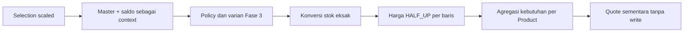

# Fase 4 · Langkah 4.2 — Domain transaksi dan Dexie v3

Implementasi: 21 Oktober 2026. POS-Zanna / Zanna-Cell. Baca bersama [desain 4.1](PHASE-4-1-CHECKOUT-DESIGN.md).

**Yang sudah berfungsi:** model TypeScript, validator runtime, kalkulasi murni, fingerprint dan salinan command, serta schema v3 dengan tes migrasi. **Yang belum dibuat:** CheckoutService operasional, prepare/execute persisten, write Sale dari Kasir, pengurangan stok penjualan, movement SALE nyata, receipt UI, dan recovery checkout. Kasir/keranjang/pembayaran tetap DEMO tanpa perubahan.

## 1. Audit dan penyesuaian desain 4.1

- Root repository tunggal, branch master, HEAD audit `9ec7d2c`. Sebelum 4.2, README sudah modified dan dokumen 4.1 masih untracked dari pekerjaan sebelumnya; keduanya dipertahankan, tidak di-reset/stage/commit.
- TypeScript strict dengan target ES2023 mendukung BigInt; konfigurasi tidak dilonggarkan. Tests tetap Node/tsx/fake-indexeddb/jsdom tanpa dependency baru.
- Skema aktual sebelum perubahan v1/v2, enam tabel. Product, ProductVariant, Unit, policy BBM, base unit terkunci, skala 1000 dan barcode lama dipertahankan.
- Konversi manual sudah tepat dan menolak pecahan diskret. Kode baru memanggil validateVariantUnit/validateUnitPolicy dan convertInventoryQuantity; tidak membuat jalur izin Sachet untuk BBM.
- CartLine.quantity UI lama adalah jumlah bulat, bukan scaled. UI tidak diubah. scaleFixedQuantity adalah adapter murni untuk dipakai secara eksplisit pada langkah berikutnya.
- Penyesuaian desain: CheckoutQuote juga membawa items hasil hitung (tanpa UUID/saleId) dan stockRequirements per productId. Ini read model sementara, bukan saldo/tabel baru dan tidak tersimpan otomatis.
- CheckoutIntent memakai discriminated union: COMMITTED wajib saleId; PREPARED/CANCELLED tidak boleh saleId. Validator runtime menerapkan aturan yang sama pada data unknown.
- Kontrak penyimpanan yang dibuat hanya CheckoutReadRepository. Tidak ada public saveSale/commit/prepare atau implementasi writer yang dapat mencatat COMPLETED tanpa inventory.
- StockMovement mendapat dua field relasi opsional, tetapi MovementType/InventoryCommand tetap empat operasi manual. SALE masih ditolak; perluasan terkontrol untuk checkout atomik adalah pekerjaan 4.3.
- Desain 4.1 tetap referensi historis. Schema v3 dan sebagian model sudah diterapkan pada 4.2; service/UI/recovery yang digambarkan 4.1 masih rencana.

## 2. Lima belas konsep pembelajaran

| Konsep | Penjelasan dan contoh aktual |
| --- | --- |
| Sale dan SaleItem | Sale adalah satu header pembayaran; SaleItem adalah baris barang. Satu pembeli membeli mi dan solar menghasilkan satu Sale dengan beberapa item. Model ada di domain/sale.ts |
| CheckoutIntent | Menyimpan identitas niat checkout, command dan status PREPARED/COMMITTED/CANCELLED. Pada 4.2 baru tipe/validator/tabel; aplikasi belum menyimpan intent |
| Domain model dan interface | Interface menjelaskan bentuk data, tidak memvalidasi JSON saat runtime. validateCheckoutCommand/validateSale menerima unknown dan memeriksa nilai nyata. CheckoutReadRepository baru kontrak baca, bukan adapter DB |
| Invariant bisnis | Aturan yang selalu harus benar: total = jumlah lineTotal, tunai ≥ total, kembalian = tunai − total, hubungan saleId benar, urutan item 1..N, varian tidak ganda |
| Integer Rupiah | 19500 berarti Rp19.500, tanpa pecahan Rupiah tersimpan. Harga null ditolak; Rp0 tetap nilai eksplisit. assertMoney menerima 0..1.000.000.000 integer |
| Scaled quantity | 1500 berarti 1,5 dalam satuan yang ditentukan. SaleItem.quantity memakai satuan JUAL, quantityBase memakai satuan DASAR. Skala sama tidak berarti unitnya sama |
| Fixed vs variable | Fixed menghitung kemasan/satuan jual bulat, misalnya 2 botol = 2000 scaled. Variable mengukur berat/volume, misalnya 1,5 L = 1500 scaled; tidak menerima 0,5 jeriken yang kapasitasnya ambigu |
| HALF_UP_LINE_V1 | Pembulatan setengah ke atas dilakukan per baris. Rp12.500 × 0,001 L = Rp12,5 → Rp13. Dua baris seperti itu dijumlah Rp26, bukan Rp25 |
| BigInt dan overflow | Perkalian harga/jumlah dapat melebihi safe integer sementara. Hitung dengan BigInt, periksa batas hasil, lalu Number untuk disimpan. Tidak menyimpan BigInt dalam model/tabel |
| Database migration | version(3).stores menambah store dan indeks dengan deklarasi v1/v2 tetap. Tidak menghapus/menafsirkan ulang master, balance atau ledger |
| Unique index | receiptNumber/checkoutOperationId tidak boleh ganda; saleId+position menjaga urutan unik dalam Sale; saleItemId ledger unik hanya jika field ada |
| Foreign key vs IndexedDB | Indeks saleId membantu pencarian, tetapi tidak memastikan Sale parent ada. Constraint dan model belum menjamin semua hubungan/efek bisnis lengkap; repository atomik 4.3 harus melakukannya |
| Price snapshot | Nama, harga, unit, faktor pada SaleItem merekam makna saat transaksi. validateSale memakai snapshot, tidak master terbaru; edit harga besok tidak mengubah transaksi kemarin |
| Mengapa belum ada write Sale | Menyimpan Sale dahulu lalu stok belakangan dapat meninggalkan pendapatan tanpa pengurangan persediaan. Model COMPLETED bukan bukti commit; writer belum disediakan sampai transaksi atomik 4.3 dibangun |
| Domain vs integration tests | Domain tests menguji aturan/rumus tanpa DB. Integration tests membuka Dexie emulator untuk upgrade, indeks, persistence. Keduanya tidak membuktikan UI Android atau checkout operasional |

## 3. Bentuk model dan status

Sale memuat id, receiptNumber, checkoutOperationId, requestFingerprint, createdAt, status COMPLETED, paymentMethod CASH, subtotal/total/cashReceived/changeAmount, operatorId nullable, pricingPolicy HALF_UP_LINE_V1.

SaleItem memuat id/saleId/position/productId/variantId, productNameSnapshot/variantNameSnapshot/saleModeSnapshot, unitSnapshot/conversionSnapshot, quantity/quantityBase, unitPriceSnapshot/lineTotal. UnitSnapshot/ConversionSnapshot memakai tipe Fase 3, bukan model unit duplikat.

CheckoutCommand v1 memuat checkoutOperationId, CASH, lines, expectedTotal dan cashReceived. Setiap CheckoutLineRequest mempunyai variantId, scaled quantity, dan expected berisi productId/baseUnitId/sellingUnitId/saleMode/faktor/harga/productUpdatedAt/variantUpdatedAt. expected adalah syarat persetujuan, bukan otoritas harga/saldo.

CheckoutQuote memuat lines expected dari master, subtotal/total, items kalkulasi tanpa id/saleId, dan kebutuhan stok per produk. CheckoutResult adalah kontrak hasil Sale/items/duplicate untuk 4.3; belum ada fungsi yang menghasilkan hasil transaksi persisten.

CheckoutIntent menyimpan command, fingerprint, waktu, ID operasi dan status. COMMITTED menunjuk saleId; PREPARED/CANCELLED tidak. Keunikan UUID sebagai primary key sudah diindeks, tetapi belum ada proses prepare/retry/cancel yang dijalankan aplikasi.

CheckoutError membawa code dan message bahasa Indonesia. Kode tersedia: INVALID_REQUEST, CASH_INSUFFICIENT, PRODUCT_UNAVAILABLE, POLICY_REVIEW_REQUIRED, QUOTE_CHANGED, STOCK_NOT_INITIALIZED, INSUFFICIENT_STOCK, OPERATION_PAYLOAD_MISMATCH, INTENT_REQUIRED, INTENT_CANCELLED, STORAGE_ERROR, INTEGRITY_ERROR. Sebagian kode storage/intent operasional disiapkan sebagai kontrak; belum berarti fitur tersebut sudah ada.

## 4. Peta file dan tanggung jawab

Semua path relatif terhadap frontend.

| File baru | Tanggung jawab |
| --- | --- |
| src/domain/sale.ts | Sale, SaleItem, PRICING_POLICY |
| src/domain/checkout.ts | Request/quote/result/intent, CheckoutReadRepository, CheckoutError/CheckoutErrorCode |
| src/domain/checkoutMath.ts | Batas, validasi angka, adapter fixed, harga per baris, total dan kembalian |
| src/domain/checkoutValidation.ts | Guard object/UUID/ISO/text/snapshot unit dan pembandingan snapshot unit |
| src/domain/checkoutRequest.ts | Guard command/intent, deep copy frozen, canonical fingerprint dan konflik replay |
| src/domain/checkoutRules.ts | Kalkulator context master+balance dan pemeriksaan expected terhadap snapshot terbaru |
| src/domain/saleRules.ts | Validator historis Sale/SaleItem dan formatter nomor struk |
| scripts/checkout-fixtures.ts | Data contoh hanya untuk tes, tidak diimpor aplikasi atau seed browser |
| scripts/checkout-domain.test.ts | 18 kelompok tes matematika/request/context/snapshot/invariant/manual SALE rejection |
| scripts/checkout-migration.test.ts | 6 tes upgrade/constraint/reopen/fresh DB memakai fake-indexeddb |
| docs/PHASE-4-2-DOMAIN-DATABASE.md | Panduan dan laporan ini |

| File diubah pada 4.2 | Perubahan |
| --- | --- |
| src/data/database.ts | Typed tables dan version(3).stores; deklarasi v1/v2 tidak diubah |
| src/domain/inventory.ts | saleId/saleItemId opsional saja; tipe operasi manual tetap |
| scripts/inventory.test.ts | Jalur upgrade v1 sekarang mengharapkan versi akhir 3; tambahan pemeriksaan tabel baru kosong; semua pemeriksaan master lama dipertahankan |
| package.json | test:checkout dan dua suite baru pada npm test; lockfile/dependencies tetap |
| README.md | Status 4.2, skema v3, perintah tes, dokumentasi dan batas fase |
| docs/INVENTORY-DATA-MODEL.md | Catatan kelanjutan v3 tanpa perubahan makna inventory |
| docs/PHASE-4-1-CHECKOUT-DESIGN.md | Catatan implementasi sebagian desain pada 4.2; rencana service/UI tidak diklaim selesai |

README dan dokumen 4.1 sudah merupakan perubahan lokal sebelum 4.2. Tidak ada source UI Kasir/keranjang atau folder backend yang diubah.

## 5. Fungsi aktual: parameter, return, dan penggunaan

| Fungsi | Parameter → hasil | Peran |
| --- | --- | --- |
| assertMoney | unknown, label opsional → void/asserts number | Rupiah integer 0..1 miliar |
| assertCheckoutQuantity | unknown, mode fixed/variable → void/asserts number | Positif, scaled integer, maksimal 1 juta satuan jual; fixed kelipatan 1000 |
| scaleFixedQuantity | count number → number scaled | Adapter eksplisit 2 menjadi 2000, tanpa mengubah CartLine lama |
| calculateLineTotal | unitPrice, quantity scaled → number Rupiah | BigInt dan HALF_UP_LINE_V1; tidak memeriksa dimensi sendirian |
| sumLineTotals | readonly number[] → number | Menjumlah nilai baris yang sudah dibulatkan dan menolak overflow |
| calculateChange | cashReceived, total → number | Menolak tunai kurang dan menghasilkan selisih integer |
| assertRecord/assertUuid/assertTimestamp/assertText/assertUnitSnapshot | unknown (dan label/batas) → assertion | Guard runtime; timestamp ISO UTC milidetik |
| unitSnapshotKey | UnitSnapshot → string | Membandingkan field snapshot, independen urutan properti object |
| validateCheckoutCommand | unknown → assertion CheckoutCommand | Struktur, CASH/v1, UUID, jumlah, expected, waktu, baris unik dan uang |
| copyCheckoutCommand | unknown → CheckoutCommand | Salinan field whitelist, deep freeze array/baris/expected/root |
| checkoutFingerprint | unknown → string | Serialisasi canonical field request dengan urutan tetap |
| assertSameCheckoutRequest | ID/fingerprint tersimpan, incoming unknown → void | Tolak ID/payload berbeda; tidak menyimpan atau memproses duplikat |
| validateCheckoutIntent | unknown → assertion CheckoutIntent | Status, identitas, fingerprint dan saleId konsisten |
| calculateCheckoutQuote | selections scaled, CatalogSnapshot, balances → CheckoutQuote | Validasi master/policy/varian, konversi, harga, kebutuhan stok bersama; tanpa write |
| validateCheckoutAgainstSnapshot | command, catalog, balances → CheckoutQuote | Hitung dari context, bandingkan expected/harga/faktor/versi/total dan cek ulang tunai |
| formatReceiptNumber | saleId UUID, createdAt ISO → string | ZC-YYYYMMDD-UUID penuh, tanggal UTC; keunikan tetap ditegakkan DB |
| validateSaleItem | unknown → assertion SaleItem | Snapshot unit/faktor/varian, kuantitas dasar eksak dan harga baris benar |
| validateSale | unknown Sale, readonly unknown[] items → assertion Sale | Item terurut, saleId cocok, id/varian unik, subtotal/total/tunai/change konsisten |

Assertion function melempar CheckoutError saat salah, bukan mengubah input atau mengembalikan data yang sudah tersimpan. Validator Sale historis tidak menilai izin kemasan terhadap policy master saat ini; izin **sebelum transaksi baru** diperiksa calculateCheckoutQuote lewat aturan Fase 3. Ini menjaga histori tidak berubah karena master diedit.

Contoh murni dari fungsi aktual, tanpa menyimpan Sale:

```ts
calculateLineTotal(13000, 1500) // 19500: 1,5 Liter
calculateLineTotal(13000, 500)  // 6500: 0,5 Liter
calculateLineTotal(12500, 1)    // 13: 0,001 Liter
sumLineTotals([13, 13])        // 26
calculateChange(20000, 19500)  // 500
scaleFixedQuantity(2)          // 2000: dua kemasan
```

Perhitungan inti:

```ts
const result = (BigInt(unitPrice) * BigInt(quantity) + BigInt(QUANTITY_SCALE / 2))
  / BigInt(QUANTITY_SCALE)
```

Nilai nonnegatif membuat pembagian integer berarti floor. Menambah setengah skala sebelum pembagian menghasilkan half-up. Batas hasil dicek sebelum Number(result). Batas awal harga/total/tunai Rp1 miliar, baris maksimal 100, quantity maksimal 1 miliar scaled; ini batas aplikasi yang sudah ditetapkan, bukan batas maksimum seluruh Number.

## 6. Alur kalkulasi dan fingerprint



calculateCheckoutQuote tidak membaca Dexie langsung, tidak membuat UUID, tidak memakai waktu sekarang, dan tidak menulis balance. Saldo null/belum diinisialisasi ditolak, beberapa varian satu produk dijumlahkan. Stok minimum hanya indikator. Harga null ditolak, Rp0 diterima. Varian/category/product nonaktif ditolak.

validateCheckoutAgainstSnapshot tidak mempercayai expected sebagai master. Bila harga/faktor/unit/mode/updatedAt atau total berbeda, hasilnya QUOTE_CHANGED. Saldo boleh berubah asalkan masih cukup. Pada 4.3, caller wajib menyediakan master/balance yang dibaca **di dalam transaksi atomik**; pure function sendiri tidak memberikan isolation.

checkoutFingerprint memakai array field berurutan, bukan urutan properti input. Fieldnya mencakup payloadVersion/metode/tunai/expectedTotal dan seluruh baris+expected. Urutan baris adalah bagian intent; variantId ganda ditolak. Operation ID dibandingkan terpisah oleh assertSameCheckoutRequest. Fingerprint bukan hash kriptografis atau proteksi terhadap DevTools.

copyCheckoutCommand menyalin setiap lapisan, sehingga perubahan form React asal tidak mengubah retry. Object.freeze memberi perlindungan runtime pada salinan memori; hasil baca IndexedDB tidak otomatis frozen, sehingga caller 4.3 perlu memvalidasi/menyalin ulang. Belum ada mekanisme idempotency persisten penuh; indeks unik dan helper konflik adalah fondasinya.

## 7. Schema sebelum/sesudah dan migrasi

| Versi Dexie aplikasi | Isi |
| --- | --- |
| v1 | products, categories, units, variants |
| v2 | Semua v1 + inventoryBalances, stockMovements |
| v3 | Semua v2 + sales, saleItems, checkoutIntents; indeks relasi saleId/saleItemId pada stockMovements |

Deklarasi v1/v2 pada database.ts tetap persis. Tambahan v3:

```ts
this.version(3).stores({
  sales: 'id, &receiptNumber, &checkoutOperationId, createdAt, status',
  saleItems: 'id, saleId, productId, variantId, &[saleId+position]',
  checkoutIntents: 'checkoutOperationId, status, createdAt, saleId',
  stockMovements: 'id, productId, &operationId, [productId+createdAt], createdAt, saleId, &saleItemId',
})
```

Tidak diperlukan callback upgrade yang menulis ulang record. Dexie membuat store/index ketika database dibuka dengan kode baru. Tidak ada backfill, seed Sale/intent, clear/reset/delete database pengguna, atau perubahan balance. Data yang belum mempunyai saleItemId tidak masuk indeks unik tersebut; banyak mutasi manual lama tetap sah. Field yang terisi ganda ditolak ConstraintError.

Versi aplikasi Dexie 3 dapat terlihat sebagai versi native IndexedDB **30** di alat browser: Dexie mengalikan nomor versi dengan 10 saat membuka database (terlihat pada source package Dexie terpasang). Ini bukan migrasi tambahan; periksa store/index dan data, jangan menganggap angka native 30 sebagai kegagalan v3.

Indeks unik menjaga receiptNumber/operation checkout, urutan item per Sale dan saleItemId pada ledger. primary key CheckoutIntent adalah checkoutOperationId. Indeks saleId biasa membantu pencarian; bukan foreign key. Field relasi belum mengizinkan SALE pada manual InventoryService.execute.

Tes sengaja memperlihatkan bahwa raw Table.add dapat menyimpan Sale tanpa parent/items/inventory dalam database emulator: **schema saja tidak memberikan atomic checkout**. Itu fixture pengujian constraint, bukan fitur aplikasi. Tidak ada repository/method publik untuk menyimpan Sale operasional pada 4.2. Akses DevTools/table rendah bukan batas keamanan; 4.3 perlu transaksi lengkap dan validasi relasi.

Upgrade gagal tidak ditangani dengan menghapus database. Provider yang sudah ada menampilkan error pembukaan storage; versionchange menutup koneksi tab lama. Muat ulang/tutup tab versi lama jika diperlukan. Agen belum membuka browser pengguna; migrasi nyata pada origin pengguna diperiksa manual saat kode baru dijalankan.

## 8. Hasil automated checks

| Perintah | Hasil |
| --- | --- |
| npm run lint | Lulus, exit 0 |
| npm run typecheck | App, konfigurasi Vite, tests lulus, exit 0 |
| npm test | 68 lulus, 0 gagal, 0 skipped; termasuk 44 regresi sebelumnya |
| npm run test:inventory | 24 lulus, 0 gagal |
| npm run test:checkout | 24 lulus, 0 gagal: 18 domain + 6 migration/constraint |
| npm run build | Lulus; JS 508,16 kB / gzip 154,30 kB, CSS 38,38 kB |

Warning build: chunk utama masih melebihi 500 kB, seperti baseline sebelumnya. Warning tidak disembunyikan dengan menaikkan batas. Pemecahan bundle di luar scope domain/database ini.

Domain tests mencakup uang/overflow, rounding per baris, fixed/variable, L/ml/kg/gram, remainder, izin BBM, harga null/nol, shared stock, expected tidak dipercaya, fingerprint/replay, deep copy, status intent, Sale multi-item dan snapshot valid/invalid, serta penolakan SALE pada validator manual.

Integration tests membuat database v2 terisolasi berisi seluruh enam tabel, policy/barcode, saldo 40 bungkus, serta dua movement manual tanpa saleItemId. Seluruh record dibandingkan deep-equal setelah upgrade v3 dan reopen. Tes juga memeriksa store baru kosong, unique indexes, missing key ledger, dan fresh DB tanpa seed otomatis.

Fixture penjualan pada tests adalah object murni atau raw constraint record di fake-indexeddb bernama acak. Cleanup db.delete hanya menghapus database emulator tes tersebut, tidak dipanggil source aplikasi dan tidak menyentuh IndexedDB browser pengguna. Tidak ada klaim checkout nyata, manual browser, atau tablet sudah diuji.

## 9. Lima latihan belajar

### Latihan 1 — Bedakan Sale dan SaleItem

**Tujuan:** memahami header pembayaran dan invariant baris.

**Langkah:** baca saleFixture pada scripts/checkout-fixtures.ts, lalu tes Sale valid/invalid. Perhatikan saleId setiap item dan cara total dihitung. Pada salinan lokal tes, ubah total tanpa mengubah lineTotal; jalankan test:checkout, pelajari error, lalu kembalikan perubahan.

**Hasil:** validator menolak total yang berbeda; object hanya data tes dan tidak menjadi transaksi browser. **Kode:** Sale/SaleItem, validateSale, validateSaleItem.

### Latihan 2 — Fixed vs variable

**Tujuan:** memahami dua skala yang mudah tertukar.

**Langkah:** baca tes fixed. Bandingkan quantity 2 dengan scaleFixedQuantity(2) = 2000. Lalu baca contoh Solar 1500 scaled = 1,5 L. Periksa quantityBase pada produk dasar Liter dan dasar ml.

**Hasil:** 2 mentah ditolak untuk fixed; 2000 diterima. Solar 1,5 L menjadi 1500 scaled base Liter atau 1500000 scaled base ml. **Kode:** checkoutMath.assertCheckoutQuantity/scaleFixedQuantity, calculateCheckoutQuote, convertInventoryQuantity.

### Latihan 3 — Harga pecahan dan BigInt

**Tujuan:** memahami pembulatan harga tanpa membulatkan stok.

**Langkah:** baca tes HALF_UP dan multi-item. Telusuri 12500 × 1 + 500 dibagi 1000. Bandingkan dua lineTotal 13+13 dengan pembulatan total mentah 25. Coba nilai overflow pada tes yang sudah disediakan.

**Hasil:** dua baris menghasilkan Rp26; quantityBase tetap eksak. Overflow ditolak sebelum Number(result). **Kode:** calculateLineTotal, sumLineTotals, calculateChange.

### Latihan 4 — Intent dan request immutable

**Tujuan:** memahami operasi sama dan payload konflik.

**Langkah:** baca tes copy/fingerprint. Ubah field object asal setelah copyCheckoutCommand; amati salinan tetap. Bandingkan object dengan urutan properti berbeda, lalu request dengan ID sama tetapi cashReceived berbeda.

**Hasil:** urutan properti tidak mengubah fingerprint; cash berbeda menyebabkan OPERATION_PAYLOAD_MISMATCH. Tidak ada prepare/retry tersimpan yang dijalankan. **Kode:** copyCheckoutCommand, checkoutFingerprint, assertSameCheckoutRequest, validateCheckoutIntent.

### Latihan 5 — Periksa migrasi melalui Chrome DevTools

**Tujuan:** memastikan v3 menambah struktur tanpa menciptakan penjualan atau mengubah data nyata.

**Langkah:** gunakan origin browser yang sama seperti Fase 3. Catat produk/UUID/barcode, saldo dan jumlah movement yang diketahui sebelum pembaruan; jika tab lama masih terbuka, jangan hapus data. Jalankan npm run dev, muat frontend baru, buka F12 → Application → IndexedDB → zanna-cell-db. Refresh daftar DevTools bila store belum terlihat. Periksa sembilan store, contoh record lama, indeks sales/saleItems, serta tiga store baru. Muat ulang halaman dan periksa lagi. Jangan menambah Sale melalui Console.

**Hasil:** products/categories/units/variants/balances/ledger lama tetap, sales/saleItems/checkoutIntents kosong pada aplikasi ini. Tidak ada stok awal nol baru. Jika Anda melakukan mutasi manual Fase 3 sendiri, perubahan tersebut harus mempunyai ledger baru sesuai tindakannya. **Kode:** ZannaDatabase, checkout-migration.test.ts, inventory.test.ts jalur v1→v3.

## 10. Checklist manual — belum ditandai lulus

- [ ] Gunakan origin/profil browser yang sama; jangan membandingkan storage localhost dengan IP LAN lain.
- [ ] Sembilan store tersedia setelah pembukaan kode baru; periksa indexes receiptNumber/checkoutOperationId, saleId+position dan saleItemId.
- [ ] Produk, kategori, satuan, varian, barcode/SKU dan unitPolicy lama tetap ada.
- [ ] Saldo dan ledger lama tidak berubah hanya karena migrasi/refresh.
- [ ] Beberapa ledger manual lama tetap tidak mempunyai saleItemId dan tetap dapat dibaca.
- [ ] sales, saleItems, checkoutIntents kosong; tidak ada seed penjualan.
- [ ] Produk/Stok/Kasir tetap dapat dibuka; drawer tablet dan pembayaran masih DEMO.
- [ ] Menjalankan pembayaran DEMO tidak menambah Sale/intent/ledger penjualan atau mengurangi stok.
- [ ] Refresh mempertahankan data, Console tidak mempunyai error upgrade/storage.

Jangan memakai Delete database/Clear site data untuk memperbaiki masalah upgrade. Tutup/muat ulang tab versi lama dan catat error jika upgrade bermasalah. Git tidak menyimpan backup data IndexedDB.

## 11. Risiko yang belum selesai dan persiapan 4.3

- Belum ada checkout atomik, relasi foreign key operasional, recovery persisten, atau idempotency write penjualan. Schema/validator tidak boleh diklaim memberikan jaminan tersebut.
- Pada 4.3 perlu reader/writer repository dalam satu transaksi yang membaca master/saldo terbaru, memeriksa duplicate lebih dahulu, membuat Sale+Item+ledger+balance bersama, dan mengubah intent secara konsisten. Harus ada fault injection, concurrency dan replay tests.
- validateCheckoutAgainstSnapshot harus dipanggil dengan context hasil baca **dalam transaksi**; memanggilnya dari React dengan snapshot lama tidak cukup.
- Manual movement harus tetap terpisah dari SaleStockMovement yang kelak diperluas. Jangan memakai ADJUSTMENT_OUT untuk menyamarkan penjualan atau menambah SALE pada dropdown koreksi.
- UI nyata, adapter scaled, input volume, receipt, freeze/clear cart setelah commit, pemisahan QRIS/Bon DEMO dan refresh recovery masih perlu cakupan/otorisasi langkah berikutnya.
- Harga/saldo lama yang secara bisnis keliru tetap membutuhkan review pemilik; migrasi tidak menebak koreksi. IndexedDB dapat terhapus/evicted dan belum punya backup/autentikasi owner tepercaya.
- Build masih warning ukuran chunk; pengujian manual data pengguna/browser/tablet belum dilakukan agen.

Tidak ada backend, PostgreSQL, sinkronisasi, printer, PWA, commit/push, atau kelanjutan implementasi 4.3. **Berhenti setelah Langkah 4.2 dan menunggu evaluasi pengguna.**
