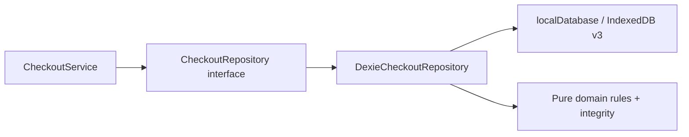
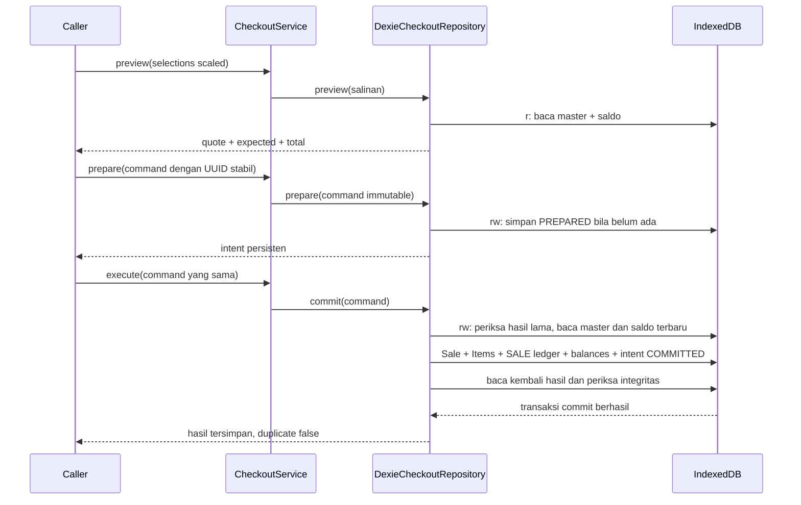

# Fase 4 · Langkah 4.3 — CheckoutService dan transaksi atomik

POS-Zanna / Zanna-Cell. Implementasi dan verifikasi: 21 Oktober 2026.

**Selesai pada lapisan domain/service/repository:** preview, intent persisten, commit tunai atomik, ledger SALE, idempotency, cancel dan recovery. **UI Kasir tetap DEMO** dan tidak mengimpor service checkout nyata. Tidak ada auto-execute saat startup, backend, PostgreSQL, sync, QRIS/Bon nyata, printer, PWA, laporan laba/HPP, commit atau push.

## 1. Audit dan keputusan awal

Repository awal bersih pada branch master, HEAD `f9ccb86` (`feat(checkout): add transaction domain and Dexie v3`). Fondasi 4.2 mempunyai sembilan tabel, 68 tes baseline, validator/kalkulator murni dan kontrak baca; belum ada writer checkout. Domain dan desain aktual diperiksa sebelum perubahan.

Keputusan implementasi:

- Skema tetap **v3**. Tidak diperlukan tabel/index/migrasi baru. Data lama tidak dihapus/reset/diinterpretasikan ulang.
- CheckoutRepository memperluas CheckoutReadRepository. CheckoutService mengorkestrasi kontrak, DexieCheckoutRepository menjadi batas penulisan atomik. React tidak diberi akses writer baru.
- MovementType dan InventoryCommand tetap empat operasi manual. StockMovement menjadi union ManualStockMovement dan SaleStockMovement; SALE mewajibkan saleId/saleItemId, sedangkan histori manual tetap kompatibel.
- Perbandingan expected dilakukan **sebelum** kalkulasi ulang yang bergantung mode/faktor. Perubahan variable→fixed pada jumlah 1,5 atau faktor yang kini tidak sesuai base harus memberi QUOTE_CHANGED, bukan tertutup oleh error kalkulasi baru. Harga null/nonaktif tetap ditolak sebagai master tidak layak jual.
- Setiap SaleItem mendapat satu movement, saldo dasar diperiksa gabungan per productId. Tidak memanggil InventoryService.execute per baris dan tidak memakai ADJUSTMENT_OUT sebagai penjualan.
- getResult/replay memeriksa graph Sale–Item–Intent–Movement tersimpan, tanpa menghitung ulang master atau membandingkan saldo sekarang dengan saldo lama.
- prepare hanya membekukan request yang strukturnya sah; bukan reservasi stok atau janji bahwa master masih valid. execute melakukan pemeriksaan otoritatif.
- Optimisasi dan perbaikan nonkritis dipisahkan dalam [PROJECT-BACKLOG.md](PROJECT-BACKLOG.md); layout premium tidak dirombak.

## 2. Peta source dan dependency

Path relatif terhadap frontend.

| File baru | Simbol dan tanggung jawab |
| --- | --- |
| src/domain/checkoutRepository.ts | Interface CheckoutRepository, tanpa impor Dexie/React |
| src/domain/checkoutIntegrity.ts | conversionSnapshotKey, saleMovementFingerprint, integrityError, validateStoredCheckout |
| src/data/dexieCheckoutRepository.ts | Class DexieCheckoutRepository: scope transaksi, master terbaru, persistensi dan recovery |
| src/services/checkoutOperations.ts | Class CheckoutService: enam metode aplikasi; salinan input sebelum async boundary |
| src/services/checkoutService.ts | Composition root memakai localDatabase singleton; tidak dipanggil UI/startup |
| scripts/checkout-service.test.ts | 36 tes service/repository dengan database emulator bernama acak |
| docs/PHASE-4-3-CHECKOUT-SERVICE.md | Dokumentasi ini |
| docs/PROJECT-BACKLOG.md | Optimisasi/nonkritis yang ditunda |

| File diperbarui | Perubahan |
| --- | --- |
| src/domain/checkout.ts | CheckoutCancellation dan cause pada CheckoutError; kontrak baca dipertahankan |
| src/domain/checkoutRules.ts | copyCheckoutSelections; activeVariant/expectedVariant bersama; guard expected mendahului kalkulasi |
| src/domain/inventory.ts | Union manual/SALE; command manual tidak diperluas |
| src/domain/inventoryRules.ts | Label SALE agar pembaca ledger lama dapat menampilkannya; whitelist mutasi manual tetap |
| src/data/database.ts | Komentar status disesuaikan; schema dan versi tidak berubah |
| package.json | Suite service ditambahkan ke npm test dan test:checkout, tanpa dependency/lockfile baru |
| scripts/checkout-domain.test.ts, scripts/checkout-migration.test.ts | Nama tes lama diperjelas sesuai tahap sekarang; assertion tetap |
| README.md, docs/PHASE-4-1-CHECKOUT-DESIGN.md, docs/PHASE-4-2-DOMAIN-DATABASE.md, docs/INVENTORY-DATA-MODEL.md | Catatan kelanjutan 4.3 dan batas integrasi UI |

Model Sale/SaleItem, command, HALF_UP_LINE_V1, parse/guard/konversi Fase 3–4.2 digunakan kembali. Tidak ada library baru. Source CashierPage/PaymentDialog/CartPanel/provider dan layout tidak diubah.

Factory checkoutService memakai instance database yang sama dengan product/inventory. Mengimpor factory hanya membuat objek service/repository; tidak menyiapkan atau mengeksekusi intent. Saat ini app/features tidak mengimpornya.

## 3. Kontrak metode aktual

Semua metode service async: validation error juga berupa rejected promise, sehingga caller dapat menangani satu pola error.

| Metode CheckoutService | Parameter | Return dan perilaku |
| --- | --- | --- |
| preview | readonly CheckoutSelection[] (`variantId`, quantity scaled) | Promise CheckoutQuote dari satu transaksi baca master+balance; tanpa write |
| prepare | CheckoutCommand | Promise CheckoutIntent persisten; request sama mengembalikan intent sama, termasuk COMMITTED; CANCELLED ditolak |
| execute | CheckoutCommand | Promise CheckoutResult (`sale`, `items`, `duplicate`); mendelegasikan repository.commit |
| getResult | checkoutOperationId UUID | Promise CheckoutResult atau null; membaca snapshot konsisten; duplicate true karena hasil sudah tersimpan |
| listUnresolved | tanpa parameter | Promise readonly CheckoutIntent[] berstatus PREPARED, urut createdAt/ID; tidak auto-execute |
| cancel | checkoutOperationId UUID | Promise CheckoutCancellation: status CANCELLED + intent, atau COMMITTED + result bila penjualan sudah commit |

Repository mengimplementasikan preview/prepare/**commit**/getResult/listUnresolved/cancel. Tambahan getIntent adalah kontrak baca 4.2: membaca intent setelah memeriksa konsistensi operasi. Nama execute dipakai pada service, commit pada adapter agar batas transaksi jelas.

Input preview disalin oleh copyCheckoutSelections. prepare/execute memakai copyCheckoutCommand di service **dan** repository, sehingga akses langsung adapter tetap terlindungi dari perubahan object pemanggil ketika promise sedang berjalan. Salinan memuat field yang diizinkan, array/baris/expected di-freeze. Data hasil IndexedDB merupakan hasil baca baru, bukan referensi React.

## 4. Alur dari command sampai commit

UUID checkout dibuat caller untuk satu intent, tidak dibuat ulang service ketika error. preview tidak menjamin stok tersedia selamanya. Caller harus meminta konfirmasi terhadap quote sebelum prepare/execute. Pada tahap 4.3 caller hanya digunakan oleh tests/lapisan aplikasi; UI nyata belum dihubungkan.

Di dalam commit:

1. copyCheckoutCommand memeriksa struktur, CASH, integer uang/jumlah, expected dan UUID.
2. Mulai satu transaksi **rw sembilan tabel**.
3. operationState mencari Sale/intent lama. Hasil committed valid diperiksa dan dikembalikan sebelum membaca master sekarang. Payload beda ditolak.
4. Belum ada hasil: intent wajib PREPARED dengan fingerprint sama; CANCELLED tidak boleh dijalankan.
5. context membaca products/categories/units/variants/inventoryBalances dalam transaksi yang sama.
6. validateCheckoutAgainstSnapshot memeriksa aktif, harga null, expected, policy, mode/faktor, kebutuhan stok bersama, total, serta uang diterima. Stok tidak boleh negatif dan quantityBase tidak dibulatkan.
7. Buat Sale, SaleItem dan movement dengan UUID masing-masing. validateSale dan validateStoredCheckout memeriksa rencana sebelum penulisan.
8. Tulis Sale → semua SaleItem → semua movement → balance akhir tiap produk → intent COMMITTED.
9. Baca kembali nilai yang benar-benar tersimpan melalui operationState. Kegagalan/ketidakcocokan harus abort, bukan menghasilkan respons sintetis.
10. Promise transaksi berhasil hanya setelah commit. Hasil awal duplicate false; hasil baca/replay duplicate true.

Tidak ada fetch, timer, printer, dialog atau state UI di callback transaksi. createUuid, Date.now, aritmetika dan request IndexedDB lokal tidak memperkenalkan network wait. context memakai Promise.all untuk request database di transaksi aktif.

## 5. Atomicity, isolation, dan rollback

Scope commit: products, categories, units, variants, inventoryBalances, sales, saleItems, stockMovements, checkoutIntents. Baca master dan hitung saldo dilakukan di scope ini, bukan di React sebelum transaksi. Tidak ada transaksi mandiri per baris.

Jika item kedua gagal, Sale dan item pertama ikut batal. Jika ledger/balance/intent gagal, seluruh efek bisnis juga batal. Error dibiarkan keluar dari callback; safely memetakan error setelah transaksi berakhir. Intent PREPARED dibuat pada transaksi sebelumnya dan boleh tetap ada untuk recovery. Tidak ada Sale FAILED/DRAFT parsial yang menjadi pendapatan.

Transaksi dengan object store bersinggungan diserialkan secara lokal oleh IndexedDB. Dua checkout dari koneksi berbeda tidak boleh membaca saldo sama lalu saling menimpa. Checkout dan inventory manual berbagi store balance/ledger; checkout dan edit master berbagi master stores. Cancel dan commit berbagi intent/sales/ledger/items. Ini jaminan untuk database/origin lokal yang sama, bukan koordinasi server/perangkat berbeda.

Durability tetap mengikuti penyimpanan browser. Tes reopen tidak membuktikan ketahanan terhadap kehilangan listrik, eviction atau penghapusan site data. Tidak ada backend/backup baru.

## 6. Snapshot, ledger dan contoh warung

Sale berstatus COMPLETED/CASH, integer Rupiah, operatorId null. SaleItem memakai snapshot nama/unit/faktor/harga dari master yang dibaca dalam commit. Nomor struk tetap `ZC-YYYYMMDD-UUID_Sale_lengkap`, tanggal UTC, unik lewat indeks. Bukan count(sales)+1. Benturan struk/primary key membatalkan transaksi, tidak menimpa penjualan lama.

StockMovement sekarang:

- ManualStockMovement tetap OPENING_BALANCE/STOCK_IN/ADJUSTMENT_IN/ADJUSTMENT_OUT.
- SaleStockMovement bertipe SALE dengan saleId/saleItemId wajib. Setiap movement memiliki id dan operationId UUID tersendiri, berbeda dari checkoutOperationId.
- inputQuantity adalah quantity scaled dalam satuan jual. quantityDeltaBase = −SaleItem.quantityBase. Snapshot konversinya sama dengan item, before + delta = after.
- reason mengacu pada nomor struk; createdBy null. Waktu movement bertambah per position agar urutan ledger before/after jelas.
- initializedAt saldo tidak berubah. updatedAt saldo mengikuti movement terakhir produk dalam Sale.

**Solar:** 1,5 L × Rp13.000 = Rp19.500. Tunai Rp20.000 ⇒ kembalian Rp500. Jika saldo awal 100 L (100000 scaled base Liter), saldo akhir 98,5 L (98500). Pada base ml, skala konversi Fase 3 tetap dipakai. Tidak ada kapasitas jeriken atau harga bensin yang ditebak.

**Bensin bersama:** stok 10 L, jual botol 1 L, 1,5 L dan 5 L masing-masing satu. Tiga SaleItem, satu saldo Product; movement membentuk 10→9→7,5→2,5 L. Gabungan 11 L ditolak walaupun setiap varian sendiri tampak cukup.

**Harga pecahan:** Rp12.500/L × 0,001 L menghasilkan Rp13 menurut HALF_UP_LINE_V1; quantityBase tetap 0,001 L tepat. Harga null ditolak; harga Rp0 yang secara eksplisit ditetapkan tetap sah.

Aturan policy Fase 3 tetap berlaku: fuel wajib VOLUME, kemasan hanya Botol/Jeriken yang diizinkan. Memalsukan expected agar mengikuti master Sachet yang tidak sah tetap ditolak domain. InventoryService.execute manual tidak dapat menerima SALE; penjualan tidak disamarkan sebagai koreksi.

## 7. Idempotency dan pemeriksaan integritas hasil

Fingerprint command tetap dari checkoutFingerprint 4.2: field canonical dengan urutan tetap, mencakup versi/metode/tunai/total/baris/expected. Urutan properti object tidak berpengaruh; urutan baris merupakan bagian intent.

saleMovementFingerprint membuat serialisasi deterministik dari versi fingerprint, fingerprint Sale, saleId, saleItemId, position, productId, variantId, quantity dan quantityBase. Tidak memakai Math.random, waktu sekarang, atau master terbaru untuk membangun ulang fingerprint saat replay. conversionSnapshotKey membandingkan snapshot melalui field baku, bukan urutan properti bebas. Fingerprint bukan tanda tangan keamanan.

| Keadaan | Hasil |
| --- | --- |
| ID sama, payload sama, PREPARED | Prepare mengembalikan intent; execute boleh dilanjutkan eksplisit |
| ID sama, payload sama, committed valid | Sale/items/receipt lama, duplicate true, tanpa write stok |
| ID sama, payload berbeda | OPERATION_PAYLOAD_MISMATCH |
| CANCELLED | INTENT_CANCELLED; tidak menghidupkan intent lama |
| COMMITTED tanpa Sale valid | INTEGRITY_ERROR; tidak membuat Sale pengganti |
| Dua ID berbeda dengan isi sama | Dua permintaan berbeda; masing-masing harus lolos stok |

validateStoredCheckout memeriksa intent/fingerprint/status, Sale/SaleItem dan jumlah baris, harga/quantity/unit/faktor sesuai command, satu movement per item, UUID operasi unik, snapshot movement, tanda delta, chain before/after, waktu dan referensi struk. Sale tanpa intent, item rusak, atau ledger rusak ditolak.

getResult tidak membaca master saat ini atau membandingkan balance saat ini dengan saldo akhir penjualan lama. Stok dapat sah berubah oleh barang masuk/koreksi sesudah penjualan. Ini menghindari false alarm dan menjaga receipt tidak berubah saat master diedit.

Pemeriksaan ini melindungi konsistensi aplikasi, bukan audit kriptografis atau pemeriksaan seluruh database dari manipulasi DevTools. listUnresolved hanya memeriksa intent PREPARED yang ditanyakan; bukan global corruption scan.

## 8. Recovery, cancel dan status uncertain

Service/repository tidak mempunyai UI status success/processing. Keberhasilan berasal dari promise commit atau hasil persisted yang tervalidasi. Caller 4.4 kelak harus memetakan status ke UI.

| Situasi | Cara menanganinya |
| --- | --- |
| Prepare berhasil, browser ditutup sebelum execute | Setelah reopen, listUnresolved memberi command/ID yang sama; lanjut hanya atas keputusan kasir |
| Execute sudah commit, respons hilang | getResult(ID yang sama) membaca hasil; jangan membuat UUID baru |
| Transaksi gagal sebelum commit | Tidak ada Sale/balance/ledger parsial; PREPARED tetap tersedia; retry payload sama atau cancel untuk edit |
| Storage error dan DB belum dapat dibaca | Status belum dapat dipastikan. Pertahankan ID; jangan menyimpulkan gagal lalu menjual ulang dengan ID baru |
| getResult null | Pada snapshot baca konsisten belum ada Sale untuk ID tersebut; intent PREPARED dapat dicek/list untuk tindakan eksplisit |
| Data committed tidak utuh | INTEGRITY_ERROR dan review; jangan membangun ulang Sale dari master |

getResult memakai satu transaksi r pada sales/saleItems/checkoutIntents/stockMovements yang scope-nya beririsan dengan commit. Pembacaan menunggu transaksi relevan yang sudah berjalan; tidak membaca Sale sebelum item/ledger commit terpisah karena semua merupakan satu unit.

cancel memakai rw pada store hasil tersebut. Jika cancel menang, intent menjadi CANCELLED dan execute berikutnya ditolak. Jika execute menang, cancel mengembalikan COMMITTED + hasil; tidak menghapus Sale atau mengembalikan stok. Cancel berulang pada CANCELLED idempoten. Pembatalan/retur penjualan committed bukan cakupan cancel intent ini.

**Kebutuhan integrasi 4.4:** simpan penunjuk checkoutOperationId aktif secara tahan-refresh per tab sebelum mengeksekusi, bekukan command/tunai/cart selama proses atau uncertain, lalu periksa hasil ID itu saat reload. Engine menyimpan intent, tetapi belum memilih intent aktif untuk UI. listUnresolved tidak menampilkan intent COMMITTED; penunjuk aktif atau navigasi transaksi nanti diperlukan untuk mengidentifikasi keberhasilan yang responsnya hilang.

Tidak ada auto-execute saat constructor/factory/app dibuka. Cart RAM yang belum menjadi intent belum dipersistenkan. Storage antar-origin/perangkat tidak dibagikan.

## 9. Error handling dan keputusan teknis

- Kesalahan bisnis tetap CheckoutError dengan code asli: INVALID_REQUEST, CASH_INSUFFICIENT, PRODUCT_UNAVAILABLE, POLICY_REVIEW_REQUIRED, QUOTE_CHANGED, STOCK_NOT_INITIALIZED, INSUFFICIENT_STOCK, OPERATION_PAYLOAD_MISMATCH, INTENT_REQUIRED, INTENT_CANCELLED.
- Validator pada data tersimpan dipetakan ke INTEGRITY_ERROR, bukan dianggap request baru yang boleh mengganti penjualan lama.
- Kegagalan Dexie/constraint/hook/akses storage dipetakan ke STORAGE_ERROR dengan cause asli; tidak menulis log payload atau kredensial. Caller memeriksa getResult untuk memastikan hasil bila respons tidak jelas.
- prepare tidak memeriksa master secara otoritatif; sifatnya immutable intent, bukan reservasi. preview memberi feedback; execute tetap membaca ulang.
- Pemeriksaan expected yang sebelumnya berada sesudah kalkulasi diperbaiki agar mode/faktor berubah menghasilkan QUOTE_CHANGED. Integrasi baru membuktikan kasus variable 1,5→fixed serta faktor lama berubah.
- Typecheck awal menemukan cancel belum mempersempit union status sebelum membuat CANCELLED. Guard PREPARED eksplisit ditambahkan; tidak memakai cast untuk menghilangkan kewajiban integritas.
- Nomor struk/UUID collision tidak di-retry otomatis. Seluruh transaksi abort, ID intent dipertahankan; getResult dan retry eksplisit menentukan langkah berikutnya.
- Tidak ada perubahan UI/revisi visual; optimisasi query/chunk ditunda sesuai prioritas pengguna.

## 10. Pengujian dan hasil verifikasi

36 tes baru pada checkout-service.test.ts:

| Kelompok | Skenario dan alasan |
| --- | --- |
| Berhasil | Preview tanpa write, prepare persisten/idempoten, Solar tunai/kembalian, multi-product, varian bensin bersama, HALF_UP dan harga Rp0: memastikan output dan seluruh efek bisnis cocok |
| Ditolak | Empty/QRIS/Bon/amount salah, cash insufficient, master nonaktif/null/policy invalid, expected berubah, Solar Sachet, uninitialized/stock bersama kurang, payload konflik, CANCELLED: menjaga uang/stok sebelum write |
| Fault injection | creating SaleItem posisi kedua, creating StockMovement, updating InventoryBalance, updating CheckoutIntent: bandingkan **semua sembilan tabel** sebelum/selepas kegagalan; PREPARED tetap dan retry berhasil |
| Concurrency dua koneksi | Prepare/execute ID sama; dua intent memperebutkan stok; checkout vs koreksi; checkout vs edit master; cancel vs execute: menguji serialisasi nyata di emulator, bukan sekadar disabled button |
| Recovery | Prepare/reopen tanpa auto-execute; commit/reopen; replay/getResult setelah master berubah; listUnresolved; saldo sah berubah setelah Sale: hasil historis tetap stabil |
| Integritas | COMMITTED tanpa Sale, item/movement/intent rusak, payload dimutasi saat promise, benturan receipt: jangan membuat Sale pengganti atau menimpa keberhasilan lama |

Fixture memakai database fake-indexeddb bernama acak. Mutasi/raw corruption dan cleanup db.delete hanya terjadi pada emulator tersebut. Tidak ada penjualan tes atau koreksi yang ditulis ke database browser pengguna.

Hasil dijalankan dari frontend:

| Perintah | Hasil |
| --- | --- |
| npm run lint | Lulus, exit 0 |
| npm run typecheck | App, konfigurasi Vite, tests lulus, exit 0 |
| npm test | **104 lulus, 0 gagal, 0 skipped**; 68 baseline + 36 service tests |
| npm run test:inventory | **24 lulus, 0 gagal** |
| npm run test:checkout | **60 lulus, 0 gagal**; domain/migration/service |
| npm run build | Lulus; JS **508,18 kB**, gzip 154,31 kB; CSS 38,38 kB |

Warning build: chunk utama >500 kB masih ada, dicatat di backlog. Threshold tidak dinaikkan dan routing tidak dirombak. Semua assertion regresi sebelumnya tetap, termasuk CRUD/barcode, hardening BBM, v1/v2→v3, serta DOM Kasir DEMO/drawer. Pengujian otomatis ini tidak menggantikan browser/tablet nyata atau simulasi mati listrik.

## 11. Materi dan latihan setelah website selesai

1. **Telusuri Solar:** baca tes Solar, ikuti command → prepare → commit → validateStoredCheckout. Catat perbedaan quantity/inputQuantity/quantityBase dan jumlah uang. Hasil yang diharapkan Rp19.500, change Rp500 dan stok turun tepat 1,5 L.
2. **Buktikan rollback:** baca hook failItem pada posisi 2 dan snapshot sembilan tabel. Jalankan npm run test:checkout, pastikan tes fault injection lulus. Pelajari mengapa intent PREPARED boleh tersisa tetapi Sale/item pertama tidak.
3. **Pelajari idempotency:** bandingkan eksekusi pertama dan replay. Periksa ID Sale/Item/receipt serta snapshot tabel. Ubah cashReceived pada object tes dengan ID yang sama: hasil yang diharapkan OPERATION_PAYLOAD_MISMATCH, bukan penjualan kedua.
4. **Pelajari concurrency:** baca tes 4 L dari stok 5 L dan cancel-versus-execute. Jangan mengasumsikan urutan Promise.all adalah urutan commit; invariant harus benar untuk pemenang mana pun.
5. **Pelajari recovery/integritas:** baca tes reopen dan corruption fixture. Bedakan null, COMMITTED tervalidasi, STORAGE_ERROR/uncertain dan INTEGRITY_ERROR. Jangan mempraktikkan corruption fixture melalui DevTools pada data toko.

Untuk memeriksa data browser sekarang, buka origin yang sama → DevTools Application → IndexedDB → zanna-cell-db. Tabel tetap sembilan; menggunakan Kasir DEMO tidak boleh menambah Sale/SALE/intent. Jangan menjalankan contoh engine pada database toko hanya untuk belajar; gunakan tests terisolasi. Saat UI 4.4 tersedia, checklist tunai/double-click/reload/receipt/tablet akan diuji manual secara khusus.

## 12. Batas fase dan kesiapan 4.4

Engine siap dipakai integrasi UI setelah evaluasi pengguna. Tidak ada bug kritis transaksi yang masih diketahui dari skenario otomatis yang dijalankan. Ini tidak meniadakan kebutuhan validasi browser/storage nyata, terutama quota/error, refresh dan dua tab. Kesalahan data historis tetap membutuhkan review pemilik, bukan perbaikan otomatis.

Pekerjaan berikutnya **belum dijalankan**: hook UI checkout, modal tunai nyata/receipt, penunjuk operasi aktif tahan-refresh, freeze/clear cart setelah commit yang cocok, dan pemisahan QRIS/Bon DEMO. [Backlog](PROJECT-BACKLOG.md) mencatat optimisasi terpisah agar tidak menahan roadmap inti.

Berhenti setelah 4.3 dan tunggu evaluasi. **Setelah hasil tervalidasi dan disetujui, lakukan commit dan push ke GitHub.** Agen tidak membuat commit/push otomatis.
