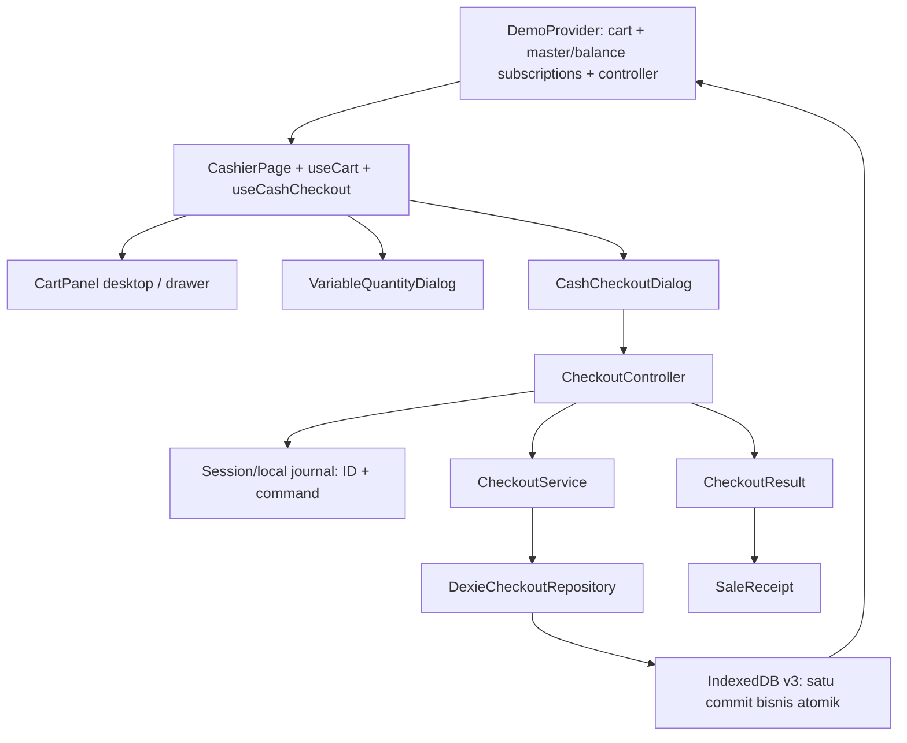
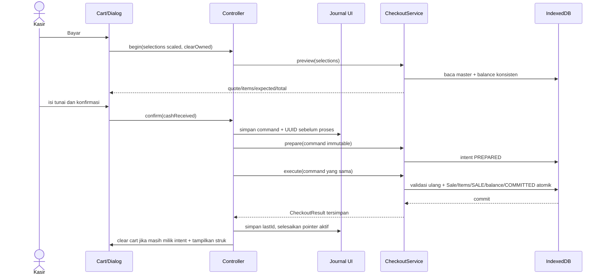

# Fase 4 · Langkah 4.4 — Integrasi checkout tunai nyata ke UI Kasir

Implementasi: 21 Oktober 2026. POS-Zanna / Zanna-Cell. Baca bersama [desain 4.1](PHASE-4-1-CHECKOUT-DESIGN.md), [domain/database 4.2](PHASE-4-2-DOMAIN-DATABASE.md), [engine 4.3](PHASE-4-3-CHECKOUT-SERVICE.md), dan [backlog](PROJECT-BACKLOG.md).

**Kelanjutan 4.5 (22 Oktober 2026):** [Riwayat Penjualan dan struk hanya-baca](PHASE-4-5-SALES-HISTORY.md) kini tersedia. Batas di bawah yang menyatakan belum ada pencarian seluruh Sale bersifat historis 4.4 dan sudah diselesaikan pada 4.5. Pengguna melaporkan checkout bensin/produk lain telah diuji manual; agen tidak mengklaim melakukan pengujian manual itu. Validasi browser/tablet untuk riwayat 4.5 masih pending.

**Sudah berfungsi:** UI checkout CASH, preview otoritatif, input tunai/kembalian, fixed/variable quantity, commit atomik melalui service, struk snapshot, perlindungan klik ganda, pembatalan intent, recovery refresh dan jurnal setelah tab ditutup. QRIS dan Bon DEMO dinonaktifkan. Dashboard/laporan tetap sampel. Tidak ada implementasi Fase 4.5, backend, PostgreSQL, sync, PWA, printer, retur, HPP, commit atau push.

## 1. Audit aktual dan keputusan

Baseline sebelum perubahan: 104 automated tests, termasuk 24 inventory dan 60 domain/migration/service checkout. UI Kasir memakai PaymentDialog bertimer 700 ms dan menganggap success sebagai simulasi. Cart berada di DemoProvider; master dan balance berasal dari subscription Dexie. Layout desktop dua panel dan drawer pada lebar <1024 px dipertahankan.

API aktual CheckoutService adalah preview/prepare/execute/getResult/listUnresolved/cancel. Repository memakai nama commit untuk writer atomik; UI tidak boleh mengasumsikan service.commit/saveSale. Quote service sudah mempunyai items snapshot, expected lines dan total. Domain siap untuk quantity variable dengan policy satuan yang sah; tidak perlu mengubah engine atau schema v3.

Keputusan penting:

- Controller terpisah mengurus workflow async; state bukan timer keberhasilan. useSyncExternalStore menghubungkannya ke React tanpa library baru.
- Controller dimiliki satu instance DemoProvider agar berpindah rute operasional tidak membuat checkout kedua atau kehilangan proses yang sedang berjalan.
- React hanya memanggil CheckoutService. Tidak ada Table.add/put/delete atau penulisan balance dari komponen/hook.
- Katalog/cart memberi feedback awal. Preview membaca IndexedDB; execute tetap menjadi pemeriksaan otoritatif harga, policy dan stok dalam transaksi atomik.
- Identitas cart dibedakan dari isi cart. Array baru dengan barang/jumlah sama tetap belanja baru, sehingga tidak boleh dihapus oleh hasil lama.
- Recovery tidak otomatis menjalankan penjualan. Pembacaan hasil boleh berjalan saat startup; prepare/execute baru terjadi setelah tindakan eksplisit.
- Jurnal session saja tidak cukup setelah tab ditutup. Penunjuk durable per operasi di localStorage dibuat sebelum prepare; ini metadata pemulihan UI, bukan database penjualan kedua atau antrean sinkronisasi.

## 2. Peta file aktual

Path relatif terhadap frontend.

| File baru | Fungsi/tanggung jawab |
| --- | --- |
| src/features/cashier/checkoutController.ts | CheckoutController, CashState/CashStatus, CheckoutClient; workflow dan guard sinkron |
| src/features/cashier/checkoutSession.ts | browserCheckoutSession; validasi/read/write journal, pending, resolve, konstanta key |
| src/features/cashier/checkoutCart.ts | scaledCartQuantity dan cartSelections; adapter jumlah UI ke domain |
| src/features/cashier/useCashCheckout.ts | Subscription React dan boot controller |
| src/features/cashier/CashCheckoutDialog.tsx | Preview, input tunai, status, tindakan recovery/koreksi dan receipt |
| src/features/cashier/SaleReceipt.tsx | Presentasi CheckoutResult tersimpan; tidak membaca katalog |
| src/features/cashier/VariableQuantityDialog.tsx | Form jumlah volume/berat dengan parser presisi dan feedback stok/konversi |
| scripts/checkout-ui.test.tsx | 29 integrasi DOM + service + IndexedDB emulator |
| docs/PHASE-4-4-CASHIER-INTEGRATION.md | Panduan ini |

| File diubah | Alasan |
| --- | --- |
| src/app/DemoProvider.tsx, demoContext.ts | Memiliki controller; service/session dapat diinjeksi untuk tes; subscription lama tetap |
| src/features/cashier/CashierPage.tsx | Membuka tunai nyata, recovery/struk terakhir, input variable; mempertahankan breakpoint/drawer |
| src/features/cashier/CartPanel.tsx | Kontrol locked, alasan baris invalid, QRIS/Bon disabled dan label tunai lokal |
| src/features/cashier/useCart.ts | Guard mutasi dan clearOwned dengan pembandingan referensi array |
| src/features/cashier/cartLogic.ts | Domain math/konversi dipakai ulang; mendukung decimal variable; baris hilang tetap tampil |
| src/features/cashier/ProductCard.tsx | Membuka form jumlah aktual; fixed tetap tombol tambah |
| src/features/cashier/PaymentDialog.tsx | Legacy simulasi hanya menerima QRIS/Bon pada tipe; tidak diimpor CashierPage |
| src/services/catalogRepository.ts, src/types/pos.ts | Read model conversion dan kapasitas variable tanpa floor kemasan |
| src/components/layout/AppLayout.tsx, OperationalLayout.tsx | Label aplikasi sesuai tunai nyata; tidak mengubah struktur layout |
| src/features/home/HomePage.tsx, dashboard/DashboardPage.tsx, settings/SettingsPage.tsx | Perjelas tunai nyata versus laporan/halaman contoh |
| src/features/stock/StockPage.tsx, products/ProductsPage.tsx, products/ProductForm.tsx | Koreksi teks lama yang menyatakan Kasir tidak mengurangi stok atau variable belum tersedia; logika Fase 3 tidak diubah |
| scripts/cart-ui.test.tsx | Regresi empat viewport kini menguji pembayaran nyata dengan service DB tes |
| scripts/demo-logic.test.mjs | Impor cartLogic melalui tsx agar dependency domain asli teruji; assertion lama tetap |
| package.json | Tambah checkout-ui ke npm test dan perintah test:checkout-ui; tanpa dependency baru |
| README.md, docs/PROJECT-BACKLOG.md, docs/PHASE-4-3-CHECKOUT-SERVICE.md | Status terbaru, batas, manual pending dan temuan nonkritis |

Schema, Sale/SaleItem, engine CheckoutService, adapter DexieCheckoutRepository dan aturan inventory Fase 3 tidak diubah pada langkah ini. Tidak ada package-lock/dependency baru.

## 3. Arsitektur komponen dan alur data



DemoProvider masih bernama historis; namanya tidak berarti semua datanya simulasi. Provider sekarang menggabungkan state interaksi cart, read model produk/persediaan lokal dan controller checkout. Renaming lintas aplikasi ditunda agar tidak memperbesar perubahan.



Subscription inventory yang sudah ada membaca balance terbaru setelah commit. UI tidak mengurangi stockBase secara optimistis dan tidak memanggil InventoryService per baris. Tidak ada perhitungan penjualan kedua di React yang mengganti hasil execute.

## 4. State dan hooks

CashState mempunyai status, open, busy, ready, quote, command, result, unresolved, message dan code. Nama status:

| Status | Makna/tindakan |
| --- | --- |
| editing | Preview tersedia; kasir dapat mengisi tunai. Tombol hanya aktif bila uang sah |
| preparing | Command sudah dipilih; jurnal ditulis dan prepare berlangsung |
| processing | Intent dipersiapkan; execute sedang menulis atomik |
| success | execute atau getResult/cancel mengonfirmasi CheckoutResult tersimpan; struk boleh ditampilkan |
| rejected | Error bisnis atau hasil baca belum menemukan Sale; koreksi harus membatalkan intent lama terlebih dahulu, atau lanjutkan payload sama secara eksplisit |
| uncertain | Storage/integrity tidak bisa memastikan hasil. Pertahankan ID/command; blok checkout baru dan penutupan modal; periksa kembali |

busy adalah guard segera, bukan menunggu render React. Contohnya, confirm mengubah state menjadi preparing sebelum await pertama, sehingga tiga click dalam event turn yang sama hanya memulai satu request. ready false memblokir checkout sebelum audit startup selesai. locked juga true selama ada command atau uncertain.

useCashCheckout berlangganan controller dengan useSyncExternalStore. useEffect memanggil boot sekali per instance; guard started mencegah efek ganda pada StrictMode. Controller terus hidup selama provider operasional ada, termasuk ketika halaman Kasir dilepas karena navigasi rute. boot/check hanya melakukan read/recovery, bukan execute.

useCart tetap menyimpan CartLine[] pada provider. Handler menolak add/change/remove/clear ketika controller locked. Kontrol UI juga dinonaktifkan. Modal native menjaga interaksi latar ketika preview sedang ditinjau. Payload command disalin mendalam dan di-freeze dengan copyCheckoutCommand, terpisah dari form/cart.

**clearOwned:** saat mulai checkout, hook menangkap referensi array cart. Setelah sukses ia menjalankan `setCart(items => items === capturedCart ? [] : items)`. Cart baru dengan isi identik tidak sama referensinya. Recovery dari startup atau pilihan intent lama tidak memasang callback clear untuk cart yang sekarang. Jadi transaksi lama tidak menghapus belanja baru.

## 5. Kontrak fungsi UI dan service

| Fungsi controller | Parameter → efek |
| --- | --- |
| boot | tanpa parameter → startup check sekali |
| begin | readonly CheckoutSelection[], callback clearOwned → preview otoritatif, buka dialog |
| confirm | cashReceived integer Rupiah → validasi change, satu UUID, journal, prepare, execute |
| refreshQuote | tanpa parameter, hanya tanpa command/uncertain → preview ulang selections; perlu konfirmasi lagi |
| check | tanpa parameter → baca journal/pointer, getResult, pending durable dan listUnresolved; tidak execute |
| resume | tanpa parameter → simpan kembali command yang sama, prepare/execute atas tindakan kasir |
| select | recoverable checkout berisi ID+command → pilih/persist pointer dan periksa hasil ID itu |
| cancel | tanpa parameter → cek hasil lalu cancel intent; Sale committed ditampilkan, tidak dibatalkan |
| close | tanpa parameter → hanya menutup bila tidak busy, command, atau uncertain |
| reopenReceipt | tanpa parameter → tampilkan hasil tersimpan terakhir yang tersedia |

Metode async mengembalikan Promise<void> dan memperbarui CashState. UI tidak perlu menangkap storage exception sendiri untuk membuat status berhasil.

Service yang dipanggil tetap kontrak 4.3:

```ts
preview(selections)       // Promise<CheckoutQuote>, tanpa write
prepare(command)         // Promise<CheckoutIntent>, bukan reservasi stok
execute(command)         // Promise<CheckoutResult>, commit atomik
getResult(operationId)   // Promise<CheckoutResult | null>
listUnresolved()         // Promise<readonly CheckoutIntent[]>, PREPARED
cancel(operationId)      // CANCELLED+intent atau COMMITTED+result
```

CheckoutClient adalah Pick enam metode tersebut, bukan implementasi backend. Default provider memakai checkoutService singleton yang sudah ada. Pada tes, provider menerima service dari DB emulator yang sama dengan repository/inventory. Tidak ada koneksi React ke PostgreSQL.

## 6. Scaled quantity, policy dan harga

CartLine.quantity tetap satuan jual yang terlihat kasir. Fixed harus bilangan bulat; variable boleh decimal hingga tiga angka. Adapter eksplisit:

```ts
scaledCartQuantity(2, 'fixed')     // 2000: dua botol
scaledCartQuantity(1.5, 'variable') // 1500: 1,5 Liter jika unit jual Liter
cartSelections(cart, products)    // [{ variantId, quantity: scaled }]
```

Fixed memakai scaleFixedQuantity. Variable memakai parser decimal parseQuantity, bukan perkalian bebas dan pembulatan diam-diam. Form menerima koma atau titik decimal; `1,2345`, negatif, kosong dan notasi eksponen ditolak. Jangan memasukkan 1500 ke CartLine untuk maksud 1,5 L; 1500 scaled hanya berada di request domain.

Saldo produk tetap scaled dalam satuan dasar. Contoh botol berisi 1,5 L: cart.quantity=2 → request.quantity=2000 satuan jual Botol → quantityBase=3000 dalam dasar Liter. Solar variable 1,5 L → 1500 scaled jual dan 1500 scaled dasar Liter. Jika dasar ml, hasil dasar mengikuti konversi domain, bukan angka Liter yang disalin begitu saja.

ProjectCatalog memasok ConversionSnapshot untuk feedback keranjang. cartLogic memanggil convertInventoryQuantity untuk kebutuhan stok bersama dan calculateLineTotal/sumLineTotals untuk harga. Keputusan akhir tetap calculateCheckoutQuote/validateCheckoutAgainstSnapshot di engine dengan master+balance dalam transaksi. Tidak ada rumus pengurangan stok lain di komponen.

Variable hanya untuk satuan berat/volume yang kompatibel. Varian kemasan/count tidak dapat diperlakukan sebagai 0,5 botol. validateVariantUnit/unitPolicy lama tetap berlaku; BBM tidak diizinkan memakai Sachet/Bungkus. Input harus menghasilkan konversi dasar yang tepat; presisi yang tidak bisa disimpan ditolak, bukan dibulatkan.

Harga mengikuti HALF_UP_LINE_V1: bulatkan integer Rupiah per baris lalu jumlahkan. UI subtotal awal hanya estimasi dari read model; dialog menggunakan quote service. Input uang memakai parseWholeAmount dan calculateChange yang sama dengan domain. Nilai Rp0 eksplisit tetap sah; harga null tetap tidak dapat dijual. Maksimal uang domain Rp1 miliar.

## 7. Error bisnis dan koreksi

- QUOTE_CHANGED: harga/faktor/mode/versi master berubah sejak preview. Cart tidak dihapus. Batalkan intent lama, pilih Tinjau ulang harga dan stok, baca quote baru lalu konfirmasi kembali. Tidak mengganti expected secara diam-diam.
- INSUFFICIENT_STOCK/STOCK_NOT_INITIALIZED: stok bersama tidak cukup/belum diatur. Pertahankan cart; batalkan intent untuk koreksi jumlah atau atur stok yang benar pada halaman Stok.
- PRODUCT_UNAVAILABLE/POLICY_REVIEW_REQUIRED/INVALID_REQUEST: review master/satuan/jumlah. Baris yang hilang dari projection tetap ditampilkan sebagai varian tidak tersedia dengan alasan; tidak dikeluarkan diam-diam dari quote.
- CASH_INSUFFICIENT: tombol pembayaran dinonaktifkan untuk input kurang/invalid. Engine tetap memvalidasi ulang uang.
- OPERATION_PAYLOAD_MISMATCH/INTENT_CANCELLED: jangan hidupkan ulang ID dengan payload baru. Pilih pembatalan/koreksi yang sesuai; service tetap menjaga intent immutable.
- STORAGE_ERROR/INTEGRITY_ERROR/error tak dikenal: uncertain, tidak menampilkan stack trace atau menganggap pasti gagal. ID dan payload tetap sama sampai pemeriksaan berhasil.

Kode bisnis ditampilkan bersama pesan Indonesia agar kasir dapat melaporkan masalah. Tidak ada error yang membuat UI menghapus transaksi/intent atau memberi stok balik secara manual.

## 8. Journal, refresh, penutupan tab dan uncertain

Tiga key browser yang dipakai:

| Penyimpanan | Key | Isi |
| --- | --- | --- |
| sessionStorage | zanna-cell.checkout.v1 | active command per tab dan lastId |
| localStorage | zanna-cell.checkout.recovery.v1.<operation UUID> | Command immutable untuk operasi yang hasilnya belum diselesaikan UI |
| localStorage | zanna-cell.checkout.last-receipt.v1 | ID checkout terakhir yang hasilnya sudah diketahui UI |

write menyimpan durable command lebih dahulu, kemudian penunjuk tab. Jika salah satunya gagal, prepare/execute tidak dilanjutkan. Setelah hasil Sale terverifikasi, UI menyimpan lastId dan boleh menyelesaikan pointer durable melalui resolve. **resolve hanya menghapus metadata recovery UI, tidak pernah menghapus CheckoutIntent/Sale/ledger dari IndexedDB.**

Setiap operasi memiliki key sendiri, sehingga dua tab tidak perlu mengubah bersama satu array JSON berisi semua operasi. Jurnal bukan data penjualan otoritatif, bukan sync outbox, bukan worker, dan tidak otomatis mengeksekusi payload apa pun.

Startup check:

1. Validasi/read session pointer; jika tab baru, baca last receipt ID durable.
2. Jika ada ID aktif, getResult(ID). Jika tidak, hasil terakhir boleh ditampilkan.
3. Gabungkan pending durable dengan listUnresolved dari IndexedDB, deduplikasi berdasarkan ID.
4. Hasil committed → tampilkan snapshot lama. PREPARED atau journal tanpa hasil → pilihan eksplisit periksa/lanjut/batal. Bukan auto-execute.
5. Tab yang ditutup setelah commit tetapi sebelum UI selesai masih meninggalkan durable command. Di tab baru, tombol Pulihkan intent memeriksa ID tersebut dan menemukan Sale lama, tanpa write ulang.
6. Jika storage tidak bisa dibaca atau data pointer rusak → uncertain dan blok checkout. Jangan menimpa pointer rusak untuk membuka akses pembayaran.

Sesudah execute melempar storage error, tombol Periksa hasil transaksi memakai ID lama. Jika Sale ditemukan, tampilkan success/receipt. Jika getResult null dan daftar intent dapat dibaca, tampilkan belum ada Sale pada snapshot baca itu; kasir boleh melanjutkan payload sama atau membatalkan. Null tidak berarti request tertunda di tab lain mustahil commit nanti; idempotency/cancel serial engine tetap menjaga hasilnya.

Cancel lebih dahulu membaca getResult, lalu memanggil cancel. Jika commit menang, kembalikan struk, bukan undo stok. Bila intent belum pernah tersimpan (jurnal sudah dibuat tetapi prepare belum selesai), UI menyiapkan command yang sama lalu cancel untuk membuat CANCELLED persisten. Ini mencegah prepare terlambat dari tab lain menghidupkan ID yang sudah dibatalkan. Tidak ada execute dalam jalur pembatalan ini.

Jika penyimpanan pointer terakhir gagal **sesudah** Sale terverifikasi, status tetap success karena hasil bisnis sudah diketahui; pointer aktif/durable yang tersisa aman untuk dibaca ulang. UI tidak mengarang kegagalan penjualan atau membuat ID pengganti.

## 9. Struk dan pemisahan DEMO

SaleReceipt hanya menerima CheckoutResult. Header memakai sale.receiptNumber/createdAt/paymentMethod/subtotal/total/cashReceived/changeAmount. Setiap baris memakai productNameSnapshot, variantNameSnapshot, quantity, unitSnapshot.name, unitPriceSnapshot dan lineTotal. Tanggal disajikan dalam locale Indonesia/zona waktu perangkat; timestamp tersimpan tetap ISO UTC.

Tidak ada lookup produk untuk memperbarui struk lama. Tes mengubah nama/varian/harga master lalu membuktikan isi struk tetap identik. Tombol Tutup struk tidak menghapus Sale. Buka struk terakhir menampilkan hasil yang sudah diketahui; setelah aplikasi dibuka kembali ID terakhir dibaca melalui service. Belum ada printer/PDF.

QRIS dan Bon berlabel DEMO dan disabled dengan penjelasan. Tidak ada jalur UI mereka menuju service. PaymentDialog lama tidak digunakan CashierPage dan parameter method-nya tidak lagi menerima Tunai. Dashboard/laporan tetap data contoh, tidak dihitung dari Sale baru. Teks aplikasi sudah diperbarui agar tidak menjanjikan angka laporan nyata atau mengatakan seluruh pembayaran masih simulasi.

## 10. Pengujian otomatis dan batas bukti

scripts/checkout-ui.test.tsx menggabungkan komponen nyata, controller nyata, CheckoutService nyata, Dexie repository dan fake-indexeddb. Wrapper service hanya dipakai untuk menunda/merusak respons dan mensimulasikan storage gagal. Input/click/submit melalui DOM jsdom. Tidak ada framework baru.

| Skenario wajib | Bukti |
| --- | --- |
| Tunai sukses/kurang | Sale/items/SALE/balance dan receipt/clear; input kurang/invalid tidak prepare |
| Harga berubah | QUOTE_CHANGED, cart tetap, intent lama CANCELLED, preview dan konfirmasi baru |
| Stok berubah | Ditolak setelah preview tanpa Sale/clear |
| Double-click | Tiga click sinkron hanya satu eksekusi dan Sale |
| Gagal write | Hook ledger gagal; Sale/items/balance rollback, intent dapat dipulihkan |
| Uncertain | Respons commit hilang dan getResult gagal sementara; retry memakai ID lama |
| Refresh prepare/commit | Fixture intent/journal persisten dipasang sebelum mount; startup tidak execute; committed ditemukan |
| Cancel vs commit | Sale yang sudah commit saat cancel tetap ada, saldo tidak di-undo; race engine juga diuji suite 4.3 |
| Fixed/variable | Dua botol →2000 scaled; 1,5 L →1500, Rp19.500, kembalian Rp500; 0,5 L dan empat desimal |
| Shared stock | Dua varian satu produk memberi dua movement dan satu balance yang tepat |
| QRIS/Bon | Disabled; tidak ada intent/Sale/perubahan saldo |
| Drawer | Regresi cart-ui.test.tsx: 390/768/1024/1366 px, akses atas/bawah, cart sama, dialog pembayaran dan fokus |
| Cart baru | Recovery tidak clear; async hasil lama tidak clear array baru walaupun isinya identik |
| Snapshot struk | Harga/nama/varian master diedit; receipt lama tetap identik |
| Storage pointer | Write gagal memblok prepare; pointer rusak tidak ditimpa; DB startup gagal dapat diperiksa ulang |
| Durability tab | Session dihapus untuk mensimulasikan tab ditutup; durable journal/lastId menemukan Sale yang sama |
| Cancel sebelum prepare | Persist CANCELLED lalu prepare tab lain ditolak |

29 tes baru, ditambah satu regresi cart DOM dalam suite khusus UI. Suite lama inventory/domain/repository/migration tetap dijalankan. Database menggunakan nama acak pada emulator; cleanup hanya menghapus database emulator tersebut. Tidak ada akses/penghapusan IndexedDB pengguna. Identitas checkout memakai helper createUuid proyek yang sudah mendukung getRandomValues saat randomUUID tidak tersedia pada HTTP LAN; jalur fallback ini juga diuji.

Hasil final perintah ada di bagian berikut. Tes ini **tidak membuktikan** layout visual Android, focus trap native browser, keyboard virtual, power loss, eviction, atau persistensi perangkat fisik. Pengujian manual browser/tablet masih pending.

## 11. Hasil verifikasi

| Perintah | Hasil aktual |
| --- | --- |
| npm run lint | Lulus, exit 0 |
| npm run typecheck | App, Vite/node dan tests lulus, exit 0 |
| npm test | **133 lulus**, 0 gagal, 0 skipped; 104 baseline + 29 baru |
| npm run test:inventory | **24 lulus**, 0 gagal, 0 skipped; bagian dari 133 |
| npm run test:checkout-ui | **30 lulus**, 0 gagal, 0 skipped; 29 baru + 1 regresi cart/viewport, bagian dari 133 |
| npm run build | Lulus, exit 0; Vite 8.3.4, 2018 modules |
| git diff --check | Bersih |

Build final: JS **541,49 kB**, gzip **162,56 kB**; CSS **38,95 kB**, gzip **8,38 kB**. Warning chunk >500 kB tetap ada dan masuk BL-001, tidak disembunyikan dengan perubahan threshold. Tidak ada dependency baru. Tidak ada hasil manual browser/tablet yang ditandai lulus oleh agen.

Masalah yang ditemukan dan diperbaiki sebelum selesai:

- Cart quote lama menghilangkan varian yang tidak ada di projection; kini baris invalid tetap terlihat. Shared-stock/pricing memakai helper domain yang sama dengan checkout.
- Session pointer saja tidak melindungi commit dengan respons hilang setelah tab ditutup; jurnal durable per operasi dan last receipt lokal ditambahkan, dengan tes tab baru.
- Cancel sebelum prepare harus menyimpan CANCELLED agar late prepare dari tab lain tidak bisa menjalankan ID yang dianggap dibatalkan.
- Pointer rusak berupa JSON yang valid tetapi command/UUID salah harus menjadi uncertain, bukan rejected yang bisa ditutup; recovery read sekarang selalu gagal secara konservatif.
- Checkout harus memakai createUuid proyek agar fallback HTTP LAN tetap berjalan. Jalur randomUUID tidak tersedia diuji, tanpa Math.random.
- Typecheck awal menemukan parameter property yang tidak cocok dengan erasableSyntaxOnly dan literal source yang melebar ke string. Keduanya diperbaiki tanpa melonggarkan TypeScript. Tes fallback juga memakai Uint8Array<ArrayBuffer> sesuai tipe Web Crypto TS 6; perubahan anotasi ini tidak mengubah runtime.

Seluruh pengujian runtime final lulus. Tidak ada bug kritis yang diketahui tersisa dari skenario yang diuji; batas pengujian dan risiko storage tetap berlaku.

## 12. Checklist manual pengguna

Jalankan `npm run dev` dari frontend. Gunakan origin/profil yang sama; jangan menghapus site data. Untuk eksperimen, gunakan produk uji yang jelas karena tunai kini benar-benar mengurangi stok lokal.

- [ ] Data master/saldo/ledger sebelum pembaruan tetap tersedia; hanya checkout tunai eksplisit yang menambah Sale/SALE.
- [ ] Atur produk fixed, harga dan stok awal. Jual dua kemasan; periksa Sale, dua quantity jual, konversi stok dan kembalian tepat.
- [ ] Solar/Beras variable: input 1,5 L/kg. Uji koma/titik, tiga desimal dan penolakan empat desimal/pecahan count.
- [ ] Uang kurang/kosong/format salah mematikan tombol. Uang pas dan uang lebih memberi kembalian benar.
- [ ] Klik konfirmasi cepat berulang; hanya satu struk/Sale dan satu pengurangan per item.
- [ ] Dari tab lain ubah harga atau stok setelah preview. Cart tetap; tinjau/cancel/konfirmasi ulang sesuai pesan.
- [ ] Struk memuat nama/varian/unit/harga saat penjualan. Edit master lalu buka struk terakhir; isi tidak berubah.
- [ ] Refresh setelah sukses; hasil lama dapat dibuka tanpa pengurangan stok kedua.
- [ ] Dengan skenario intent terputus yang dikendalikan, periksa recovery setelah refresh/tab ditutup. Jangan mengarang kegagalan dengan menghapus database atau menerima pembayaran lagi.
- [ ] QRIS/Bon jelas DEMO dan disabled. Dashboard/laporan jelas contoh dan tidak bertambah karena tunai baru.
- [ ] Drawer/launcher pada 390×844 dan 768×1024; dua panel pada 1024×768 dan 1366×768. Tidak tertutup navigasi bawah, scroll panjang dan keyboard tunai tetap dapat dipakai.
- [ ] Fokus setelah dialog ditutup, Escape/backdrop saat editing, busy/uncertain tidak menutup sembarangan, kontras dan reduced-motion tidak berubah.
- [ ] Console tidak memuat exception saat alur normal. Stok dan riwayat diperbarui setelah commit tanpa reload.

Tidak ada test hook/fault switch di UI produksi untuk memaksa proses berhenti. Kasus kegagalan deterministik diuji otomatis. Checklist manual recovery memerlukan interupsi yang dikendalikan pengguna; bukti refresh dalam jsdom tidak menggantikan pengujian native.

## 13. Risiko/batas yang belum selesai

- Data lokal masih dapat hilang karena site data dihapus, eviction/mode privat/perangkat rusak. Jurnal browser bukan backup; belum ada backend/sinkronisasi.
- Origin/perangkat berbeda tidak berbagi IndexedDB/jurnal. Helper UUID memakai randomUUID atau fallback getRandomValues yang sudah ada di proyek; HTTP LAN tetap memerlukan validasi browser/storage perangkat pengguna. Tidak ada fallback Math.random untuk ID penjualan.
- Keranjang sebelum konfirmasi belum durable. Setelah refresh ia hilang; yang dipulihkan adalah command intent, bukan seluruh sesi interaksi lama.
- Jika seluruh pointer lokal hilang tetapi Sale committed tetap ada, UI ini belum mempunyai daftar histori Sale untuk menemukannya. Tidak boleh menganggap Sale hilang dari DB atau menjual ulang otomatis. Riwayat penjualan memerlukan scope berikut.
- Journal/session tidak dilindungi dari pengguna DevTools. Validasi integritas engine tetap berlaku, tetapi tidak ada autentikasi owner atau audit kriptografis.
- Recovery summary intent v1 masih menampilkan ID varian, jumlah dan harga konfirmasi karena intent tidak menyimpan nama. Receipt committed lengkap dari snapshot. Peningkatan summary dicatat di backlog.
- Tidak ada transaksi cart lintas perangkat atau reservasi stok. Tab berbeda dapat memiliki belanja/ID berbeda; engine serial dan stok bersama mencegah oversell, bukan menganggap dua belanja identik sebagai satu transaksi.
- Build mempunyai warning chunk >500 kB; optimasi ditunda di backlog. Tidak menaikkan warning threshold atau menambah library kompleks.

## 14. Contoh dan latihan mandiri

### Latihan A — Telusuri dua botol

1. Baca scaledCartQuantity → cartSelections → controller.begin.
2. Ikuti quote.items.quantity dan quantityBase pada tes fixed dua botol.
3. Bandingkan faktor isi 1000 dan 1500: quantity jual tetap 2000, stok dasar berbeda.

Tujuan: membedakan jumlah jual, faktor isi dan saldo dasar. Jangan mencoba memperbaiki stok dengan menambah operasi manual dari komponen.

### Latihan B — Harga berubah setelah quote

1. Baca tes QUOTE_CHANGED dan handler cancel/refreshQuote.
2. Perhatikan expected disalin dari preview, bukan mengambil harga terbaru dari form ketika execute.
3. Jalankan `npm run test:checkout-ui`; identifikasi intent CANCELLED dan ID baru setelah konfirmasi ulang.

Tujuan: memahami bahwa preview bukan reservasi/harga final tanpa pemeriksaan ulang dan setiap konfirmasi baru memiliki identitas sendiri setelah intent lama diselesaikan.

### Latihan C — Respons hilang setelah commit

1. Baca wrapper execute pada tes respons commit hilang. Sale sudah ada meski promise UI melempar error.
2. Ikuti state uncertain → check → getResult dengan ID yang sama.
3. Baca tes penutupan tab dan key durable; bandingkan dengan sessionStorage yang sengaja dihapus dalam emulator.

Tujuan: memahami beda status respons dan status data. Jangan membuat UUID baru karena sebuah promise gagal.

### Latihan D — Kepemilikan cart dan snapshot

1. Baca clearOwned pada useCart serta tes array baru dengan isi identik.
2. Ubah nama/harga fixture setelah commit pada salinan tes dan perhatikan SaleReceipt tetap mengambil snapshot.
3. Temukan alasan pemulihan intent lama tidak memasang callback clear untuk cart baru.

Tujuan: menghindari hilangnya belanja baru dan perubahan histori akibat master diedit.

## 15. Kesiapan tahap selanjutnya

Integrasi tunai Fase 4.4 tersedia untuk evaluasi manual. Pengujian otomatis harus lulus sebelum dinyatakan selesai; hasil final ada pada bagian 11. Fase 4.5 belum dikerjakan dan cakupannya perlu persetujuan pengguna. Backend Spring Boot kelak berada di balik repository/API, bukan akses PostgreSQL dari React; tidak ada implementasi atau field sinkronisasi pada langkah ini.

Setelah validasi manual dan persetujuan, lakukan commit dan push ke GitHub.
