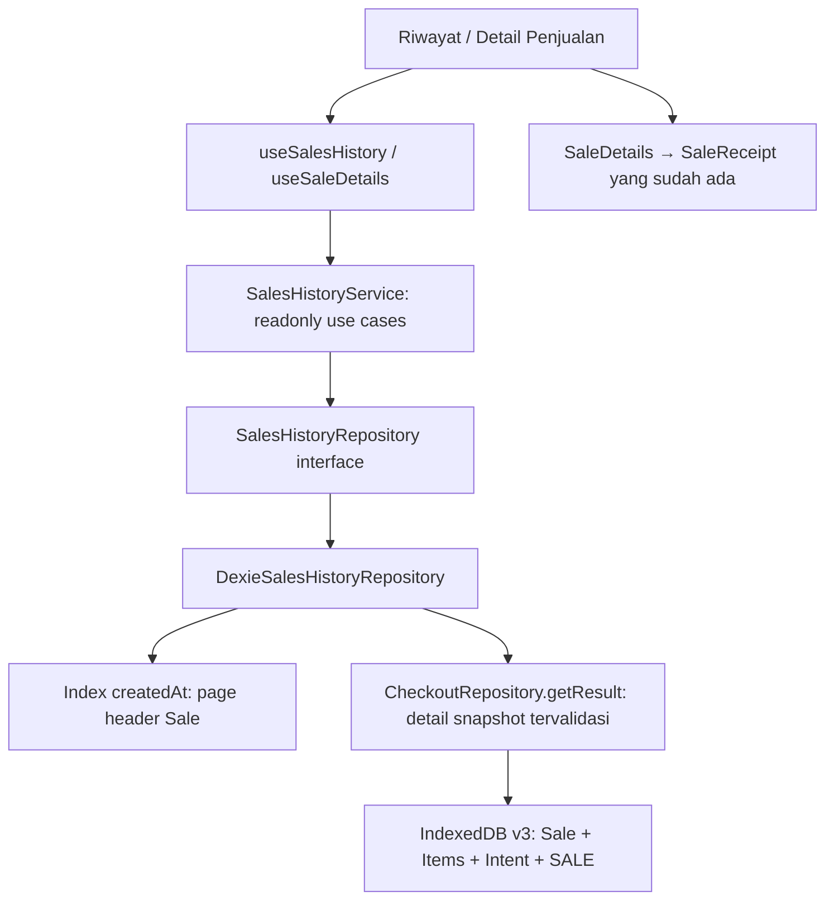

# Fase 4 · Langkah 4.5 — Riwayat Penjualan dan Manajemen Struk

Implementasi: **22 Oktober 2026**, POS-Zanna / Zanna-Cell. Referensi: [desain 4.1](PHASE-4-1-CHECKOUT-DESIGN.md), [domain/schema 4.2](PHASE-4-2-DOMAIN-DATABASE.md), [engine 4.3](PHASE-4-3-CHECKOUT-SERVICE.md), [integrasi Kasir 4.4](PHASE-4-4-CASHIER-INTEGRATION.md), [backlog](PROJECT-BACKLOG.md).

**Sudah tersedia:** halaman riwayat transaksi nyata, pencarian nomor struk, tanggal lokal, pagination, detail lengkap dan pembukaan kembali struk lama. **Seluruh fitur riwayat hanya-baca.** Tidak ada edit/hapus/void/refund/retur penjualan, perubahan stok, auto-repair, backend, PostgreSQL, sinkronisasi, HPP, QRIS/Bon nyata, ekspor, printer atau PWA.

Pengguna melaporkan checkout bensin dan produk lain telah diuji manual pada 4.4. Itu berbeda dengan pengujian manual fitur riwayat 4.5: browser/tablet untuk langkah ini masih pending oleh pengguna. Agen hanya menjalankan pemeriksaan otomatis.

## 1. Audit baseline dan batas perubahan

Baseline repository bersih, dengan 133 automated tests, termasuk 24 inventory dan 30 checkout UI. Source aktual menggunakan Sale/SaleItem, CheckoutService dengan preview/prepare/execute/getResult/listUnresolved/cancel, DexieCheckoutRepository dan SaleReceipt. Tidak mengasumsikan adanya API listSales atau history yang belum dibuat.

Temuan/keputusan:

- Sale adalah penjualan COMPLETED/CASH. PREPARED/CANCELLED merupakan status CheckoutIntent pada tabel terpisah, bukan penjualan berhasil.
- Schema tetap **v3** dengan sembilan tabel. Indeks sales: id, receiptNumber unik, checkoutOperationId unik, createdAt dan status. SaleItem memiliki saleId dan saleId+position. Tidak perlu migrasi atau indeks baru.
- getResult sudah melakukan validasi graph Sale–Item–Intent–SALE dan tidak membaca master saat ini. Adapter riwayat memakai metode itu untuk detail, di dalam transaksi baca yang sama.
- Daftar cukup membaca header Sale; tidak mengambil seluruh SaleItem. Karena jumlah baris tidak tersedia di header, daftar tidak menampilkan jumlah item yang ditebak.
- Validator header dipisahkan dari validateSale ke validateSaleHeader dalam file domain yang sama. Aturan identitas, uang, status dan kembalian digunakan bersama; validasi item/total penuh tetap di validateSale. Accepted business invariants tidak dilonggarkan. execute/prepare/cancel dan writer checkout tidak diubah.
- Provider operasional sebelumnya memanggil initialize katalog saat route apa pun dibuka. Rute riwayat kini menonaktifkan lifecycle katalog melalui catalogEnabled, sambil mempertahankan instance cart/controller. Ini menghindari inisialisasi satuan dan pembacaan master yang tidak diperlukan untuk struk historis. Saat kembali ke Kasir/Produk/Stok, subscription dibuka lagi.

## 2. Arsitektur



Tidak ada akses db.sales/db.saleItems atau operasi mutasi dalam komponen/hook. Factory service hanya menyusun dependency dengan localDatabase. Tidak ada write penjualan baru saat riwayat dibuka, di-refresh, dicari, di-reset, dimuat lebih banyak, atau struk dilihat kembali.

Tiga batas sengaja dipisahkan: service menormalisasi input filter, repository mengurus query/transaksi IndexedDB, hook mengurus lifecycle async React. Model Sale/SaleItem dan komponen SaleReceipt tetap digunakan, bukan membuat model/struk kedua.

## 3. File dan fungsi aktual

Path relatif terhadap frontend.

| File baru | Peran/simbol utama |
| --- | --- |
| src/domain/salesHistory.ts | SalesHistoryError/code, Filters/Request/Query/Cursor/Page, SalesHistoryRepository dan SalesHistoryReader |
| src/domain/salesHistoryQuery.ts | createSalesHistoryQuery, parsing hari lokal, normalisasi receipt/cursor dan batas halaman |
| src/data/dexieSalesHistoryRepository.ts | list/getDetail, transaksi r, penerjemahan storage/integrity error |
| src/services/salesHistoryOperations.ts | SalesHistoryService.list/getDetail; use case tanpa impor Dexie |
| src/services/salesHistoryService.ts | Instance service dengan repository DB lokal |
| src/features/sales-history/useSalesHistory.ts | Halaman pertama/load more, retry, guard request lama dan click ganda |
| src/features/sales-history/useSaleDetails.ts | Pembacaan satu Sale, loading/error/retry dan cleanup |
| src/features/sales-history/SalesHistoryPage.tsx | URL filter, daftar header, empty/error/loading/load more |
| src/features/sales-history/SalesHistoryFilters.tsx | Draft form, Terapkan dan Reset filter |
| src/features/sales-history/SaleDetailsPage.tsx | Route ID, pembacaan detail dan pesan not found/integrity/storage |
| src/features/sales-history/SaleDetails.tsx | Kartu status COMPLETED dan reuse SaleReceipt |
| src/features/sales-history/HistoryReadError.tsx | Pesan kasir dan Coba lagi; tidak menampilkan cause/stack |
| scripts/sales-history-fixtures.ts | Graph transaksi valid untuk emulator, tidak diimpor aplikasi |
| scripts/sales-history.test.ts | 24 tes domain/query/repository/integrity/read-only |
| scripts/sales-history-ui.test.tsx | 15 tes DOM/routing/filter/detail/retry/race/provider |
| docs/PHASE-4-5-SALES-HISTORY.md | Dokumentasi ini |

| File diubah | Perubahan |
| --- | --- |
| src/app/routes.tsx | /penjualan dan /penjualan/:saleId; dependency reader opsional untuk tes |
| src/app/navigation.ts | Entry Riwayat Penjualan setelah Stok; tiga shortcut mobile awal tetap |
| src/components/layout/OperationalLayout.tsx | Deskripsi/menu aktif detail, lifecycle katalog pada route riwayat, label fase |
| src/app/DemoProvider.tsx | catalogEnabled; pause initialize/subscription tanpa mereset cart/controller |
| src/domain/saleRules.ts | Ekstraksi validateSaleHeader yang dipakai daftar dan validateSale |
| package.json | Suite test:sales-history dan dua suite baru pada npm test; tidak ada dependency baru |
| README.md, docs/PROJECT-BACKLOG.md, docs/PHASE-4-4-CASHIER-INTEGRATION.md | Status riwayat, batas lama yang sudah diselesaikan dan validasi manual |

database.ts, Sale/SaleItem, CheckoutService dan DexieCheckoutRepository, writer inventory, CashierPage, PaymentDialog serta SaleReceipt tidak diubah. Tidak ada perubahan lockfile, test baseline, kredensial atau backend.

## 4. Kontrak repository/service

```ts
service.list({
  receipt: '',             // substring literal, case-insensitive, trim; maksimal 100 karakter
  startDate: '2026-10-22', // opsional, tanggal kalender lokal
  endDate: '2026-10-22',   // opsional, seluruh hari akhir disertakan
  pageSize: 20,           // default 20, batas 1–50
  cursor: null,           // posisi dari hasil halaman sebelumnya
}) // Promise<{ sales: readonly Sale[], nextCursor: SalesHistoryCursor | null }>

service.getDetail(saleId) // Promise<CheckoutResult>; NOT_FOUND bila ID/alamat tidak ditemukan
```

SalesHistoryService.list menerima request mentah bertipe SalesHistoryRequest lalu memanggil createSalesHistoryQuery. Query repository berisi receipt yang dinormalisasi, fromInclusive/toExclusive ISO UTC, pageSize dan cursor tervalidasi. Reader publik tidak mempunyai prepare, execute, cancel, update, remove atau save.

getDetail memvalidasi UUID route. Repository membaca Sale berdasarkan primary key dan memanggil pembaca checkout dengan checkoutOperationId. Jika tidak ada Sale tetapi ada intent COMMITTED yang merujuk ID tersebut, hasilnya INTEGRITY_ERROR; bila ID benar-benar tidak ditemukan, NOT_FOUND. Tidak membuat Sale pengganti.

## 5. Indeks, urutan dan pagination

Daftar memakai indeks **createdAt**, bukan `sales.toArray()` lalu sort semua record di memori. Query:

1. Batasi rentang createdAt dari tanggal lokal yang dikonversi ke UTC.
2. Jika ada cursor, batasi ujung atas sampai createdAt cursor, inklusif.
3. reverse() mengurutkan indeks dan primary key secara menurun: **createdAt DESC, id DESC**.
4. Pada timestamp yang sama, lewati id ≥ id cursor agar halaman berikutnya dimulai sesudah transaksi terakhir yang sudah tampil.
5. Validasi header dan cocokkan substring nomor struk dalam rentang itu.
6. Ambil paling banyak pageSize+1 header. Baris tambahan hanya menentukan ada/tidak halaman berikutnya, tidak ikut ditampilkan.

IndexedDB memakai primary key sebagai tie-breaker indeks nonunik. Tidak memakai localeCompare untuk UUID atau offset yang mudah bergeser ketika Sale baru masuk. Tes memasukkan lima ID yang diketahui pada timestamp sama dan memeriksa urutan serta kelengkapan tiga halaman.

Cursor berisi createdAt, id dan filterKey. filterKey berasal dari pencarian dan batas UTC yang sudah dinormalisasi. Cursor dari filter berbeda ditolak; hook selalu memulai halaman pertama ketika filter berubah. Cursor bukan token keamanan/server, hanya posisi baca lokal.

Jumlah header yang ditransfer ke hasil per query dibatasi. Pencarian substring tetap dapat memindai banyak header dalam rentang karena indeks receiptNumber biasa tidak mendukung contains case-insensitive. Tidak membaca item setiap header. Pada timestamp yang sama dalam jumlah sangat banyak, sebagian key akan dilewati ulang oleh filter cursor. Optimasi indeks/query lebih jauh dicatat di backlog untuk pengukuran, bukan migrasi baru pada fase ini.

Pagination bukan snapshot permanen seluruh database: setiap page adalah satu transaksi baca konsisten. Sale baru yang lebih baru dari cursor tidak menggeser/menduplikasi halaman lama; gunakan Muat ulang untuk melihatnya. Filter tidak membuat reservasi atau mengubah data.

## 6. Tanggal lokal dan zona waktu

Input tanggal adalah hari kalender pada **zona waktu perangkat/browser**, bukan UTC dan tidak di-hardcode ke +08. Untuk perangkat Asia/Singapore:

- Pilih 22 Oktober 2026 → mulai 2026-10-21T16:00:00.000Z, inklusif.
- Ujung akhir → 2026-10-22T16:00:00.000Z, eksklusif.
- Transaksi 2026-10-22T15:59:59.999Z masuk; transaksi tepat ujung akhir masuk hari berikutnya sehingga tidak masuk filter tanggal 22.

Parser memeriksa format YYYY-MM-DD dan apakah tanggal benar-benar ada. 30 Februari tidak dinormalisasi menjadi Maret. Tanggal mulai setelah akhir ditolak. Filter satu sisi diperbolehkan. Tahun 1000–9998 membatasi input ke ISO empat digit dan menghindari overflow tahun pada ujung hari akhir.

Akhir eksklusif dihitung dengan setDate(+1) pada kalender lokal, bukan menambah 86.400.000 ms. Ini mempertahankan seluruh hari di zona yang mempunyai DST. Tes mengubah TZ hanya pada proses tes terisolasi dan membuktikan hari 23/25 jam; aplikasi tidak mengubah timezone perangkat.

Timestamp Sale tetap ISO UTC; UI menggunakan `toLocaleString('id-ID')`. Uang memakai formatter money proyek, quantity pada struk memakai quantityText berskala 1000. Filter dan tampilan karena itu sama-sama mengikuti timezone lokal perangkat.

## 7. Header versus detail dan snapshot

Daftar memvalidasi identitas/status/metode/receipt/timestamp/uang/kembalian melalui validateSaleHeader. Tabel Sale hanya mempunyai COMPLETED; status PREPARED/CANCELLED yang salah tersimpan sebagai Sale adalah kerusakan data, bukan empty state biasa. Intent PREPARED/CANCELLED tidak dibaca sebagai daftar Sale.

Validasi header tidak menjamin setiap item/ledger utuh. Ketika struk dibuka, repository memakai satu transaksi r dengan sales, saleItems, checkoutIntents dan stockMovements. getResult menjalankan validator graph yang sudah dipakai recovery checkout. SaleItem diurutkan berdasarkan position; item hilang, snapshot rusak, relasi intent/ledger salah atau hasil ID berbeda menjadi error integritas.

Tidak ada pembacaan master produk/kategori/unit untuk membangun detail. Produk yang diarsipkan tetap dapat dibaca struknya. Harga, nama, varian, satuan dan faktor yang berubah sekarang tidak menggantikan snapshot lama. Balance saat ini juga tidak dibandingkan dengan saldo akhir Sale lama: stok dapat sah berubah sesudah penjualan.

SaleDetails menambahkan status lalu meneruskan CheckoutResult ke **SaleReceipt yang sama dengan Kasir**. Nomor struk/waktu/subtotal/total/tunai/kembalian berasal dari Sale; nama/unit/quantity/harga/nilai baris berasal dari SaleItem. Tidak ada implementasi struk kedua, printer atau ekspor.

Jumlah baris tidak disajikan pada daftar karena Sale tidak menyimpan count. Detail menampilkan seluruh item yang benar-benar dibaca dan divalidasi; tidak ada angka dummy.

## 8. Routing, hooks dan lifecycle React

- `/penjualan`: daftar. Parameter URL `q`, `mulai`, `sampai` menyimpan filter sehingga link langsung/refresh mempertahankan filter.
- `/penjualan/:saleId`: detail/struk. Link dari daftar membawa query string; Kembali ke riwayat mempertahankannya.
- Sidebar dan Menu memakai array navigasi yang sama. Tiga shortcut mobile Dashboard/Kasir/Produk tetap. Parent riwayat tetap dikenali ketika route detail dibuka.
- BrowserRouter tetap dipakai. Vite dev melayani fallback SPA; hosting produksi nanti tetap perlu fallback index.html untuk direct route.

SalesHistoryFilters menyimpan draft input lokal. Terapkan filter menulis URL; key form mengembalikan draft sesuai URL ketika navigasi/reset. Request database tidak dilakukan pada setiap ketikan.

useSalesHistory menampilkan loading untuk key filter/retry baru dan mengabaikan promise dari request lama. Halaman tambahan memakai guard ref sinkron; cursor yang baru selesai tidak dimuat dua kali sebelum render baru. Callback load more yang selesai sesudah filter diganti tidak menambahkan baris ke hasil filter baru. Error halaman tambahan mempertahankan baris lama, memberikan Coba lagi dengan cursor yang sama.

useSaleDetails juga menonaktifkan hasil promise lama setelah ID berubah/unmount. Tidak menampilkan struk lama sebagai struk ID baru saat loading/error. Retry melakukan read ulang; tidak ada auto-repair.

Riwayat adalah pembacaan on-demand, bukan subscription semua Sale. Muat ulang mengambil halaman pertama terbaru. Filter dipertahankan; jumlah halaman/posisi scroll yang sudah dimuat tidak dipersistenkan setelah halaman dilepas. Ini berbeda dengan jurnal intent checkout dan tidak menggantikan workflow uncertain di Kasir.

DemoProvider tetap mounted di layout. catalogEnabled false pada route riwayat menunda initialize dan subscription master/saldo, sementara cart serta CheckoutController tetap ada. Kembali ke Kasir membuka subscription lagi dan membaca stok terkini. Tes membuktikan array cart dan instance controller tetap sama, dan perubahan stock selama berada di riwayat terbaca ketika kembali.

## 9. Error handling

| Code | Perilaku UI |
| --- | --- |
| INVALID_FILTER | Periksa filter pencarian, jelaskan tanggal/rentang/pencarian; reset tersedia. Tidak ditampilkan sebagai tanpa transaksi |
| NOT_FOUND | Detail Transaksi tidak ditemukan, tersedia jalan kembali ke riwayat |
| STORAGE_ERROR | Pesan penyimpanan tidak dapat dibaca dan Coba lagi; tanpa cause/stack atau instruksi menghapus DB |
| INTEGRITY_ERROR | Data transaksi tidak konsisten, blok struk parsial, minta pemeriksaan data; Coba lagi hanya membaca |

Empty state normal hanya diberikan setelah query sukses tanpa hasil. Pencarian tanpa kecocokan berbeda dengan database tidak dapat dibuka atau item yang hilang. Pembaca tidak membuat Sale/Item, mengubah intent, membatalkan penjualan, memberi stok balik atau menghapus data rusak.

## 10. Pengujian dan verifikasi

39 tes baru: **24 domain/query/repository + 15 UI**. Suite baseline tetap dipertahankan. Fixture mempunyai graph yang lolos validateStoredCheckout sebelum dimasukkan ke fake-indexeddb. Satu tes tambahan juga menjalankan prepare/execute engine yang benar-benar ada lalu membacanya dari service riwayat, sehingga bukan hanya raw header fixture.

| Cakupan | Bukti otomatis |
| --- | --- |
| Empty/satu/beberapa Sale | List kosong, header dan hasil satu Sale, urutan waktu terbaru |
| Pagination/tie | ID tetap, tiga page lengkap tanpa duplikasi; Sale baru tidak menggeser cursor; double-click load more |
| Receipt/date | Substring case-insensitive, tunggal/rentang/satu sisi, seluruh hari akhir, kombinasi, invalid date dan reset |
| Timezone | Asia/Singapore dengan batas UTC yang diketahui, serta kalender DST 23/25 jam |
| Detail | Multi-item terurut, receipt yang sama, perubahan harga/nama/unit/arsip tidak mengubah snapshot |
| Data rusak | Missing item, snapshot, ledger, intent, header/status, orphan COMMITTED; tidak auto-repair |
| Intents | PREPARED/CANCELLED tidak muncul sebagai Sale |
| Storage | DB close disableAutoOpen → error; reopen menemukan data yang sama, tanpa reset |
| UI async | Request/filter lama dan load more lama diabaikan; retry menjaga page/cursor yang benar |
| Navigation | AppRoutes aktual, direct route/refresh, filter di URL, Menu/shortcut desktop/tablet/mobile |
| Read-only | Seluruh sembilan tabel dibandingkan sebelum/sesudah list/detail/reopen/UI; daftar tidak membaca SaleItems |
| Provider | Riwayat tidak menginisialisasi katalog; cart/controller tetap, subscription saldo pulih saat kembali |

Tes memakai Node test runner, tsx, fake-indexeddb dan jsdom yang sudah terpasang. Database emulator bernama acak dibersihkan sesudah tes; tidak ada akses atau penghapusan IndexedDB browser pengguna. Jendela browser/tablet tidak dibuka oleh agen. Tes DOM breakpoint/menu bukan pengujian visual CSS native.

Hasil final perintah tercantum di bagian berikut.

## 11. Hasil akhir

| Perintah | Hasil aktual |
| --- | --- |
| npm run lint | Lulus, exit 0; tanpa warning ESLint tersisa |
| npm run typecheck | App, konfigurasi Vite/node dan tests lulus, exit 0 |
| npm test | **172 lulus**, 0 gagal, 0 skipped: baseline 133 + 39 baru |
| npm run test:inventory | **24 lulus**, 0 gagal, 0 skipped; bagian dari 172 |
| npm run test:sales-history | **39 lulus**, 0 gagal, 0 skipped: 24 query/repository + 15 UI; bagian dari 172 |
| npm run build | Lulus, exit 0; Vite 8.3.4, 2030 modules |
| git diff --check | Bersih |

Build final: JS **554,07 kB**, gzip **166,08 kB**; CSS **39,53 kB**, gzip **8,47 kB**. Warning chunk >500 kB tetap ada, masuk BL-001 dan tidak disembunyikan. Tidak ada dependency baru.

Tidak ada automated test yang gagal pada implementasi ini. Lint awal memberi warning penggunaan ref angka pada cleanup effect; guard generation diubah menjadi object active yang ditutup cleanup sehingga tidak membaca ref yang dapat berubah. Guard cursor yang telah selesai juga mencegah klik ulang sebelum cursor baru dirender. Pemeriksaan final lulus.

Tidak ditemukan bug kritis penjualan/stok pada skenario akhir yang diuji. Risiko salah urut timestamp sama, baris dari filter lama, struk parsial karena item hilang dan inisialisasi master pada route hanya-baca sudah ditangani dengan regression tests. Tidak ada penulisan baru melalui riwayat atau perubahan transaksi atomik. Jangan menandai pemeriksaan manual lulus berdasarkan tes emulator.

## 12. Checklist manual pengguna

Jalankan `npm run dev` dari frontend dan gunakan origin/profil yang sama dengan checkout sebelumnya. Membaca riwayat tidak memerlukan transaksi baru. Jangan menghapus site data untuk menguji empty state pada data penting.

- [ ] Menu Riwayat Penjualan tersedia; Kasir/Produk/Stok dan Menu tetap berfungsi.
- [ ] Penjualan tunai bensin/produk yang sebelumnya diuji muncul, terbaru lebih dahulu, total dan waktu sesuai perangkat.
- [ ] Nomor struk panjang tetap terbaca, tidak memotong tombol atau meluber pada layar tablet/mobile.
- [ ] Cari nomor lengkap dan sebagian nomor, coba tanpa hasil, kombinasikan dengan tanggal.
- [ ] Filter hari tunggal/rentang mencakup transaksi akhir hari; reset mengembalikan seluruh data.
- [ ] Bila >20 transaksi, Muat lebih banyak menambah baris tanpa duplikasi. Muat ulang mengambil transaksi terbaru.
- [ ] Buka detail dan cocokkan nama, varian, quantity/unit, harga, subtotal, total, uang diterima dan kembalian dengan struk Kasir.
- [ ] Refresh langsung pada URL detail dan URL daftar berfilter; struk/filter tetap dapat dibaca tanpa pointer checkout.
- [ ] Buka ulang struk setelah master produk diubah/diarsipkan; angka historis tidak berubah. Gunakan perubahan master yang memang diinginkan atau produk uji.
- [ ] Catat saldo/ledger sebelum dan sesudah membaca beberapa struk: tidak ada pengurangan stok atau Sale tambahan.
- [ ] Cart yang belum dibayar tetap ada saat berpindah Kasir → Riwayat → Kasir; saldo terbaru terbaca ketika kembali.
- [ ] Periksa 390×844, 768×1024, 1024×768, 1366×768: label filter/tombol/Menu/scroll nyaman, fokus terlihat, keyboard tidak menutup aksi.
- [ ] Console tidak memiliki exception pada alur normal. Hosting produksi nanti perlu diuji fallback deep link.

Error data rusak/storage deterministik diuji dengan fault fixture otomatis, bukan tombol merusak data produksi. Jangan menghapus SaleItem nyata untuk mencoba error state.

## 13. Risiko dan batas tersisa

- IndexedDB lokal bukan backup; kehilangan site data/perangkat atau eviction masih berisiko. Tidak ada backend/sinkronisasi/backup baru.
- Device/origin/profil browser berbeda membaca database berbeda; riwayat tidak menggabungkan beberapa perangkat.
- Query on-demand tidak otomatis menerima checkout dari tab lain. Gunakan Muat ulang. Ini tidak mengubah atomicity writer yang sudah ada.
- Pencarian substring dan banyak timestamp yang sama dapat memindai banyak header; hasil dan item yang dimuat tetap dibatasi. Optimasi lanjutan perlu pengukuran dan masuk backlog.
- Daftar memeriksa header yang dikunjungi indeks, bukan audit global seluruh DB. Record tanpa key indeks createdAt yang valid atau Sale yang dihapus sepenuhnya tidak otomatis ditemukan dengan list. Detail mengenali orphan COMMITTED bila ID diketahui. Tidak ada auto-repair atau jaminan terhadap manipulasi DevTools.
- Jumlah baris pada daftar, pengembalian posisi scroll/load more, tautan detail dari ledger, dan perbaikan kosmetik masih enhancement, bukan angka/data palsu yang diisi sekarang.
- Dashboard dan laporan tetap DEMO. Riwayat transaksi nyata ini tidak sama dengan laporan laba/HPP.
- Warning bundle >500 kB tetap dicatat di backlog; tidak disembunyikan dengan menaikkan threshold. Pengujian visual/native browser/tablet 4.5 masih pending.

## 14. Contoh penggunaan dan latihan

```ts
import { salesHistoryService } from '../services/salesHistoryService'

const first = await salesHistoryService.list({ startDate: '2026-10-22', endDate: '2026-10-22' })
if (first.nextCursor) {
  const next = await salesHistoryService.list({ startDate: '2026-10-22', endDate: '2026-10-22', cursor: first.nextCursor })
  console.log(next.sales.length) // jumlah page yang benar-benar dibaca, bukan total seluruh DB
}
if (first.sales[0]) {
  const detail = await salesHistoryService.getDetail(first.sales[0].id)
  console.log(detail.sale.receiptNumber, detail.items.length)
}
```

Contoh hanya read; tidak perlu memanggil prepare/execute untuk membuka struk.

**Latihan 1 — Dua macam ID.** Ikuti Link daftar yang membawa Sale.id → getDetail → Sale.checkoutOperationId → getResult. Jelaskan mengapa getResult tidak boleh dipanggil dengan Sale.id secara langsung. Temukan tes yang membandingkan hasil engine dengan detail.

**Latihan 2 — Batas hari lokal.** Baca localDay/createSalesHistoryQuery dan tes 22 Oktober. Gambarkan interval inklusif/eksklusif, lalu bandingkan dengan `new Date('2026-10-22')` yang merupakan UTC midnight. Jalankan test:sales-history untuk melihat batas milidetik akhir hari.

**Latihan 3 — Tie dan cursor.** Baca tes lima ID pada timestamp sama. Tuliskan urutan tiga page berukuran dua dan jelaskan mengapa timestamp saja tidak cukup sebagai cursor. Ubah filter tetapi gunakan cursor lama pada salinan tes; pastikan INVALID_FILTER diterima.

**Latihan 4 — Snapshot dan read-only.** Baca tes arsip/perubahan master serta perbandingan sembilan tabel. Ikuti SaleDetails ke SaleReceipt; cari apakah ada query master atau writer di jalur itu. Jelaskan mengapa saldo sekarang tidak dibandingkan dengan saldo sesaat sesudah Sale lama.

**Latihan 5 — Respons async lama.** Baca active/generation/loadedCursor pada hooks dan tes filter berubah saat load more tertunda. Jelaskan bagaimana baris dari query lama dicegah masuk ke hasil query baru tanpa membatalkan/menulis transaksi database.

## 15. Batas berhenti

Fase 4.5 selesai setelah pemeriksaan otomatis final dan dokumentasi hasil. Validasi manual fitur baru menunggu pengguna. Tidak melanjutkan fase berikutnya atau membuat commit/push. Backend, sinkronisasi dan laporan nyata tetap memerlukan cakupan/persetujuan terpisah.
