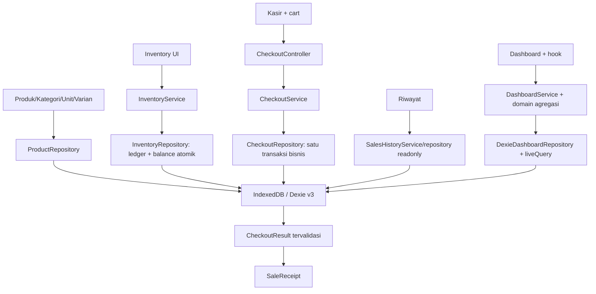

# POS-Zanna — Laporan Final Fase 4

Tanggal: **22 Oktober 2026**. Finalisasi gabungan **4.6 Dashboard Nyata + 4.7 Audit Integrasi**, tanpa subfase tambahan. Baseline working tree bersih dan Dashboard masih DEMO; tidak ada implementasi 4.6 sebelumnya yang ditimpa.

Dokumen ini menjadi status terkini. Dokumen [4.1](PHASE-4-1-CHECKOUT-DESIGN.md), [4.2](PHASE-4-2-DOMAIN-DATABASE.md), [4.3](PHASE-4-3-CHECKOUT-SERVICE.md), [4.4](PHASE-4-4-CASHIER-INTEGRATION.md), [4.5](PHASE-4-5-SALES-HISTORY.md) tetap referensi historis/teknis. Kalimat “Dashboard DEMO” pada laporan tahap sebelumnya sudah digantikan implementasi final ini. Halaman **Laporan** dan Bon tetap DEMO, QRIS/Bon belum menjadi pembayaran nyata.

## 1. Fitur Fase 4.1–4.7

| Langkah | Hasil |
| --- | --- |
| 4.1 | Audit arsitektur, rancangan checkout, snapshot, idempotency, transaksi atomik dan recovery |
| 4.2 | Model Sale/SaleItem/CheckoutIntent, kalkulator harga/quantity, validator dan skema Dexie v3 additive |
| 4.3 | CheckoutService, prepare/execute/getResult/listUnresolved/cancel; commit Sale+items+SALE+balance+intent atomik |
| 4.4 | Tunai nyata pada UI, fixed/variable quantity, uang/kembalian, freeze payload, struk, pemulihan refresh/penutupan tab dan uncertain |
| 4.5 | Riwayat hanya-baca, nomor struk/tanggal lokal, keyset pagination, detail dan reuse SaleReceipt |
| 4.6 + 4.7 | Dashboard nyata/live hanya-baca dan audit integrasi menyeluruh; hasilnya dalam laporan gabungan ini |

Dashboard menampilkan omzet hari ini, jumlah transaksi hari ini, jumlah **baris** item hari ini, tujuh hari kalender lokal (termasuk hari nol), lima transaksi terbaru, lima grup produk/satuan terlaris berdasarkan omzet, serta daftar/count stok menipis dan habis. Produk belum diinisialisasi tidak dianggap stok nol. Stok produk nonaktif tetap ditampilkan bila memerlukan perhatian, dengan label Nonaktif.

## 2. Struktur arsitektur



React tidak menulis Sale, Item, ledger atau balance secara langsung. Domain terpisah dari Dexie. Schema tetap v3 dan sembilan tabel: products, categories, units, variants, inventoryBalances, stockMovements, sales, saleItems, checkoutIntents. Tidak ada migrasi, indeks baru, reset atau penghapusan database pengguna.

Dashboard/Riwayat tidak memanggil initialize katalog. DemoProvider tetap mounted untuk mempertahankan cart/controller saat navigasi, tetapi lifecycle katalog ditangguhkan pada route hanya-baca tersebut. Subscription katalog/saldo dilanjutkan ketika kembali ke Kasir/Produk/Stok. Pembacaan Dashboard sendiri mempunyai snapshot konsisten dan subscription tersendiri.

## 3. File dan fungsi penting

Path relatif terhadap frontend. Peta lengkap tahap sebelumnya tersedia pada dokumentasi masing-masing.

| Area | File/fungsi |
| --- | --- |
| Domain transaksi | domain/sale.ts, checkout.ts, checkoutMath.ts, checkoutRequest.ts, checkoutRules.ts, saleRules.ts; quantity scaled, HALF_UP_LINE_V1, command/fingerprint/snapshot |
| Integritas | domain/checkoutIntegrity.ts: validateStoredCheckout, saleMovementFingerprint, conversionSnapshotKey |
| Engine | services/checkoutOperations.ts: CheckoutService; data/dexieCheckoutRepository.ts: prepare, commit, getResult, listUnresolved, cancel |
| Kasir | features/cashier/checkoutController.ts, checkoutSession.ts, checkoutCart.ts, useCashCheckout.ts, CashCheckoutDialog.tsx, SaleReceipt.tsx |
| Inventory | domain/inventoryRules.ts, unitPolicy.ts, services/inventoryOperations.ts, data/dexieInventoryRepository.ts |
| Riwayat | domain/salesHistoryQuery.ts; services/salesHistoryOperations.ts; data/dexieSalesHistoryRepository.ts; features/sales-history/* |
| Domain Dashboard baru | domain/dashboard.ts: kontrak data/repository; domain/dashboardRules.ts: dashboardWindow, localDateKey, summarizeDashboard |
| Repository Dashboard baru | data/dexieDashboardRepository.ts: read, subscribe; transaksi r dan liveQuery |
| Service Dashboard baru | services/dashboardOperations.ts: DashboardService.read/subscribe; dashboardService.ts: factory singleton |
| Hook Dashboard baru | features/dashboard/useDashboard.ts: state loading/error/retry, subscribe, pergantian hari/focus |
| UI Dashboard diubah | features/dashboard/DashboardPage.tsx: metrik nyata, grafik, top products, recent dan dua StockList |
| Integrasi diubah | app/routes.tsx: dependency Dashboard opsional untuk tes; components/layout/OperationalLayout.tsx: mode readonly Dashboard dan label status |
| Teks status diperbarui | features/home/HomePage.tsx, settings/SettingsPage.tsx, sales-history/SalesHistoryPage.tsx: Dashboard nyata, Laporan tetap DEMO |
| Tes baru | scripts/phase4-final.test.ts, scripts/dashboard-ui.test.tsx; test:phase4-final dan kedua suite masuk npm test |
| Dokumentasi | laporan ini, README.md dan PROJECT-BACKLOG.md |

Tidak menambah dependency, mengubah lockfile, menulis backend, atau mengubah writer checkout/inventory yang sudah stabil.

## 4. Alur transaksi

1. Cart menyimpan quantity dalam satuan jual yang terlihat kasir. Adapter mengubah fixed 2 botol →2000 scaled; variable 1,5 L →1500 scaled.
2. Preview membaca master dan balance yang konsisten, memeriksa policy/satuan/stok gabungan dan menghitung harga.
3. Konfirmasi membuat satu UUID dan command immutable berisi expected master/total serta cashReceived. Journal durable dibuat sebelum prepare/execute.
4. prepare menyimpan PREPARED, bukan reservasi stok.
5. execute memeriksa hasil lama lebih dahulu. Bila belum commit, baca master dan stok terbaru, validasi expected dan uang, kemudian tulis seluruh graph secara atomik.
6. Hanya hasil execute/getResult terverifikasi yang menghasilkan success/struk. Kegagalan bisnis mempertahankan cart; storage tidak pasti mempertahankan ID dan menampilkan uncertain.
7. Setelah sukses, hanya cart dengan kepemilikan array yang cocok dibersihkan. Recovery intent lama tidak menghapus cart baru.

Uang integer Rupiah. Harga dibulatkan half-up **per baris** memakai BigInt sementara; quantity dasar harus dapat dikonversi tepat dan tidak dibulatkan. Omzet adalah jumlah nilai penjualan, bukan laba/HPP. Harga null berbeda dari harga eksplisit Rp0.

## 5. Alur inventory

Stok dimiliki Product, bukan varian. Semua varian produk yang sama berbagi InventoryBalance.quantityBase. Stok awal, masuk dan koreksi manual berjalan melalui InventoryService; SALE hanya dari engine checkout. Setiap SaleItem mempunyai satu SALE dengan saleId/saleItemId, snapshot konversi dan before/delta/after.

Contoh audit aktual: Bensin 10 L dijual botol 1 L, botol 1,5 L dan variable 1,5 L → kebutuhan 4 L → saldo 6 L. Solar 0,5 L dan Beras 0,5 kg tetap memakai unit masing-masing; Mi dua bungkus memakai scaled jual 2000. Bensin/Solar memakai policy fuel dan unit/kemasan yang diizinkan, bukan deteksi string nama.

NOT_INITIALIZED berbeda dari balance nol. Produk tanpa stok awal/berstok tidak cukup ditolak engine. Saldo tidak pernah dikurangi dengan rumus UI kedua. Snapshot lama tidak berubah karena isi botol/harga/policy master diedit kemudian.

## 6. Alur riwayat/struk

Daftar query sales melalui indeks createdAt, urut createdAt DESC/id DESC, pagination 20 (maksimal 50), pencarian nomor struk dan hari lokal dengan end-exclusive. Tidak membaca seluruh SaleItem untuk daftar atau mengarang count item.

Detail membaca Sale berdasarkan ID, lalu memakai CheckoutRepository.getResult dalam transaksi r yang sama untuk memvalidasi Sale–Item–Intent–SALE. SaleReceipt memakai snapshot tersimpan dan tidak mengganti harga/nama/unit dari master sekarang. Missing item/ledger/intent menjadi error integritas, bukan struk parsial atau empty biasa. Semua operasi riwayat hanya-baca.

## 7. Alur dan definisi Dashboard

DashboardService membuat window **hari ini dan enam hari sebelumnya**, berdasarkan timezone lokal perangkat. Interval dimulai midnight lokal enam hari lalu dan berakhir midnight lokal besok secara eksklusif. Kalender setDate digunakan, bukan tujuh kali 24 jam tetap; DST diuji. Hari tanpa penjualan tetap ada dengan nol.

DexieDashboardRepository.read memakai satu transaksi **r**, membaca Sale tujuh hari dengan indeks createdAt dan lima Sale terbaru sepanjang histori. Setiap Sale terpilih divalidasi lewat getResult, dengan deduplikasi ID supaya recent yang juga dalam periode tidak dibaca dua kali. Item/intent/ledger konsisten dengan Sale; hasil tidak diambil dari mock. Produk, unit dasar dan balances dibaca dalam transaksi yang sama untuk indikator stock.

Definisi metrik:

- Omzet hari ini = sum Sale.total COMPLETED pada tanggal lokal hari ini.
- Transaksi hari ini = jumlah Sale yang sama, bukan jumlah movement atau intent.
- Baris item hari ini = jumlah SaleItem; satu baris berisi 20 bungkus tetap satu baris. Tidak menambahkan liter+kg+pcs sebagai satu jumlah.
- Top products = omzet tujuh hari per productId dan snapshot satuan jual, urut omzet menurun. Quantity hanya dijumlah dalam grup satuan yang sama. Nama dipilih dari snapshot penjualan terbaru pada grup; edit master tanpa penjualan tidak mengubah angka/label historis. Produk berganti nama antar-Sale tetap satu grup per satuan.
- Stock menipis/habis = stockStatus dari balance dan minimumStock Product; satu Product dihitung sekali, bukan per varian. Tidak mencampur jumlah dasar produk dengan unit berbeda dalam satu total.
- Lima recent bersifat sepanjang histori; dapat ada meskipun tujuh hari ini nol. Semuanya link ke detail/struk nyata.

Agregasi omzet/quantity memakai penjumlahan integer yang diperiksa terhadap Number.MAX_SAFE_INTEGER; tidak memakai batas Rp1 miliar per checkout sebagai batas agregat periode. Tidak ada angka laba, pelanggan contoh atau data demoSales di Dashboard. Produk berlabel data contoh yang benar-benar dijual tunai tetap memiliki Sale nyata dan dihitung berdasarkan Sale, bukan flag master.

liveQuery melacak pembacaan terkait. Setelah checkout/mutasi stok commit, subscription mengirim snapshot baru tanpa pengurangan optimistis. Hook memeriksa pergantian tanggal tiap 30 detik, saat focus dan visibilitychange; window hari lokal kemudian diperbarui. Ada loading, error dan retry; storage/corruption tidak disamarkan menjadi omzet nol.

## 8. Idempotency, concurrency dan rollback

- UUID operasi checkout stabil dan fingerprint canonical mengikat seluruh payload. Replay sama mengembalikan Sale lama, payload berbeda ditolak.
- Satu transaksi rw mencakup seluruh master, balance, Sale/Item/intent/ledger. Baca stok terbaru dan write serial pada object stores yang bersinggungan mencegah lost update/oversell.
- Dua execute dengan ID sama menghasilkan satu Sale; dua intent berbeda yang berebut stok tidak boleh menghasilkan saldo negatif. Checkout vs mutasi/edit master/cancel juga diuji.
- Kegagalan item/movement/balance/intent meng-abort seluruh transaksi. Intent PREPARED dari transaksi sebelumnya tetap tersedia untuk recovery, tanpa Sale parsial.
- Pembaca history/Dashboard memakai transaksi r yang scope-nya beririsan dengan commit sehingga tidak melihat graph setengah tersimpan.
- Cancel intent committed mengembalikan hasil committed, bukan undo Sale/stok. Cancel sebelum prepare menyimpan CANCELLED agar late prepare tidak menghidupkan ID lama.
- Journal UI per operasi di localStorage ditambah pointer per tab di sessionStorage menjaga recovery setelah refresh/tab ditutup. Tidak ada auto-execute saat startup atau UUID baru untuk respons yang belum pasti.

## 9. Matriks audit integrasi

| Invariant | Bukti otomatis |
| --- | --- |
| Harga, subtotal dan change | checkout-domain/service/UI; pipeline baru Rp71.500, tunai Rp100.000, change Rp28.500 |
| Fixed/variable dan policy BBM | inventory + domain + UI + pipeline Bensin/Solar/kg/bungkus; Sachet/lintas dimensi ditolak baseline |
| Stok gabungan varian | checkout-service dan pipeline baru memeriksa 10→6 L dengan beberapa varian |
| Double-click/replay | UI tiga klik sinkron; dua koneksi/execute paralel; pipeline baru satu Sale untuk dua execute |
| Atomic rollback | Baseline fault item/movement/balance/intent; audit baru memastikan Dashboard/history/stok tidak berubah |
| Recovery refresh/tab tutup | checkout-service/UI: PREPARED dan committed response-lost; audit reopen DB dan retry ID sama |
| Historis setelah master berubah | service/UI/history + Dashboard snapshot; rename antarpenjualan tidak memecah grup produk/satuan |
| Read-only history/Dashboard | Perbandingan sembilan tabel sebelum/sesudah read/receipt/navigasi; provider tidak initialize master di route readonly |
| Live updates | Subscription dan DOM memperbarui omzet setelah checkout dan daftar habis setelah mutasi stok |
| QRIS/Bon | Tombol disabled/DEMO; UI/domain membuktikan tidak ada Sale atau pengurangan stok |
| Produk tanpa stok | Domain/service menolak uninitialized/insufficient; UI cart/card guard, baseline inventory membedakan stok nol |
| Data lama | Migration v1/v2→v3 mempertahankan master, UUID/barcode, quantities, balances dan ledger; tidak ada schema baru pada finalisasi |
| Route/mobile | cart/history baseline + Dashboard DOM pada 390/768/1024/1366 px; Menu/shortcut/receipt links tetap |
| Hari lokal | History + Dashboard midnight/end-day dan DST; tidak memakai tanggal sampel tetap |

Audit bukan global forensic scan semua database yang mungkin dimanipulasi. Scope pemeriksaan integritas mengikuti record/periode yang dibaca. Tidak membuat koreksi otomatis bila record rusak.

## 10. Hasil pengujian final

| Perintah | Hasil aktual |
| --- | --- |
| npm run lint | Lulus, exit 0; tidak ada warning ESLint |
| npm run typecheck | App, Vite/node dan seluruh tests lulus, exit 0 |
| npm test | **186 lulus, 0 gagal, 0 skipped** |
| npm run test | **186 lulus, 0 gagal, 0 skipped** pada pemanggilan terpisah |
| npm run build | Lulus, exit 0; Vite 8.3.4, 2035 modules |
| git diff --check | Bersih |

`npm test` dan `npm run test` adalah alias untuk suite yang sama; jumlahnya tidak dijumlahkan sebagai tes unik. Baseline 172 ditambah 14 tes finalisasi (10 domain/integrasi + 4 DOM) = **186 tes unik**. Semua baseline inventory (24), checkout domain/migration/service/UI, dan sales-history (39) termasuk di dalam suite tersebut. Tidak ada tes akhir yang gagal.

Build final: JS **558,59 kB**, gzip **167,85 kB**; CSS **39,42 kB**, gzip **8,46 kB**. Warning chunk >500 kB tetap ada. Tidak melakukan optimasi bundle atau menaikkan threshold. Tidak ada dependency baru.

Semua tes memakai fake-indexeddb/jsdom pada proses terisolasi. Cleanup menghapus DB emulator bernama tes, bukan IndexedDB browser pengguna. Tidak ada pengujian manual browser/tablet yang diklaim agen.

## 11. Temuan dan perbaikan

- Dashboard sebelumnya masih omzet/transaksi/pelanggan fiktif dan tanggal tetap 19 Oktober. Diganti pembaca Sale COMPLETED dan saldo nyata; angka pelanggan contoh dihapus.
- Agregat top product harus tetap productId/satuan setelah nama berubah antarpenjualan. Key tidak memakai nama master/snapshot sebagai identitas; label berasal dari snapshot terbaru. Ada tes khusus agar omzet tidak terpecah/misrank dan struk lama tetap bernama lama.
- Perbedaan baris item versus kuantitas unit dijelaskan dan diuji; stok menipis/habis/uninitialized dipisah, tidak dideduplikasi dari kartu varian seperti sebelumnya.
- Route Dashboard menangguhkan initialize/subscription katalog provider, sehingga jalur read-only tidak menulis builtin unit. State cart/controller tetap mounted.
- Tidak ditemukan kebutuhan mengubah engine transaksi, schema, library atau desain besar. Perbaikan lama 4.2–4.5 (QUOTE_CHANGED, row cart hilang, pointer durable, cancel sebelum prepare, snapshot/header validation dan guard async history) tetap dipertahankan dan diuji.

Tidak ada bug kritis transaksi/stok yang boleh dibiarkan di backlog untuk menutup fase. Hasil akhir bergantung pemeriksaan otomatis pada bagian 10 serta evaluasi manual pengguna.

## 12. Risiko tersisa dan backlog

- IndexedDB lokal belum backup permanen. Eviction, clear site data, mode privat atau kerusakan perangkat tetap dapat kehilangan data; tidak ada backend/sync/backup otomatis pada fase ini.
- Origin/perangkat/profil berbeda tidak berbagi data. Jam dan timezone mengikuti perangkat; tidak ada waktu server tepercaya.
- Query Dashboard menghitung semua Sale tujuh hari beserta graph yang diperlukan dan master/balance. Pada volume besar bisa mahal atau menahan writer selama transaksi baca. Ini dicatat untuk pengukuran, tanpa optimasi bundle/query prematur.
- Daftar stock menampilkan lima contoh per status dengan jumlah total yang benar; semua tersedia pada halaman Stok. Top products dan recent masing-masing lima; metrik/graph tidak dipotong lima.
- Tidak ada jaminan keamanan terhadap DevTools, autentikasi owner atau audit kriptografis. Graph yang diakses diperiksa, bukan seluruh histori di luar window/recent atau orphan yang tak terindeks.
- Cart sebelum intent masih di memori. Recovery tidak sama dengan backup keseluruhan sesi.
- Warning build >500 kB tetap terlihat; tidak dioptimalkan atau disembunyikan sesuai prioritas pengguna.
- Laporan masih DEMO, belum laporan omzet/laba/HPP nyata. QRIS/Bon/retur/PWA/printer/backend tetap di luar scope.

Semua item nonkritis ada di [PROJECT-BACKLOG.md](PROJECT-BACKLOG.md). Tidak ada fitur Fase 5 yang diam-diam ditambahkan.

## 13. Checklist manual penutupan Fase 4

Pengguna sebelumnya melaporkan checkout bensin/produk lain telah diuji manual. Itu tidak otomatis menandai Dashboard baru atau seluruh checklist ini lulus.

- [ ] Gunakan origin/profil lama; pastikan master, saldo dan transaksi sebelumnya tetap ada tanpa reset.
- [ ] Buka Dashboard: omzet, transaksi dan baris hari ini cocok dengan Riwayat; hari nol tetap terlihat pada tujuh hari.
- [ ] Jual Bensin/Solar dengan varian botol dan volume aktual, Beras/kg serta barang hitungan; cek change dan saldo masing-masing, lalu Dashboard diperbarui otomatis.
- [ ] Cocokkan baris item dan top products; tidak ada penjumlahan liter+kg+pcs. Omzet tidak disebut laba.
- [ ] Buat stok menipis/habis melalui tindakan bisnis yang sah, periksa status Dashboard tanpa reload; produk belum diatur tidak muncul sebagai habis.
- [ ] Buka recent → struk → riwayat; cek snapshot dan pastikan membaca tidak mengubah stok atau menambah Sale.
- [ ] Ubah harga/nama/arsip produk yang memang perlu diubah: struk lama tetap, Dashboard historis tidak dihitung dari harga sekarang.
- [ ] Uji error yang muncul alami dengan Coba lagi; jangan sengaja merusak transaksi/clear data untuk mencoba fault injection.
- [ ] Pada kasus intent terputus yang dikendalikan, periksa hasil ID lama setelah refresh; jangan menerima pembayaran ulang saat uncertain.
- [ ] Periksa desktop/tablet/mobile 390×844, 768×1024, 1024×768, 1366×768: Menu, drawer Kasir, keyboard, fokus, scroll dan direct link.
- [ ] Periksa pergantian hari/focus perangkat dan zona waktu yang benar. Console tidak memiliki exception pada alur normal.
- [ ] QRIS/Bon jelas nonaktif/DEMO; halaman Laporan jelas sampel. Tidak ada klaim backend, sinkronisasi atau backup tersedia.

Pengujian DOM tidak membuktikan rendering, keyboard native, power loss atau eviction Android. Validasi tersebut masih menjadi pemeriksaan pengguna.

## 14. Materi pembelajaran mandiri

**Identitas dan unit.** Baca CartLine → cartSelections → CheckoutCommand → SaleItem. Dua botol berarti 2000 scaled jual; faktor isi menentukan quantityBase. Angka 1500 dapat berarti 1,5 L, 1,5 kg atau 1,5 satuan lain: unit tidak boleh hilang ketika dijumlahkan.

**Atomicity.** Ikuti commit dalam dexieCheckoutRepository. Bandingkan sembilan tabel sebelum/sesudah fault injection; jelaskan mengapa menangkap error item lalu melanjutkan transaksi berbahaya. Tidak perlu menambah transaksi baru untuk membuka struk.

**Idempotency.** Telusuri satu UUID pada journal, intent, Sale.checkoutOperationId dan getResult. Sale.id adalah identitas penjualan; operation ID adalah identitas request. Fingerprint bukan tanda tangan keamanan. Ubah payload pada salinan tes dengan ID sama dan amati penolakan.

**Read model versus otoritas.** UI cart adalah feedback awal, execute membaca ulang master/balance di transaksi. Dashboard/history adalah proyeksi hanya-baca atas data yang sudah commit; tidak boleh membuat movement karena sebuah komponen dirender.

**Snapshot.** Baca SaleReceipt dan agregasi top products. Edit master tidak mengganti histori. Nama terbaru dalam grup ranking adalah snapshot Sale terbaru, bukan nama dari master saat ini; receipt lama tetap memakai nama saat Sale tersebut.

**Timezone.** Bandingkan dashboardWindow dengan createSalesHistoryQuery. Gambar interval local-midnight → local-midnight berikutnya dan cari tes DST; jangan memakai string tanggal UTC sebagai hari lokal secara tak sengaja.

**Reaktivitas.** Ikuti DashboardPage → useDashboard → DashboardService.subscribe → liveQuery → transaksi r. Mutasi commit memicu baca ulang, bukan angka yang dikurangi/ditambah optimistis. Cleanup subscription dan interval ada pada hook.

Contoh read-only:

```ts
const snapshot = await dashboardService.read(new Date())
console.log(snapshot.today.revenue, snapshot.today.itemRows)
const stop = dashboardService.subscribe(new Date(), next => {
  console.log(next.today.transactions)
}, cause => console.error(cause))
// Pemanggil non-React harus menghentikan subscription ketika selesai:
stop()
```

Latihan: jalankan `npm run test:phase4-final`, baca pipeline Rp71.500, hitung kebutuhan 4 L Bensin dan jelaskan mengapa enam baris item tidak berarti enam unit fisik. Lalu telusuri fault ledger dan buktikan history/Dashboard tidak berubah. Gunakan fixture tes, bukan memodifikasi record browser penting.

## 15. Kesiapan Fase 5 dan batas berhenti

**Fase 4 siap ditutup berdasarkan seluruh pengujian kritis otomatis yang lulus**, dengan validasi native/manual baru tetap tercatat pending. Tidak ada bug kritis transaksi/stok yang diketahui tersisa dari cakupan uji. Cakupan Fase 5 menunggu instruksi/persetujuan pengguna dan belum diimplementasikan. Tidak membuat backend Spring Boot, PostgreSQL, sinkronisasi, backup otomatis, QRIS/Bon nyata, retur/refund, printer atau PWA. Tidak menghapus IndexedDB pengguna dan tidak melakukan commit/push otomatis.
