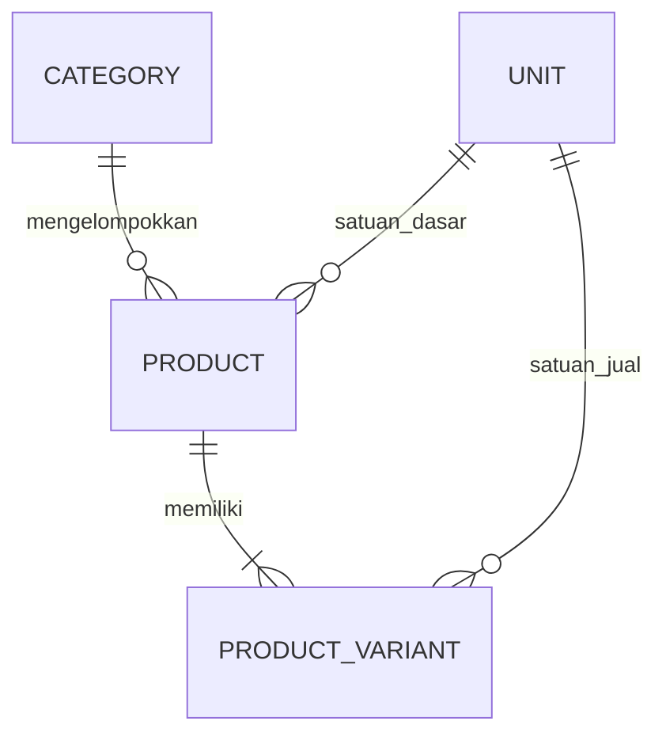
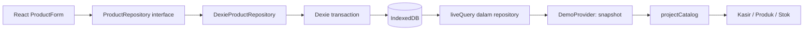

# Product Data Model — POS-Zanna Fase 2

Dokumen ini merekam keputusan master pada **Fase 2**. Pembaruan inventory dan skema v2 ada di [Inventory Data Model Fase 3](INVENTORY-DATA-MODEL.md). Pernyataan ledger belum tersedia di bawah berlaku untuk Fase 2.

Status Fase 2: master produk lokal sudah berfungsi. Kasir/pembayaran masih DEMO. Backend, PostgreSQL, ledger, PWA, dan sinkronisasi belum dibuat.

## Entitas dan relasi



Semua identitas domain menggunakan UUID string. Identitas produk/varian/kategori baru dihasilkan sekali saat disimpan dan tetap sama saat edit, refresh, dan browser dibuka kembali. UUID satuan bawaan adalah konstanta versi 4 yang stabil. UUID bukan nomor urut PostgreSQL dan tidak menyiratkan urutan data.

| Entitas | Fungsi dan field utama |
| --- | --- |
| Product | Identitas barang: id, name, categoryId, baseUnitId, costPrice, costKnown, minimumStock, isActive, createdAt, updatedAt. isDemo/demoKey hanya untuk asal sampel dan idempotensi seed; illustration opsional. |
| Category | id, name, nameKey (nama ternormalisasi untuk keunikan), isActive, createdAt, updatedAt. |
| Unit | id, code, name, dimension, factor, isPackaging, createdAt, updatedAt. Referensi bawaan tidak dapat diedit melalui UI fase ini. |
| ProductVariant | id, productId, name, sku/barcode opsional, sellingUnitId, quantityInBaseUnit, sellingPrice nullable, saleMode, isActive, createdAt, updatedAt. |

Product memiliki satu atau lebih varian. Produk aktif memerlukan minimal satu varian aktif. Nama/harga/status katalog Kasir diproyeksikan dari entitas ini; bukan salinan master kedua. Satu kartu jual mewakili satu varian. `CatalogItem` pada `types/pos.ts` adalah read model UI; bukan entitas database.

Product tidak menyimpan harga jual, barcode, atau SKU kedua yang bersaing dengan varian. Modal disimpan per **1 satuan dasar**, bukan per kemasan jual. `costKnown` harus sama dengan `costPrice !== null`; nol berarti modal diketahui sebesar nol, bukan tidak diketahui.

`CartLine.variantId` menunjuk varian, bukan master Product. `CatalogItem.id` juga UUID varian; `CatalogItem.productId` adalah UUID master induknya. Nama field ini membedakan dua identitas yang sebelumnya masih datar pada mock Fase 1.

## Harga, kuantitas, dan satuan

- Harga jual/modal berupa integer rupiah nonnegatif, maksimal Rp1.000.000.000. Harga kosong disimpan null. Bensin tidak diberi harga rekaan.
- Input harga menerima `15000` atau `15.000`, keduanya berarti Rp15.000. Input `15.50`, negatif, pecahan koma, dan eksponen ditolak. Jangan menggunakan parser floating-point untuk harga.
- `QUANTITY_SCALE = 1000`. Isi kemasan dan stok minimum disimpan sebagai **integer seper-seribu satuan dasar**. `1500` berarti `1,5` satuan dasar; `1` berarti `0,001` satuan dasar. Maksimal tiga angka desimal, dan nilai tersimpan tidak melebihi 1.000.000.000 (= 1.000.000 satuan dasar).
- Contoh: dasar liter, varian botol 1,5 L => quantityInBaseUnit 1500. Dasar kg, jual 1 gram => quantityInBaseUnit 1. Dasar bungkus, dus isi 40 => 40000.
- Satuan bawaan: pcs, bungkus, sachet, dus, kg, gram, liter, mililiter, botol, jeriken.
- Unit.dimension: count, mass, volume. Faktor ke satuan kanonik: kg 1000 gram, g 1 gram; liter 1000 ml, ml 1 ml; count 1.
- Satuan ukur tanpa kemasan wajib menggunakan rasio baku: `quantityInBaseUnit * base.factor === selling.factor * 1000`.
- Kemasan seperti botol/dus/jeriken memiliki `isPackaging = true` dan isi eksplisit per produk. Botol berisi 1,5 liter diperbolehkan karena ini hubungan **kemasan → isi**, bukan anggapan bahwa jumlah dan volume setara secara universal.
- Konversi langsung kg ↔ liter, berat ↔ count, atau volume ↔ count tanpa kemasan yang jelas ditolak. Tidak ada perkiraan densitas.
- Satuan dasar terkunci setelah produk dibuat. Menggantinya akan mengubah arti semua konversi dan batas stok; gunakan produk baru dan nonaktifkan produk lama sampai ada kebijakan migrasi khusus.
- `saleMode: fixed` mewakili satuan jual utuh. `variable` menyiapkan berat/volume aktual, hanya untuk satuan ukur mass/volume yang kompatibel. Konfigurasinya tersimpan tetapi kartu tersebut belum bisa dimasukkan ke keranjang Fase 2.

Kasir saat ini menerima jumlah bulat per varian tetap. Tidak ada perhitungan transaksi berdasarkan volume aktual, saldo stok, atau ledger. Solar sampel disiapkan per liter Rp13.000; mode aktual dapat dikonfigurasi untuk fase transaksi mendatang.

## Barcode dan SKU

Barcode **hanya pada ProductVariant**, tidak pada Product. Keunikannya berlaku global di seluruh varian pada database, termasuk varian/produk nonaktif. Barcode dibandingkan case-sensitive, mempertahankan nol di depan, dipangkas pada tepi, panjang 1–80 karakter huruf/angka/tanda hubung. Scanner belum dibuat.

SKU juga hanya pada varian, dipangkas lalu dinormalisasi UPPERCASE, unik global termasuk varian nonaktif, maksimal 60 karakter. Nilai kosong tidak disimpan sebagai string kosong, sehingga banyak varian dapat tidak memiliki SKU/barcode. Unique index Dexie memberi pengamanan tambahan selain validasi domain.

Varian lama tidak dihapus secara fisik ketika tidak dikirim pada edit: repository mengarsipkan sebagai nonaktif. Form mempertahankan baris varian tersimpan; gunakan status nonaktif. Produk tidak memiliki operasi hard delete.

## Database dan versioning

Nama database: **zanna-cell-db**. Versi skema aplikasi: **1**, didefinisikan melalui Dexie `version(1)`.

| Object store | Primary key dan index |
| --- | --- |
| products | id; categoryId, baseUnitId, unique demoKey, updatedAt |
| categories | id; unique nameKey |
| units | id; unique code |
| variants | id; productId, unique sku, unique barcode, sellingUnitId |

Nama tabel dan index tidak mendefinisikan seluruh field: IndexedDB menyimpan objek lengkap. Tidak memakai autoincrement, tabel transaksi, queue, outbox, sync marker, atau conflict table.

`initialize()` hanya mengisi referensi satuan yang belum ada. Produk dan kategori awal kosong. Setiap perubahan skema berikutnya harus menambahkan `version(2)...upgrade(...)`, mempertahankan versi sebelumnya dan memigrasikan data secara eksplisit. Jangan mengganti skema v1 lalu menghapus database untuk memperbaiki upgrade. `versionchange` menutup koneksi lama; muat ulang tab setelah versi aplikasi lain melakukan upgrade. Versi lama yang tidak kompatibel menampilkan error, tanpa reset destruktif.

Produk, varian, validasi keunikan, dan pengarsipan varian disimpan dalam satu transaksi read/write Dexie. Jika salah satu bagian gagal, seluruh perubahan dibatalkan. Pemeriksaan kategori dan relasi dilakukan ulang di dalam transaksi, bukan hanya pada form. `expectedUpdatedAt` mencegah edit produk menimpa perubahan tab lain yang lebih baru. Metadata memakai ISO UTC; updatedAt dibuat monoton untuk objek yang sama meskipun beberapa edit terjadi dalam milidetik yang sama.

Bentuk transaksi/query mengikuti [dokumentasi transaksi Dexie](https://dexie.org/docs/Dexie/Dexie.transaction%28%29). Schema TypeScript mengikuti [dokumentasi Dexie TypeScript](https://dexie.org/docs/Typescript). Observasi perubahan lokal memakai [liveQuery](https://dexie.org/docs/liveQuery%28%29), dibungkus repository agar UI tidak bergantung pada API Dexie.

## Repository dan alur React



`services/productRepository.ts` adalah composition root, tempat implementasi lokal dipilih. Komponen mengambil interface repository dari context; tidak mengimpor database atau memanggil tabel Dexie langsung. Satu transaksi menyimpan master, kemudian observable mengirim snapshot konsisten baru, dan React merender ulang. `DemoProvider` tetap bernama demikian karena juga menyediakan keranjang DEMO; snapshot master di dalamnya berasal dari database nyata.

### Contoh pemanggilan yang sudah berfungsi

Kode berikut adalah contoh modul/handler TypeScript, bukan perintah paste langsung ke Console browser:

```ts
import { productRepository } from '../services/productRepository'

await productRepository.initialize()
const category = await productRepository.saveCategory('Kebutuhan rumah')
const snapshot = await productRepository.getSnapshot()
const pcs = snapshot.units.find((unit) => unit.code === 'pcs')!

const product = await productRepository.saveProduct({
  name: 'Korek api', categoryId: category.id, baseUnitId: pcs.id,
  costPrice: null, costKnown: false, minimumStock: 5000,
  isActive: true,
  variants: [{
    name: 'Standar', sellingUnitId: pcs.id, quantityInBaseUnit: 1000,
    sellingPrice: 2000, saleMode: 'fixed', isActive: true,
  }],
})
const reread = await productRepository.getSnapshot()
console.log(reread.products.find((item) => item.id === product.id))
```

Modal belum diketahui, harga jual Rp2.000, minimum stok 5 pcs, dan satu penjualan berisi 1 pcs. Memanggil contoh berulang dengan nama kategori yang sama menghasilkan validasi kategori duplikat; dalam aplikasi gunakan kategori yang sudah ada.

## Kebijakan data DEMO

Tidak ada seed produk otomatis. Tombol **Isi Data Demo** memerlukan konfirmasi. Seed menambahkan 12 master produk dan 15 varian jual, termasuk bensin tiga kemasan dan mi per bungkus/dus. Produk memiliki `isDemo = true` serta `demoKey` unik agar pengisian ulang tidak menduplikasi, tidak mengaktifkan ulang, dan tidak menimpa edit pengguna pada sampel lama.

Satuan adalah referensi sistem, bukan stok/contoh transaksi. Kategori seed menggunakan kategori bernama setara yang sudah ada, tanpa mengganti identitas kategori pengguna. Jika SKU/barcode seed berbenturan dengan produk pengguna, seluruh seed batal dan data pengguna dipertahankan.

Implementasi Fase 1 hanya memakai memori, jadi tidak ada database produk Fase 1 yang perlu dihapus atau diimpor. Sampel berpenanda dikenali lewat demoKey; data tanpa penanda tidak ditebak sebagai demo dan tidak dibersihkan. Tidak ada operasi reset database di aplikasi.

## Integrasi Kasir dan batas stok

Katalog berasal dari `projectCatalog(snapshot)`. Produk dan varian aktif serta kategori aktif saja yang dapat ditambahkan. Varian nonaktif tetap tersedia dalam snapshot agar item yang sudah di keranjang bisa ditandai tidak valid, bukan menghilang diam-diam. Perubahan master dari menu atau tab lain diperbarui lewat langganan lokal repository.

**Aturan demo harga:** nama dan harga di keranjang selalu mengikuti master terbaru. Total dihitung ulang. Jika master berubah ketika modal simulasi sedang memproses, konfirmasi dibatalkan dan pengguna diminta memeriksa total lagi. Hasil sukses menyimpan total hanya dalam state dialog, tanpa mencatat transaksi. Produk/varian nonaktif harus dihapus dari keranjang sebelum melanjutkan.

Tidak ada stok aktual: `CatalogItem.stock = null` dengan teks “Stok belum dicatat”. Halaman Stok menampilkan satuan dasar dan batas minimum master, tidak mengubah saldo. Dashboard/laporan penjualan tetap sampel tetap berlabel DEMO dan tidak mengambil checkout sesi. Keranjang berada di memori, tetap sama saat viewport/menu berubah, dan kembali kosong setelah refresh.

## Perbaikan akses keranjang tablet

Pada kode awal, panel kiri di bawah 1024px memakai display:none, dan satu-satunya akses alternatif berupa tombol fixed di dalam subtree konten. Pemeriksaan sumber dan CSS hasil build menunjukkan tombol seharusnya tersedia pada 768px: **hilangnya tombol yang dilaporkan pengguna belum direproduksi secara visual**, sehingga penyebab runtime spesifik (termasuk kondisi build/perangkat) belum diklaim terbukti.

Perbaikan yang diterapkan mengganti pemilihan panel dengan `useWideCashier` / matchMedia tunggal 1024px. Tombol layar sempit dibuat melalui portal langsung ke document.body, tanpa kelas visibility breakpoint dan tanpa ketergantungan containing block konten. Tepat satu CartPanel dirender: desktop atau drawer. State tetap dari context yang sama. Ketika layar melebar drawer ditutup, isi keranjang tidak direset.

Drawer memakai dialog native (top layer), Escape, tombol tutup, backdrop, scroll halaman terkunci, fokus kembali ke pemicu atau main bila pemicu sudah hilang, safe-area, max-height dinamis, dan VisualViewport untuk ruang keyboard. Uji DOM mensimulasikan breakpoint; belum memvalidasi hasil pixel, top layer browser, atau keyboard virtual Android nyata.

## Future Backend & Synchronization

Ini **dokumentasi rencana**, bukan implementasi:

- IndexedDB tetap penyimpanan lokal frontend.
- Java Spring Boot nantinya menyediakan REST API dan autentikasi/otorisasi; PostgreSQL menjadi database pusat di belakang backend.
- Browser tidak boleh terhubung langsung ke PostgreSQL atau membawa kredensial database.
- UUID domain dapat membantu pertukaran identitas, tetapi kontrak API tetap harus disepakati. Jangan menganggap key/urutan lokal sama dengan sequence PostgreSQL.
- Fase sinkronisasi khusus kelak memerlukan push, pull, idempotency, conflict handling, serta reconciliation agar data lokal/pusat konsisten setelah putus jaringan dan retry.
- Cara menentukan perubahan, otoritas harga, versi konflik, penghapusan, serta aturan stok/transaksi perlu ditetapkan sebelum membuat sync engine.
- Belum ada REST endpoint/client, background synchronization, outbox, resolver, tabel/field sync, server, koneksi PostgreSQL, atau library sinkronisasi.

Repository interface dan composition root adalah titik pengembangan integrasi di masa depan. Hal ini tidak berarti cukup mengganti satu URL untuk memperoleh offline-first/sinkronisasi yang benar.

## Risiko dan pengujian

IndexedDB terikat **origin**: protokol, host, port. localhost:5173, IP LAN:5173, port lain, dan browser/perangkat lain memiliki database berbeda. Refresh pada origin sama mempertahankan data; berpindah origin tidak memindahkannya. Menghapus site data, mode privat, eviction, atau kegagalan perangkat dapat menghapusnya. Belum ada backup/restore. Tanpa backend, harga modal tidak dilindungi hak akses owner.

Tes repository memakai fake-indexeddb; tes UI memakai jsdom dan stub dialog/matchMedia, bukan browser render sebenarnya. Semua database tes memakai nama acak, bukan zanna-cell-db. Uji manual target: 390×844, 768×1024, 1024×768, 1366×768, keyboard Android, focus/scroll dan persistence browser nyata.
